# QC-052 驗收記錄（前端）：作品庫改名、右鍵選單、多選批量、卡片縮小、最近刪除

日期：2026-11-21　分支：`feat/qc052-library-ux`（從 main `762b883` 開，已 rebase 到 `b2e6214`，含 QC-051 的 API）
範圍：卡片上的五項全部完成。第一個 commit 做改名、右鍵選單、卡片縮小、選取；第二個 commit 接 QC-051，做刪除、最近刪除、批量改狀態與加減標籤。
所有測試都用臨時 `CREATORHUB_HOME`，沒有對任何第三方服務發出請求。

## 設計參考（qiuge-design）

- `/Users/feature/code/qiuge-design/cases/ian-interactive-table-demo/case.md`（concept）
  - **卡片內容**：勾選後才浮出批次工具列，列出已選數量、可做的操作和「關閉」入口。卡片的移植注意也說，要定義「全選」涵蓋哪些作品，並保留取消選取。
  - **我的做法**：
    - 選取後在篩選列下方出現批量列，寫「已選 N 個」，有「改狀態」和「取消選取 esc」。
    - ⌘A 只選目前篩選後顯示的作品，篩選掉的作品會自動退出選取。
    - 批量列放在頂部而不是底部，是為了不跟底部的提示疊在一起。
- `/Users/feature/code/qiuge-design/cases/kubai-999-009-overlay-selection/case.md`（concept）
  - **卡片內容**：作者主張「可撤銷的操作先執行再給撤銷；不可逆操作才確認；批次或影響大的操作用 Dialog」。
  - **我的做法**：
    - 改狀態可以撤銷，所以直接執行，提示帶「復原」。
    - 刪除雖然能從最近刪除還原，但卡片要求先確認，所以照卡片做確認框加撤銷提示。這部分在 QC-051 之後做。
- `/Users/feature/code/qiuge-design/cases/kubai-999-016-toast-vs-notification/case.md`（concept）
  - **卡片內容**：Action 型提示要有「Undo」，停留至少 5 秒。
  - **我的做法**：改狀態的提示停留 8 秒，有「復原」，沿用 QC-045 的共用提示佇列。
- `/Users/feature/code/qiuge-design/cases/kubai-999-002-menu-safe-triangle/case.md`（concept）
  - **卡片內容**：作者主張斜向移到子選單時不要立刻切換，並保留方向鍵、esc 和焦點返回。
  - **我的做法**：
    - 沒有實作三角幾何判斷。改成指標移到別的列後延遲 280 ms 才收起子選單，進入子選單就取消收起。
    - →、←、esc 和焦點返回都有。
- **缺口**：參考庫裡沒有 Finder、Notion、Bear 的多選或右鍵卡片。⌘、⇧、⌘A、雙擊改名的行為，照 macOS Finder 的一般慣例。

## 做了什麼

### 卡片縮小（第 4 項）

- **尺寸**：卡片最小寬度從 220 px 改成 164 px，間距 12 px，封面比例從 4:3 改成 16:10。
- **資訊精簡**：卡片只留標題（兩行）、狀態、類型、更新時間。外部作品加一個資料夾小圖示，來源移到 tooltip。
- **結果**：1440 寬的視窗一列放 6 張，e2e 量第一列有幾張卡片，至少要 6。列表檢視保留。

### 原地改名（第 1 項）

- **哪裡能改**：卡片標題、列表列的標題、編輯頁的分頁標籤，都可以雙擊改名。右鍵選單也有「重新命名」。
- **按鍵**：
  - ↩ 或失焦就儲存，esc 取消，焦點回到原本的卡片或分頁。
  - 名稱留空或沒改時，不送出請求。
  - 輸入法組字中按 ↩ 只會選字，不提交。判斷依據是 `isComposing`、`Process` 鍵，以及 composition 事件。
- **雙擊和單擊的分工**：
  - 點卡片標題時，等 260 ms 再開啟，讓雙擊能進入改名。點封面等其他位置照舊立刻開啟。
  - e2e 確認雙擊標題不會開出分頁。
- **衝突處理**：
  - 作品已在分頁開著時，改名透過該編輯器的 `WorkSession` 儲存佇列送出，不會和編輯器搶修訂。編輯器裡的標題欄會同步更新。
  - 其他作品用列表上的 `current_revision_id` 去 `PATCH /works/:id`。作品在別處改過時會回 409，不寫入任何東西，提示「沒有改名：…剛在別處修改過，已重新載入」。
- **沒載入的分頁**：先讀作品最新版本再改名，不必載入編輯器。
- **三種作品**：文章、貼圖、視頻的改名，在單元測試裡對真實 mac-server 驗過。

### 右鍵選單（第 2 項，不含刪除）

- **選單內容**：
  - 卡片或列表列：開啟、在新分頁開啟、重新命名、改狀態（子選單，目前的狀態打勾）。
  - 外部作品另有「複製路徑」和「在 Finder 顯示」。託管作品在磁碟上沒有固定的單一檔案，所以不顯示這兩項。
  - 分頁標籤：重新命名、關閉分頁 ⌘W、關閉其他分頁。
- **在新分頁開啟**：把作品加進分頁列但不載入，也不離開作品庫，提示「已在新分頁開啟「…」」。
- **為什麼自己畫，而不用 Electron 原生 `Menu`**：
  - 文案能跟著介面語言即時切換。
  - 樣式和 DESIGN.md 的浮層（`.pop`）一致。
  - e2e 能直接驗證。原生選單在 Playwright 裡點不到。
- **鍵盤**：↑↓ 移動、→ 開子選單、← 收回、↩ 選取，esc 或點外面關閉並把焦點還回原處。
- **改狀態**：完成後提示「「…」已改為「待發布」」，帶「復原」，每個作品各自回到原來的狀態。

### 多選（第 3 項的一部分）

- **選取方式**：⌘ 點選加選或取消，⇧ 點選從錨點選到該處，⌘⇧ 把範圍加進已選，⌘A 全選目前顯示的作品，esc 取消。
- **右鍵**：點在已選取的作品上時，選單作用於全部選取（目前只有「改狀態」）。點在其他作品上時只作用於那一個，不改變選取。
- **批量列**：已選 N 個、改狀態、取消選取。改狀態完成後有「復原」。

## 截圖

| 畫面 | 檔案 |
| --- | --- |
| 1440 寬一列 6 張 | 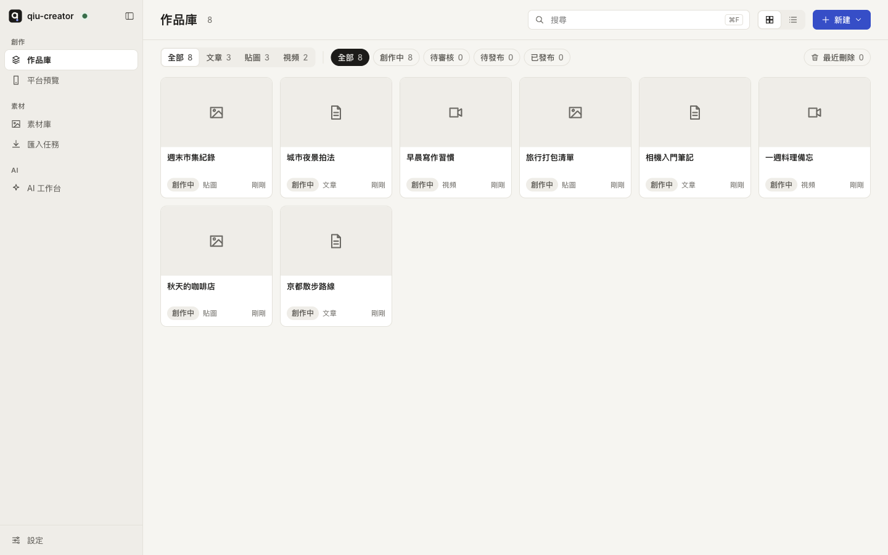 |
| 雙擊卡片標題改名（組字中的 ↩ 不提交） | 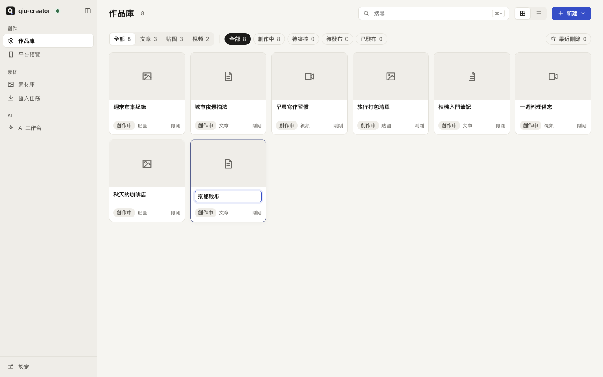 |
| 右鍵選單與改狀態子選單（靠右時翻到左側） | 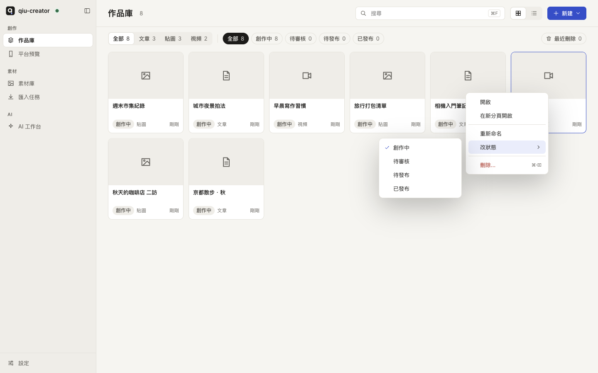 |
| 改狀態後的復原提示 | 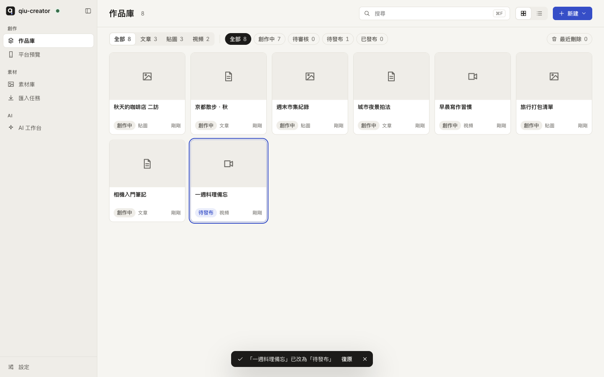 |
| ⌘A 全選與批量列 | 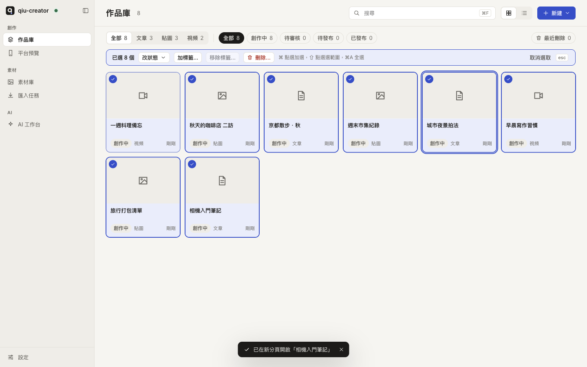 |
| 列表檢視改名 | 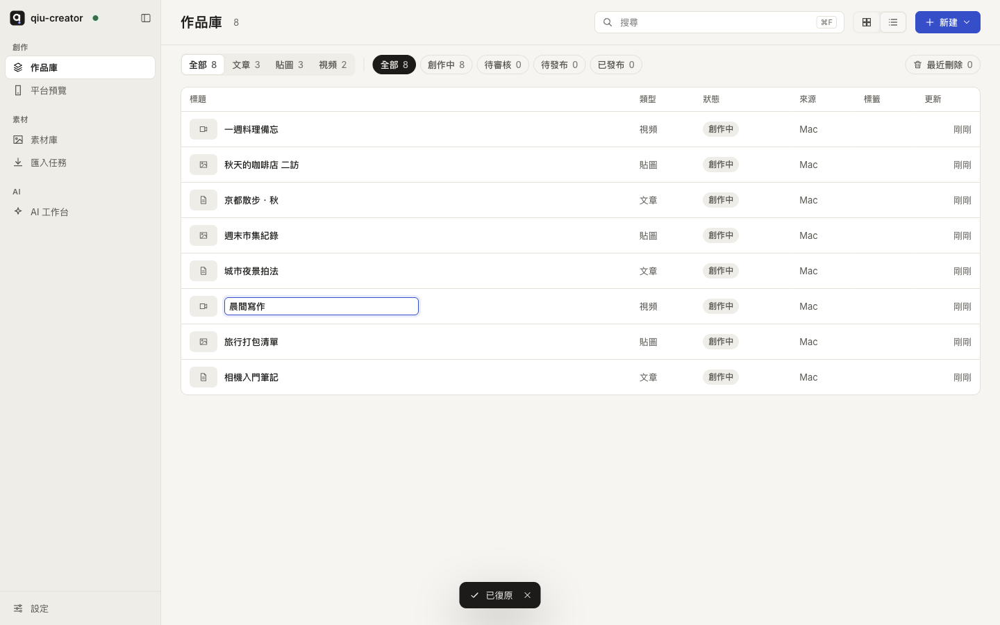 |
| 分頁標籤雙擊改名 | 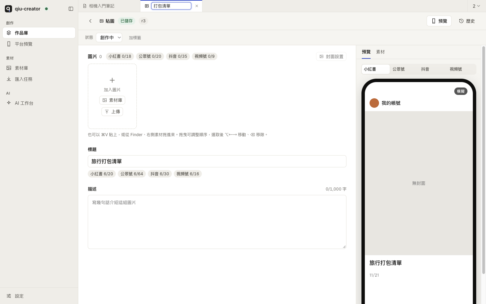 |
| 分頁右鍵選單 | 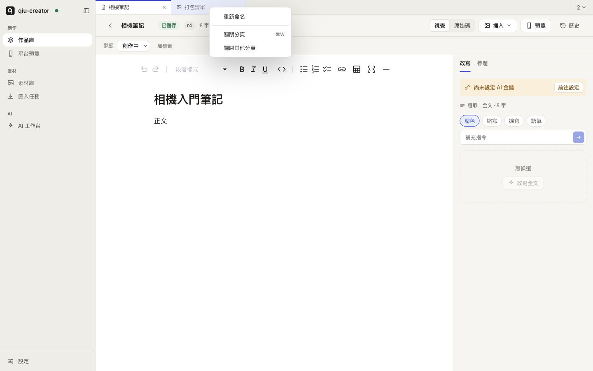 |
| 简体中文：多選後右鍵與子選單 | 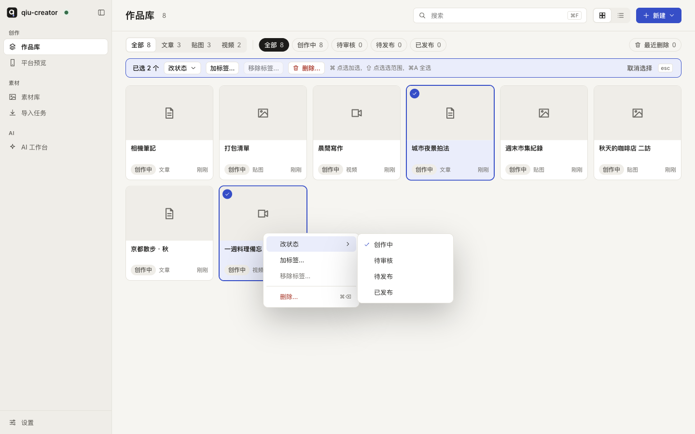 |
| English：多選後右鍵與子選單 | 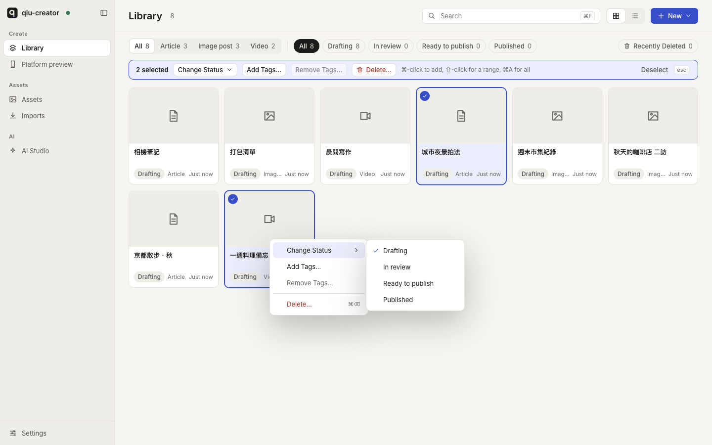 |
| 深色 | 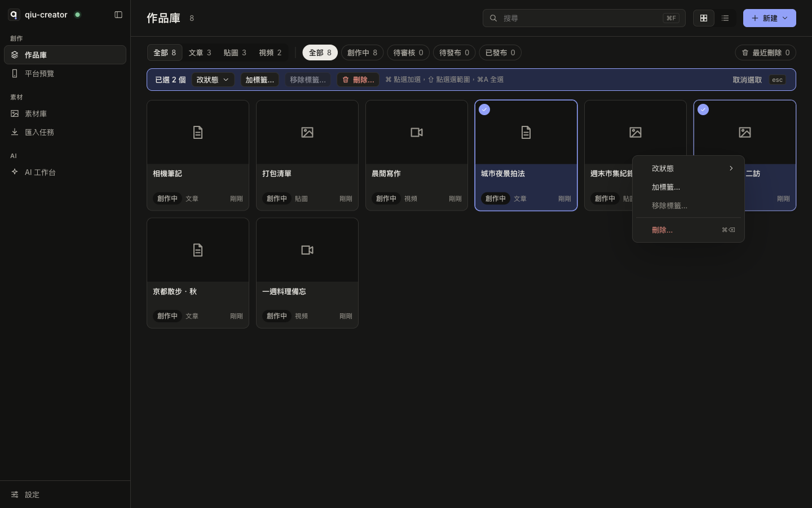 |

## 測試

- **單元測試**：`apps/mac/test/library-actions.test.ts`，共 15 個。
  - **選取規則**：⌘、⇧ 雙向、⌘⇧、⌘A、篩選後保留、右鍵目標。
  - **改名按鍵**：組字中的 ↩ 和 `Process`、留空、未改、裁到 500 字。
  - **選單位置**：右下角放不下時往回推，子選單靠右時翻到左邊。
  - **分頁**：`TabsModel.openInBackground`。
  - **真實 mac-server 的整合測試**：
    - 三種作品改名。
    - 列表的修訂已過期時回 409，名稱和別處的修改都保持不變。
    - 開著的分頁改名或改狀態時，走編輯器的 session，未存的修改也一起保住。
    - 缺檔的唯讀作品不能改名。
    - 改狀態後可以復原。
- **e2e**：`e2e/specs/library-actions.spec.ts`，八個步驟，與上面「做了什麼」對應。設 `QC052_SHOTS=<目錄>` 會另外拍截圖。

閘門結果見交付訊息：typecheck、lint、format、全套測試（passed／failed／total 與負載）、e2e。

## NOT_VERIFIED

- 真實的中文輸入法沒有在 App 裡實機打字。e2e 用 composition 事件和 `isComposing: true` 的 keydown 模擬，單元測試覆蓋判斷邏輯。
- 「在 Finder 顯示」只在程式路徑上檢查過（主程序只接受作品 id，自己查掛載根目錄加 `external_path`，並用 `resolveInsideHome` 擋路徑跳出）。沒有在 e2e 裡打開 Finder。
- 「複製路徑」沒有在 e2e 裡讀剪貼簿確認內容。
- 「原檔也移到 macOS 垃圾桶」勾選後的路徑只靠 QC-051 的後端測試，前端 e2e 只驗證預設不勾時原檔不動。
- VoiceOver 沒有實測。選單用 `role="menu"`、`menuitem`、`menuitemradio`，選取的卡片在無障礙名稱裡加了「（已選取）」。
- ⌘A 只用 Playwright 送出的按鍵驗過。沒有用實體鍵盤確認，App 選單列「編輯 › 全選」不會先把鍵吃掉。
- 框選（拖曳矩形）屬於可選項，沒有做。點空白處取消選取也沒有做，目前用 esc 或「取消選取」。

## 第二批：接 QC-051 的刪除、最近刪除、批量

### 刪除（第 3 項）

- **入口**：右鍵選單的「刪除…」、批量列的「刪除…」、⌘⌫，三個都會先開確認框。
- **確認框內容**：
  - 寫明「會移到最近刪除，30 天內可以還原，版本與歷史不變」。
  - 有外部作品時，另加一句「外部資料夾的作品只會從作品庫移除，原檔留在原處」。
  - 只刪一個檔案還在的外部作品時，可以勾選「原檔也移到 macOS 垃圾桶」，預設不勾。
- **完成後**：提示「已刪除「…」，可在最近刪除還原」，帶「復原」。如果作品開在分頁裡，會先存檔再刪除，分頁跟著關掉。
- **怎麼送出**：
  - 一個作品用 `works.trash`（可帶 `move_original_to_trash`）。
  - 多個作品用 `works.batch`，外部作品一律只取消索引。
  - 部分失敗時，逐項報出原因，例如「1 個已完成，1 個沒有變更：內容已在別處被修改」，並重新載入列表。

### 批量改狀態與加減標籤

- **一律走 `works.batch`**，每個請求帶自己的冪等鍵，一次最多 200 個。
  - 送出前，先讓開著的編輯器存檔，再取最新修訂。所以編輯器裡未存的修改不會遺失，也不會因為編輯器自己剛存的版本被當成衝突。
- **加標籤**：輸入框用逗號、頓號、空白或 # 分隔，下方即時顯示 #標籤。組字中的 ↩ 不套用。
- **移除標籤**：列出選取作品已有的標籤，勾選要移除的。
- **復原**：只撤銷每個作品真正變了的標籤。原本就有的標籤，復原後保留。

### 最近刪除（第 5 項）

- **入口**：篩選列右端的「最近刪除 N」。
- **頁面**：
  - 上方有返回作品庫、標題、說明「30 天後自動永久刪除；還原後版本與歷史不變」、清空最近刪除。
  - 卡片顯示「N 天後刪除」（剛刪除顯示 30）。外部作品另外標明「只從作品庫移除，原檔未動」或「原檔在垃圾桶」。
  - 單擊是選取，因為已刪除的作品不能開啟。⌘、⇧、⌘A、esc 照常可用。
- **還原**：在右鍵選單或批量列。修訂與歷史不變。原檔還在垃圾桶的外部作品，會提示先到 Finder 放回原處。
- **永久刪除與清空**：確認框寫「無法復原」，預設焦點在「取消」。外部作品的原檔不受影響，e2e 有檢查檔案還在。

## 截圖（第二批）

| 畫面 | 檔案 |
| --- | --- |
| 刪除確認（刪除鈕預設焦點） | 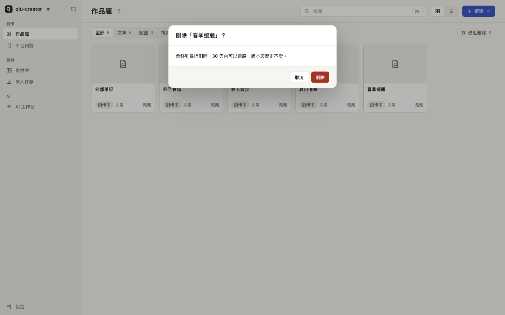 |
| 刪除後的復原提示 | 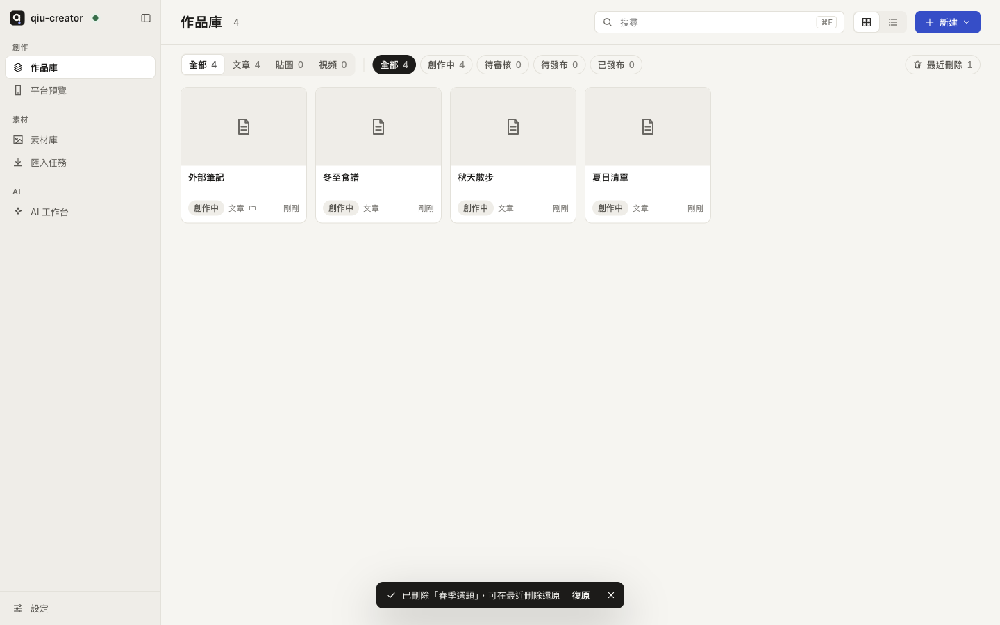 |
| 批量加標籤 | 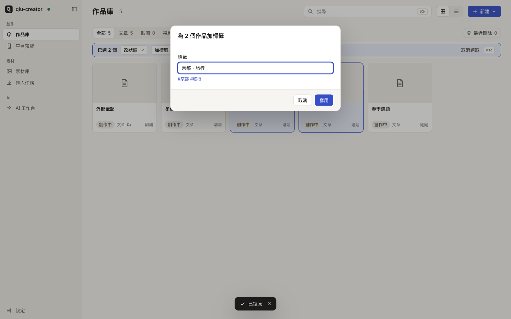 |
| 最近刪除（剩餘天數、外部作品說明） | 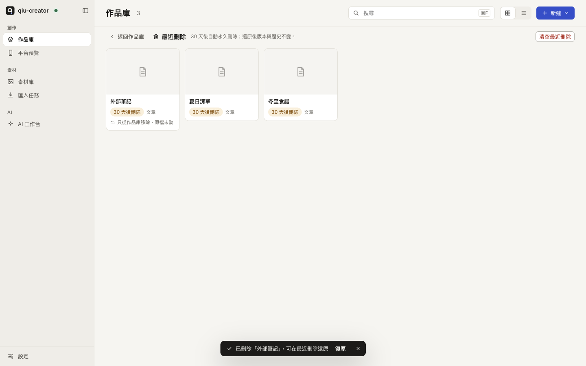 |
| 永久刪除確認（取消預設焦點） | 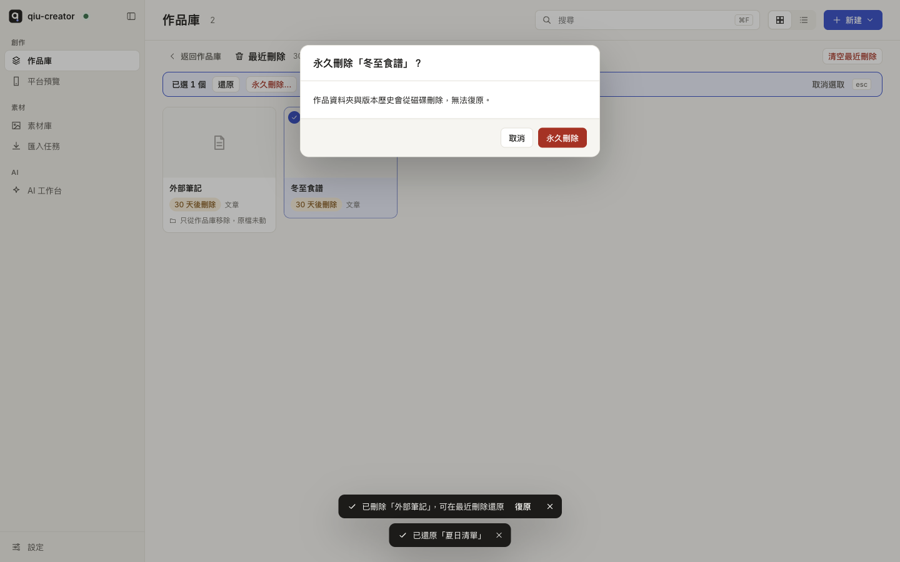 |
| 简体中文：最近刪除 | 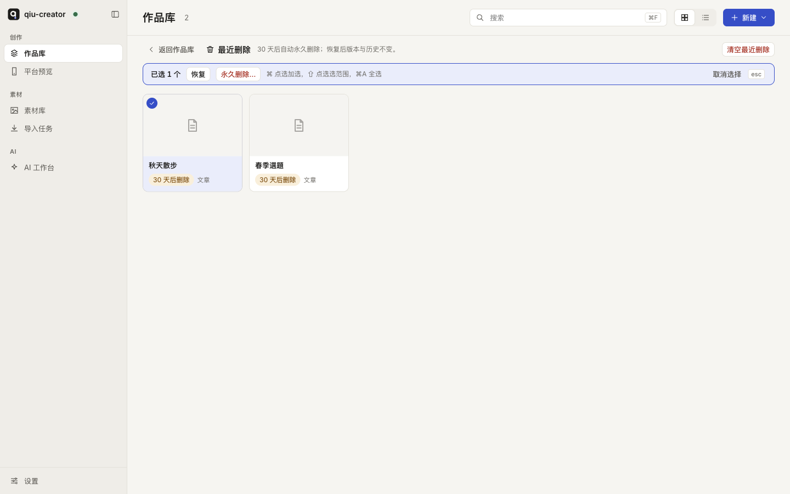 |
| English：Recently Deleted |  |
| 深色：最近刪除 | 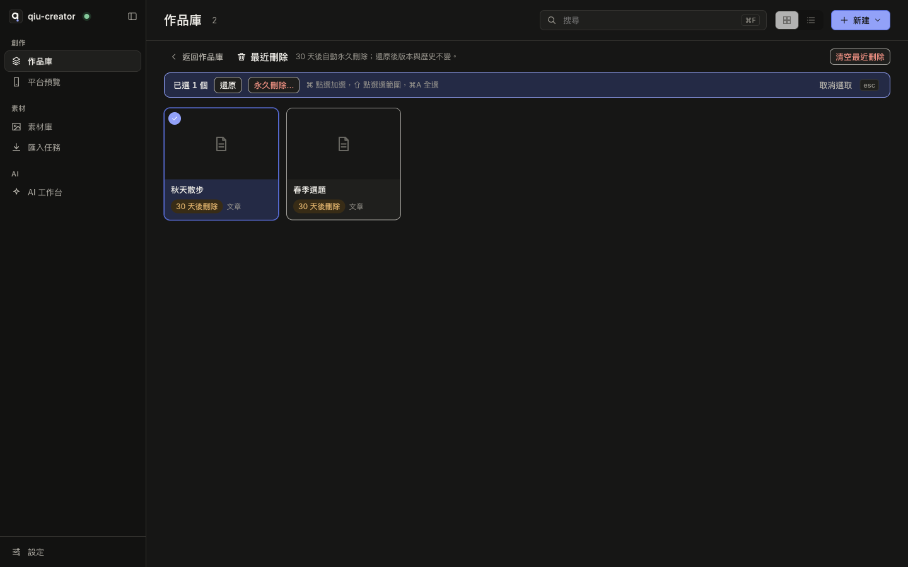 |

## 測試（第二批）

- **單元測試**：`library-actions.test.ts` 另加 8 個，全檔共 23 個。
  - 剩餘天數、標籤解析、標籤聯集、標籤復原分組、批量結果拆分。
  - 對真實 mac-server：
    - 刪除後再還原，修訂不變。
    - 批量刪除時，修訂過期的那個不刪，其餘照刪。
    - 永久刪除時，不在最近刪除的作品回 `not_found`。
    - 開著的編輯器先存檔再批量改狀態與標籤，未存的修改保留。
- **e2e**：`library-actions.spec.ts` 第二個測試，涵蓋以下流程：
  - 右鍵刪除與復原。
  - 批量加標籤（含組字中的 ↩）、復原、移除標籤。
  - ⌘⌫ 刪除兩個作品，背景分頁跟著關閉。
  - 外部作品只取消索引，原檔還在，系統垃圾桶沒有收到檔案。
  - 最近刪除的剩餘天數、還原、永久刪除、清空。

## 範圍外發現

- 在 e2e 裡由繁中切到简体後，側欄分組標題「創作」沒有變成「创作」（`shell.groupCreate` 的文案是對的）。看起來是側欄沒有跟著語言重新渲染，不在本卡範圍，沒有修。
- 提示（toast）建立時就把文字固定下來，切換語言後，還在顯示的提示仍是舊語言，最多 8 秒後消失。作品庫的提示也一樣。
- 由 Agent 或其他裝置刪除一個已開在分頁的作品時，分頁不會自動關閉，編輯器之後儲存會收到 `work_in_trash`。這需要分頁監聽 `work.trashed` 事件，建議另開卡片。
