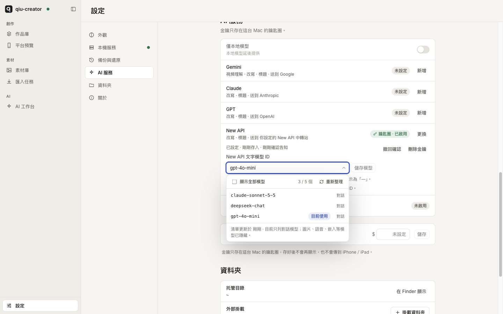
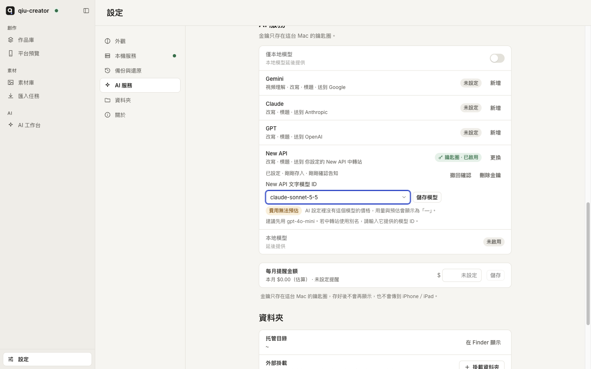
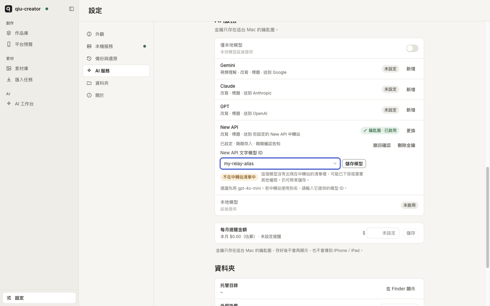
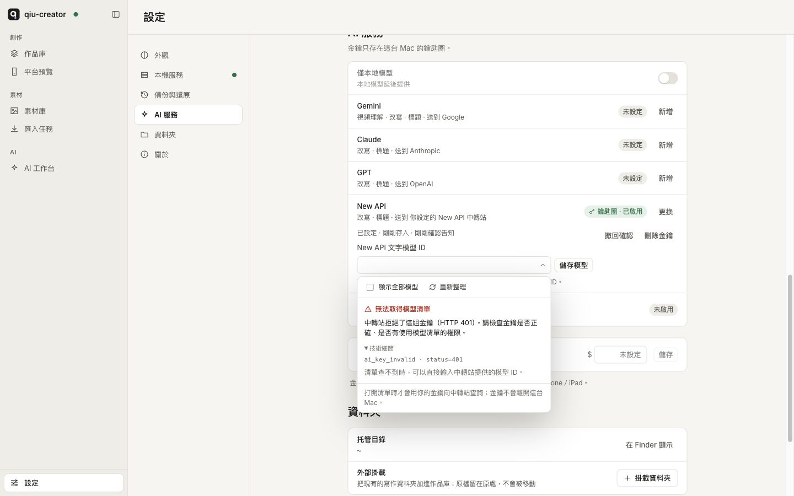
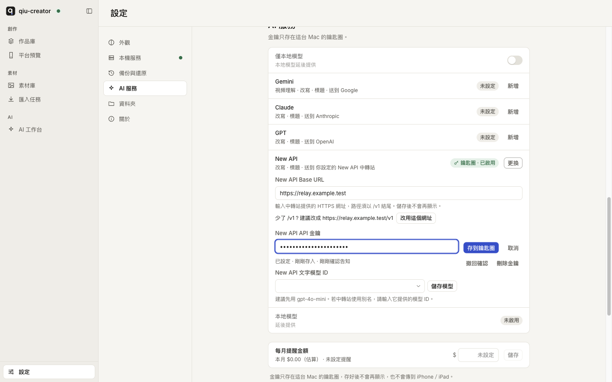
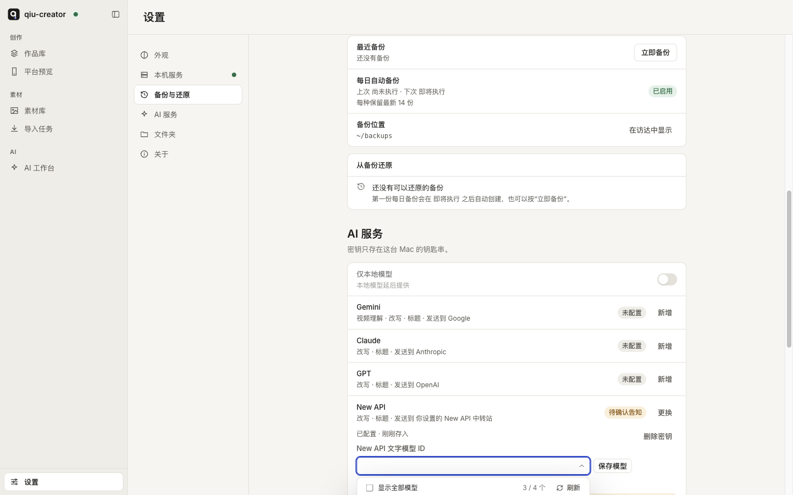
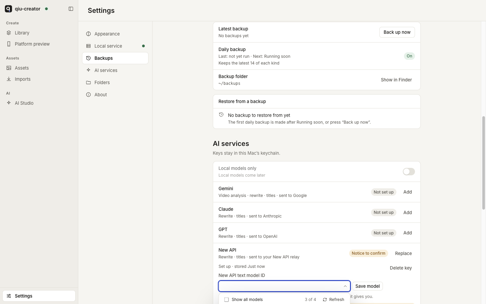
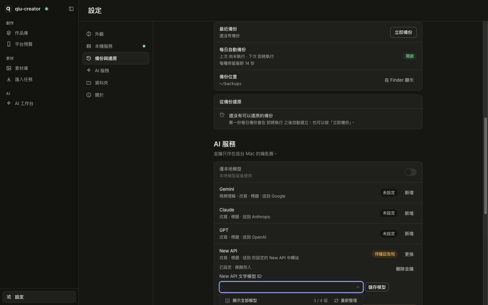

# QC-054 驗收記錄（前端）：New API 模型下拉

日期：2026-11-21　分支：`feat/qc054-model-combobox`（疊在 QC-056 `feat/qc056-ai-workbench-layout` 之上，基底是 main `df26eb6`，含 QC-054 後端、QC-055、QC-057 後端）
所有測試都用本機的假 AI 服務（`FakeAiServer`，新增了 `GET /v1/models` 的回覆設定），沒有連到任何真實的中轉站。

## 做了什麼

- **獨立元件 `ModelCombobox`**：資料來源、存檔、驗證都由外部傳入，設定頁改版（QC-057）可以直接沿用。這次只換掉現有設定頁的「New API 文字模型 ID」欄位，沒有動設定頁的版面。
- **什麼時候查詢**：只在打開下拉（右側箭頭或 ↓）或按「重新整理」時，才向中轉站查詢。頁面載入時不查，e2e 確認請求數是 0。打字只篩選已經查到的清單。
- **清單內容**：預設只列對話模型，可以勾「顯示全部模型」。每列標示類型（對話、圖片、其他），目前使用的模型標「目前使用」，而且永遠列出，因為自訂名稱會被歸為「其他」。
- **選取**：輸入文字會篩選清單；↑↓ 移動、↩ 選取、esc 關閉；輸入法組字中按 ↩ 不會選取。
- **手動輸入**：清單查不到時，可以直接輸入 ID 並儲存。
- **提示**：
  - 清單裡沒有這個模型時，欄位下方標「不在中轉站清單中」並說明原因。
  - 這個模型在 AI 設定裡沒有價格時，標「費用無法預估」，並說明用量與預估會顯示為「—」。
  - 原本每一列也都標了「費用無法預估」，但 New API 沒有內建價格，所以幾乎每列都會出現，太吵，改成只標在欄位下方。
- **錯誤**：顯示三語原因，例如「中轉站拒絕了這組金鑰（HTTP 401）」、連不上的 5 種原因、回應格式不對的 5 種原因。錯誤碼與 details 放在「技術細節」裡，不含金鑰。
- **Base URL 建議**：離開欄位或按存檔時，用 `suggestNewApiBaseUrl()` 檢查。少了 `/v1`，或貼的是 `/v1/chat/completions` 這類完整端點時，顯示「少了 /v1？建議改成 …」和「改用這個網址」，按一下就填入。不會自動替使用者改網址。

## Plan（依總監要求寫在這裡，不寫進 .tasks）

1. `model-list.ts`：清單篩選規則與錯誤描述。
2. `ModelCombobox.tsx`：可重用的元件。
3. 設定頁：換掉原本的文字欄位，Base URL 加上建議。
4. 三語文案：新增 `modelPicker` 區。
5. 測試：單元測試、e2e、截圖。

## 截圖

| 畫面 | 檔案 |
| --- | --- |
| 打開下拉：只列對話模型，3／5 個 |  |
| 選了沒有價格的模型：費用無法預估 |  |
| 手動輸入清單外的模型：不在中轉站清單中 |  |
| 中轉站拒絕金鑰：原因與技術細節 |  |
| Base URL 少了 /v1：一鍵採用建議 |  |
| 简体中文 |  |
| English |  |
| 深色 |  |

## 測試

- **單元測試**：`apps/mac/test/model-picker.test.ts`，共 6 個，涵蓋：
  - 只列對話、顯示全部、篩選。
  - 目前使用的自訂名稱一定列出。
  - 判斷模型是否在清單內、有沒有價格。
  - 各種錯誤的三語原因與技術細節，以及服務沒回應時的處理。
  - Base URL 建議。
- **通知開著的視頻面板**：`apps/mac/test/ai-workbench.test.ts` 新增一個測試，確認從下拉儲存模型（`AiSettingsStore.setModel`）時，會經由 QC-055 的 `notifyAiStatusChanged()` 通知已經開著的視頻面板重新讀取狀態。
- **額度不足**：QC-057 後端新增了 `quota` 原因，這裡也有對應的文案與測試。
- **e2e**：`e2e/specs/model-picker.spec.ts`，涵蓋：
  - 頁面載入時不查詢，打開才查。
  - 只列對話與顯示全部。
  - 輸入篩選、↓↩ 選取，組字中的 ↩ 不選取。
  - 費用無法預估，以及儲存。
  - 手動輸入清單外的模型，以及不在中轉站清單中。
  - 重新整理會略過快取再查一次。
  - 401 錯誤與技術細節。
  - Base URL 建議：一鍵採用，以及按存檔時才發現的情況。
  - 既有的 `new-api.spec.ts` 照常通過。

## 第一次全套 e2e 的一個失敗（交 qc-test 追查）

- **時間與範圍**：2026-11-21 20:30:11，第一次對本分支（當時的基底是 `18c2539`）跑全套 e2e，結果 20 passed、1 failed，開始時負載 5.21。完整輸出不在倉庫裡（`.log` 被 gitignore），已放到共用筆記資料夾 `side-session-notes/local_2cc861c6-…/qc054-e2e-editor-tabs-failure.log`，交 qc-test 追查（QC-059）。
- **哪個測試**：`e2e/specs/editor-tabs.spec.ts:63` 的「開多個作品、切換保留狀態、重複開啟、快捷鍵與選單」，失敗在步驟「切換時保留模式、草稿、游標與捲動」。
- **錯誤**：`editor-tabs.spec.ts:121`，`expect.poll(() => source.selectionStart).toBe(11)` 在 5000 ms 內一直拿到 `10`。這一步是用 ⌘⇧[ 切回「甲篇長文」分頁後，檢查原始碼模式的游標有沒有還原到第 11 格。
- **Trace**：當時的位置是 `tmp/playwright/editor-tabs-開多個作品、切換保留狀態、重複開啟、快捷鍵與選單/`（Electron trace 與 `trace.zip`，以及 `error-context.md`）。之後重跑時 Playwright 會清空 `outputDir`，所以這份 trace 已經不在了，只留下上面那份 log。
- **後續重跑**：負載約 4.1 時單獨跑這個 spec 3 次，都通過（5 passed）；重跑全套 21 passed。我沒有改動這個測試，也沒有放寬它的斷言。
- **為什麼跟本卡無關，以及可能的原因**：本卡沒有改動編輯器或分頁的程式。游標差了一格，看起來像是 QC-047 的游標還原（在下一個 frame 才放回）和捲動或聚焦之間的時序問題。這是推論，沒有驗證。

## NOT_VERIFIED

- 真實的中轉站（例如使用者自建的那一個）沒有連線測試，因為不能打真實網址。
- 真實的中文輸入法沒有實機打字，e2e 用 `isComposing: true` 的按鍵模擬。
- VoiceOver 沒有實測。欄位是 `role="combobox"`，清單是 `listbox`／`option`，並用 `aria-activedescendant`。

## 範圍外

- Gemini、Claude、GPT 是否也改成線上查詢模型清單，照卡片不做。
