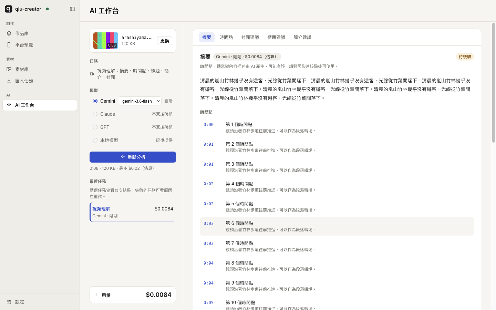
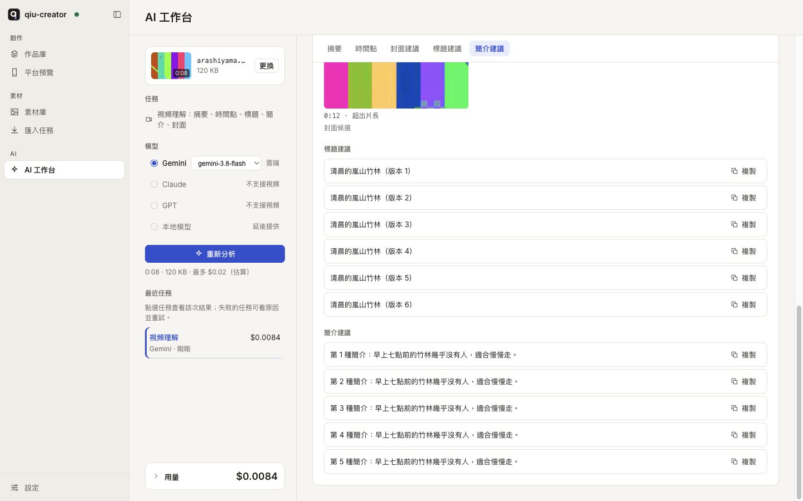
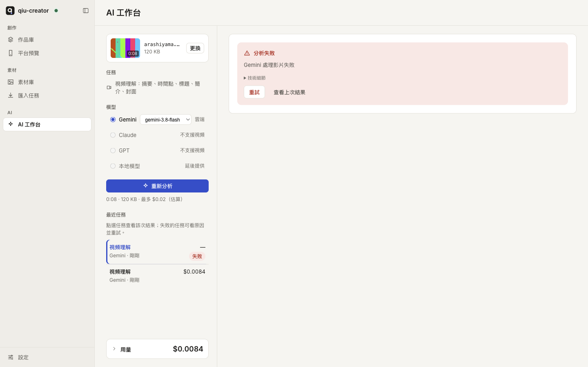
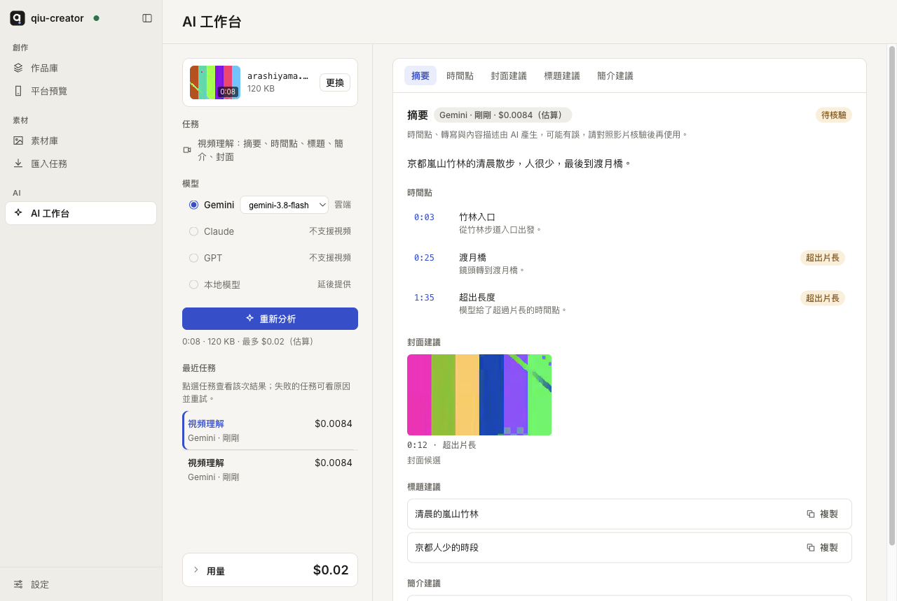
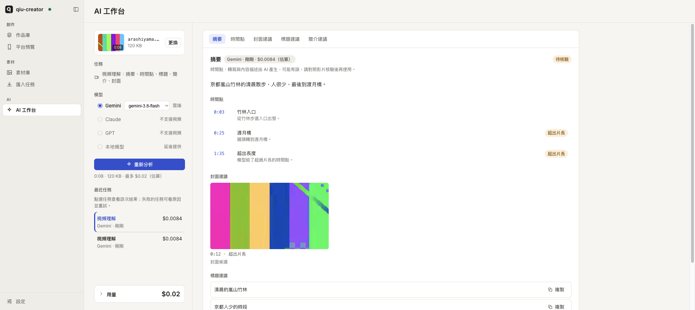
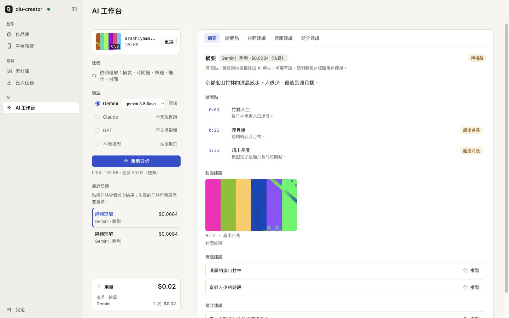
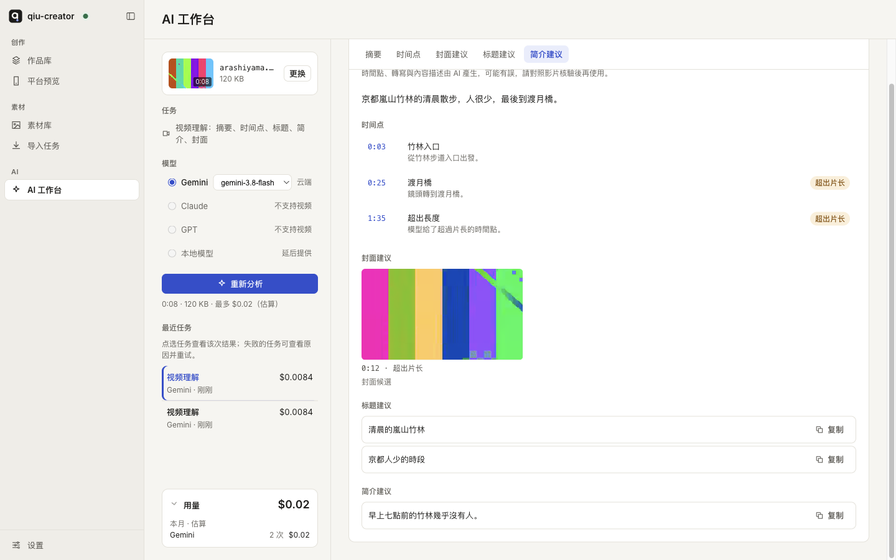
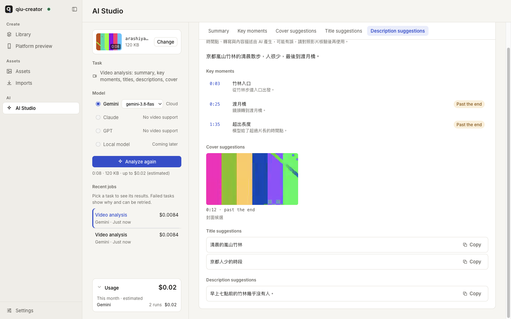
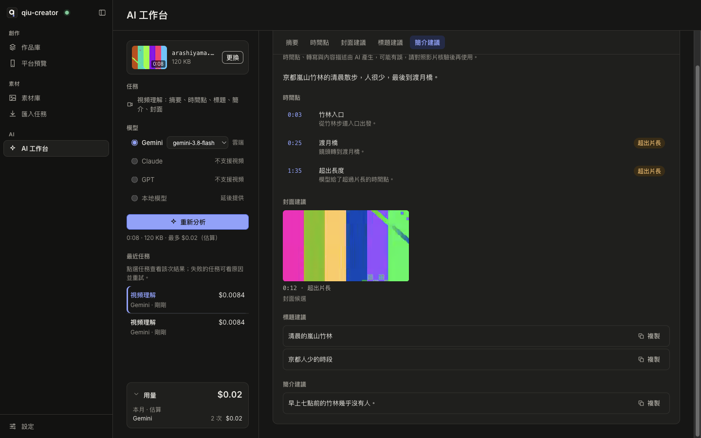

# QC-056 驗收記錄（前端）：AI 工作台版面重整

日期：2026-11-21　分支：`feat/qc056-ai-workbench-layout`（從 main `3305c35` 開）
所有測試都用本機的假 Gemini（`FakeGeminiVideo`），沒有對 Google 發出任何請求。

## 問題

使用者回報：左右兩欄一起捲動。結果很長時往下捲，左欄就只剩一大片空白。另外，「用量／最近任務」卡會被擠到左下角，與右欄內容錯開。

原因有兩個：

- 舊版的 `.aiw` 是三個 flex 項目換行排列（設定、結果、用量），整頁一起捲動。
- 視窗不夠寬時，用量卡會換到第二行，出現在結果下方的左側。

## 方案與理由

- **兩欄各自捲動，頁面本身不捲**。左欄寬 300 px（最窄 272 px），右欄是結果。
  - 捲動結果時，設定和分析按鈕都留在原處。
  - 參考 `/Users/feature/code/qiuge-design/cases/kubai-999-008-responsive-wiki/case.md`（concept）。卡片做法是「章節導覽與正文分區，導覽使用獨立高度」，作者也提醒要檢查獨立捲動與焦點返回。
- **最近任務放在左欄設定下方**。點一列任務，就決定右欄顯示哪一次結果，所以它跟設定一樣是「選擇看什麼」的控制，應該和設定放在同一欄，並且一直看得到。
  - 參考 `/Users/feature/code/qiuge-design/cases/codex-project-chat-artifact-workspace/case.md`（product）。卡片做法是對話清單與成果預覽並排，移植注意寫「將預覽、編輯、審查分清楚」。在這裡，左欄負責選擇，右欄負責看結果。
- **用量收成左欄底部的一行**。平常只顯示本月估算總額；超過提醒金額時，提醒一直看得到；各供應商小計要展開才顯示。用量很少需要看，不該和結果搶位置。
  - **沒有採用的做法**：另開抽屜或分頁。那樣算新增功能區塊，需要原型核准，而且只為了一行數字並不划算。
- **結果的段落跳轉**：右欄頂部有固定的段落列（摘要、時間點、封面建議、標題建議、簡介建議，只列出有內容的段落）。點一下就捲到該段，捲動時會標出目前所在的段落；捲到底時，最後一段算是目前位置。
- **寬度**：1280 寬時右欄約 700 px，1920 寬時結果卡最寬 1040 px，避免長句太寬難讀。
- **沒有新增功能區塊**。這次只是重排既有內容，所以沒有回報總監做原型核准。

## 做了什麼

- **版面**：`AiWorkbenchPage.tsx` 改成 `.aiw__side`（設定、`RecentJobs`、`UsageSummary`）加 `.aiw__result`（結果卡與 `SectionNav`）。換成另一次結果時，右欄回到頂端。
- **最近任務**：
  - 成功的任務：顯示該次結果。
  - 失敗的任務：顯示原因、技術細節、重試，以及「查看上次結果」。
  - 進行中的任務：跟進進度。
  - 已取消的任務：沒有內容，不能點。
  - 正在顯示的那一列有底色、左側色條和 `aria-current`，讀屏會念出「（正在顯示）」。
  - 對應程式：`ai-video.ts` 的 `open()` 依任務狀態處理，另加 `selectedJobId()`、`canOpenJob()`。
- **三語文案**：新增 `ai.resultSections`、`ai.jobsHint`、`ai.jobShowing`。

## 截圖

| 畫面 | 檔案 |
| --- | --- |
| 捲動前（1440） |  |
| 捲動到底：左欄不動，段落列停在頂部，標出「簡介建議」 |  |
| 失敗的任務被選中：原因、技術細節、重試 |  |
| 1280 寬 |  |
| 1920 寬 |  |
| 用量展開 |  |
| 简体中文（捲動中） |  |
| English（捲動中） |  |
| 深色 |  |

## 測試

- **單元測試**：`apps/mac/test/ai-workbench.test.ts` 新增「最近任務 (QC-056)」，對真實 mac-server 加假 Gemini 驗證：
  - 成功的任務打開後顯示結果，失敗的打開後顯示原因。
  - `selectedJobId` 指向正在顯示的那一次。
  - 已取消的任務不能打開。
  - 從最近任務打開失敗的任務後，重試可以拿到新結果。
- **e2e**：`e2e/specs/ai-workbench.spec.ts`
  - 捲動結果到底後，頁面本身沒有捲動，左欄的分析按鈕和用量卡位置都不變，段落列貼在右欄頂端。
  - 段落跳轉可以用，目前位置會跟著標示。
  - 失敗的任務在最近任務中標為正在顯示；點成功的任務看該次結果，再點回失敗的任務重試。
  - 1280 和 1920 寬都沒有橫向捲動，右欄至少 600 px。

## NOT_VERIFIED

- VoiceOver 沒有實測。段落列是 `nav`，目前段落用 `aria-current="location"`；最近任務用 `aria-current="true"`，另有隱藏文字。
- 卡片提到「時間點可點跳到預覽」：工作台沒有內建播放器，點時間點照舊打開素材檢視器，從該秒開始播放（QC-025 的行為），這次沒有改。
- 卡片提到「建議可採用到作品」：工作台的結果沒有綁定作品，只能複製；採用到作品的候選加 diff 流程在視頻作品編輯器裡（QC-046）。這次沒有在工作台新增採用功能，因為那算新功能區塊。

## 範圍外發現

- 繁中的沿用結果對話框標題是「已分析過此**影片**」（`ai.reuseTitle`），和 QC-050 待改的「影片 → 視頻」是同一件事，留給 QC-050 處理。
