# QC-057 驗收記錄（前端）：設定 v4，每個分類一頁，AI 服務重整並加測試連線

日期：2026-11-21　分支：`feat/qc057-settings-frontend`（已 rebase 到 main `b5c5c06`）
依據：原型 PT-20261121-002 的帳本（`docs/design/prototype/changes.json` 的 boards、states、decisions、approvalDecisions），以及共用筆記資料夾 `pt-20261121-002-boards/` 的畫板原始檔與 `qc-v4.css`。畫布尚未上傳，所以以帳本為準。

**後端**：qc-backend 的追加合約（last_test、rate_limited、`/ai/defaults`、`unpriced_jobs`、`base_url`／`base_url_host`）已在 main（284a631）。本分支開發時先 cherry-pick 了它的 commit，現在已 rebase 到 main 並丟掉那個 commit。

所有測試都用本機的假服務：AI 供應商是 `FakeAiServer`，資料目錄是臨時的。

## 做了什麼

### 每個分類一頁

- **切換方式**：左側分類欄只切換右側頁面，不再捲動整份設定。切換後焦點移到頁標題（`h1`），讀屏會念出目前在哪一頁。
- **記住分類**：重新打開設定時回到上次的分類，記在 localStorage。
- **⌘,**：App 選單加上「設定…」（⌘,），從任何頁面都能打開設定。
- **頁面版型**：
  - 頁標題 20 px，頁面動作在標題右側（本機服務的「重新檢查」、備份的「立即備份」、資料夾的「新增資料夾」）。
  - 不放頁面副標，只保留跟後果有關的頁尾說明。
  - 正文最寬 720 px，AI 服務放寬到 1000 px。
- **分類狀態點**：AI 服務在左側分類欄有狀態點。有金鑰無效或連不上時是紅點，有待確認告知、額度不足或暫時受限時是黃點。

### AI 服務：四個分頁

#### 供應商

清單與詳情並排；窄視窗（小於 1000 px）時改成上下排列。

- **清單**：每列顯示用途和狀態，測試得到的狀態另外附上時間，例如「連線正常 · 2 分鐘前」。狀態共九種：未設定、待確認告知、未測試、測試中、連線正常、金鑰無效、連不上、額度不足、暫時受限。本地模型那一列停用。
- **詳情頁首**：名稱、「內容送到 X」（New API 顯示中轉站的主機名），以及「測試連線」按鈕。測試中按鈕變成「取消」。
- **測試結果卡**：
  - 未測試：說明只查詢模型清單，不送出內容，也不產生費用。
  - 測試中。
  - 連線正常：顯示延遲、可用模型數、測試時間，並一定附註「額度是否足夠，要等實際使用時才知道」。目前的文字模型不在清單裡時，另外提示。
  - 金鑰無效：下一步是「更換金鑰」。
  - 連不上：依原因說明，下一步是「重試」；New API 另有「檢查 Base URL」。
  - 額度不足、暫時受限：下一步是「重試」。
  - 失敗時，技術詳情是一行文字，可以複製，不含金鑰。
- **連線組**：
  - New API 存好後顯示完整的 Base URL，因為它不是祕密。
  - 金鑰顯示「已設定 · 何時存入」，可以更換或刪除。
  - 還沒設定金鑰時，直接顯示輸入框。
  - Base URL 少了 `/v1` 時，一鍵改正（沿用 QC-054）。
- **模型組**：
  - 全部用 QC-054 的 `ModelCombobox`。
  - New API 打開下拉時才查詢中轉站的清單。
  - Gemini、Claude、GPT 用內建清單（`builtin` 模式：不顯示重新整理與只列對話的切換）。核准決定是三家線上清單這次不做。
- **使用告知組**：已確認時顯示日期與「撤回」；未確認時顯示黃底告知與「我已了解，啟用」。刪除金鑰、撤回告知都要先確認。

#### 用途

- 文字改寫、標題與簡介：各自選預設供應商，或選「自動」（第一個可用的）。選擇會存到 `PUT /ai/defaults`。
- 視頻理解鎖定 Gemini。
- 還沒有任何供應商可用時，顯示「設定供應商」按鈕。

#### 用量

- 本月估算金額、提醒金額，以及進度條（超過提醒金額時變黃）。
- 各供應商的次數與金額；沒有價格的任務顯示「另有 N 次無法預估」（`unpriced_jobs`）。如果只有沒有價格的任務，金額欄顯示「無法預估」，不顯示 US$0.00。
- 每月提醒金額可以設定與清除。

#### 隱私

- 每家供應商的內容送往哪裡，以及是否已確認告知。
- 「管理」跳回該供應商的詳情。
- 「僅本地模型」停用，標「延後提供」。

### 狀態的規則（`ai-settings.ts`、`ai-test-view.ts`，都是純函式）

- 狀態依序判斷：沒有金鑰 → 測試中 → 上次測試失敗（依錯誤碼和原因分類）→ 待確認告知 → 連線正常或未測試。
- 測試失敗排在待確認告知前面，因為它是讓服務不能用的原因。
- 上次測試的結果，優先用這個視窗的測試，沒有時才用服務端保存的 `last_test`。重新開啟 App 後，清單仍會顯示上次測試的結果。
- 換金鑰或刪除金鑰時，清掉這個視窗的測試結果。服務端也會清掉 `last_test`。

## 參考（qiuge-design，沿用原型帳本的引用）

- `/Users/feature/code/qiuge-design/cases/nowdex-error-recovery-next-action/case.md`（concept）：測試結果卡把問題、原因、下一步放在同一張卡，技術詳情另外一行可以複製，不含祕密。
- `/Users/feature/code/qiuge-design/cases/dual-agent-searchable-model-picker/case.md`（concept）：可搜尋的模型下拉，目前的選擇打勾。這部分沿用 QC-054 的元件。
- `/Users/feature/code/qiuge-design/cases/kubai-999-020-choice-controls/case.md`（concept）：依行為挑控制項。分頁切換用分段控制，「測試連線」用按鈕，結果顯示在別處。
- `/Users/feature/code/qiuge-design/cases/agent-ui-copy-essential-information/case.md`（concept）：沒有頁面副標，只留跟後果有關的頁尾說明。

## 與原型的差異（實作時的判斷，請總監確認）

- **模型選擇**：用 QC-054 的可輸入下拉（輸入框加清單），不是畫板上「按鈕加彈出搜尋框」的樣式。兩者功能相同，只是同一個元件不必做兩種外觀。
- **用途頁**：用原生 `select`，選項文字帶上供應商狀態，旁邊另有狀態點。沒有做成自繪的彈出清單。
- **頁面寬度**：AI 服務的四個分頁都是 1000 px 寬，不只供應商分頁。

## 截圖

| 畫面 | 檔案 |
| --- | --- |
| 每個分類一頁：備份與還原（立即備份在頁首） | 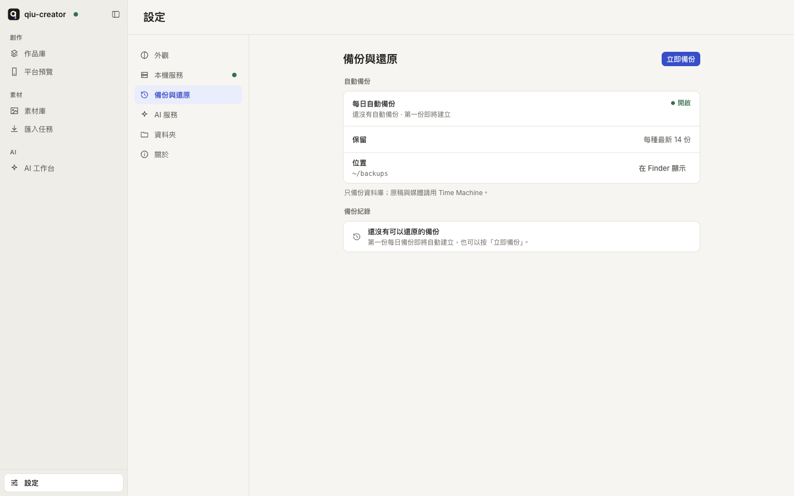 |
| 供應商：空狀態（先存入金鑰） | 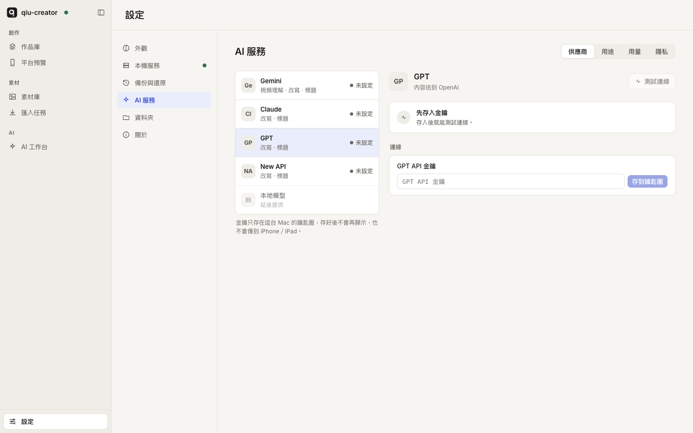 |
| 測試成功：延遲、模型數，以及額度說明 | 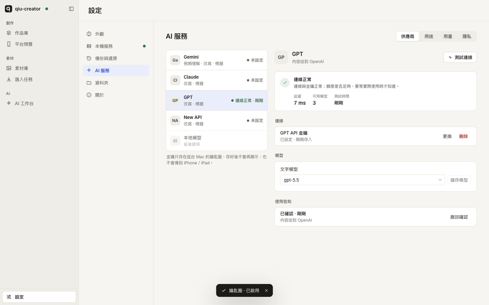 |
| 金鑰無效：更換金鑰、技術詳情、分類紅點 | 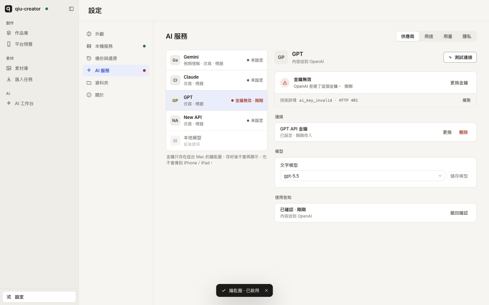 |
| 額度不足：分類黃點 | 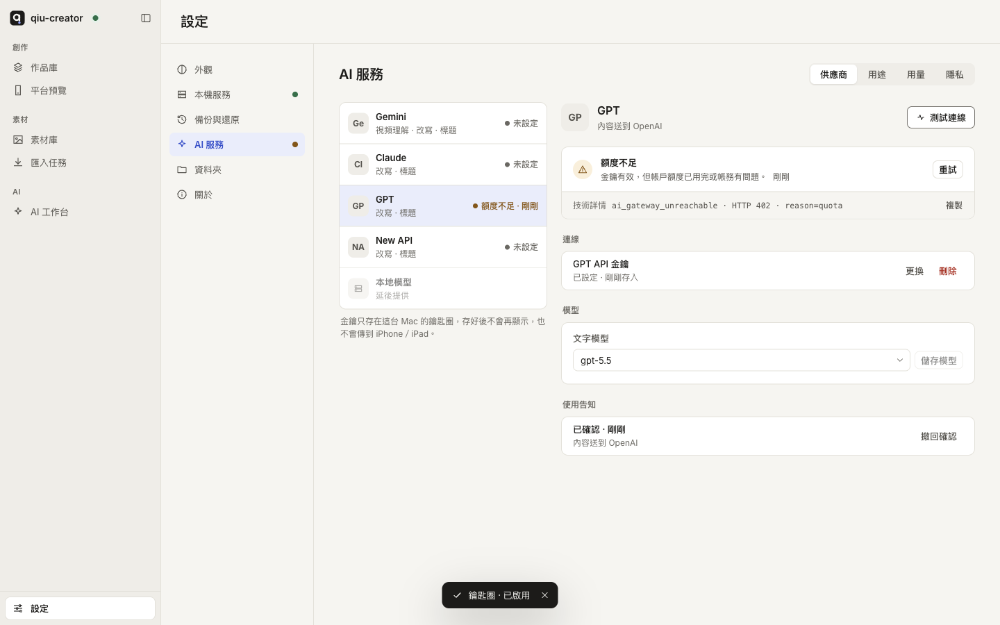 |
| New API：顯示 Base URL 與中轉站主機名 | 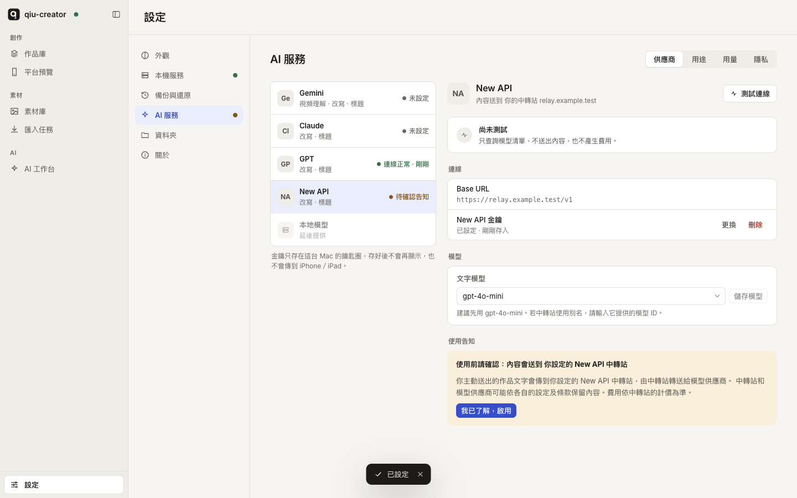 |
| 用途 | 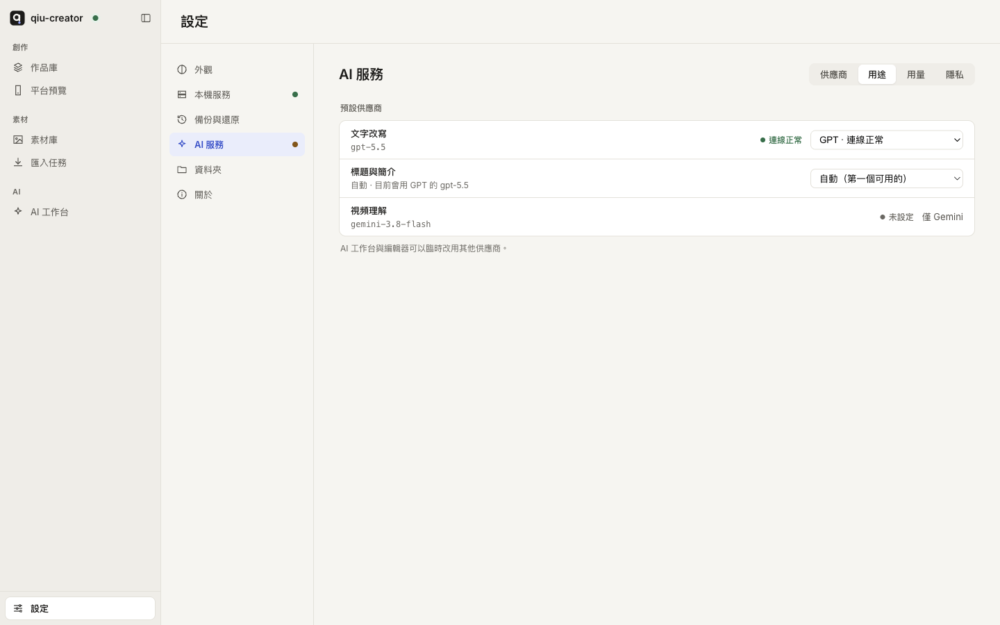 |
| 用量與提醒 | 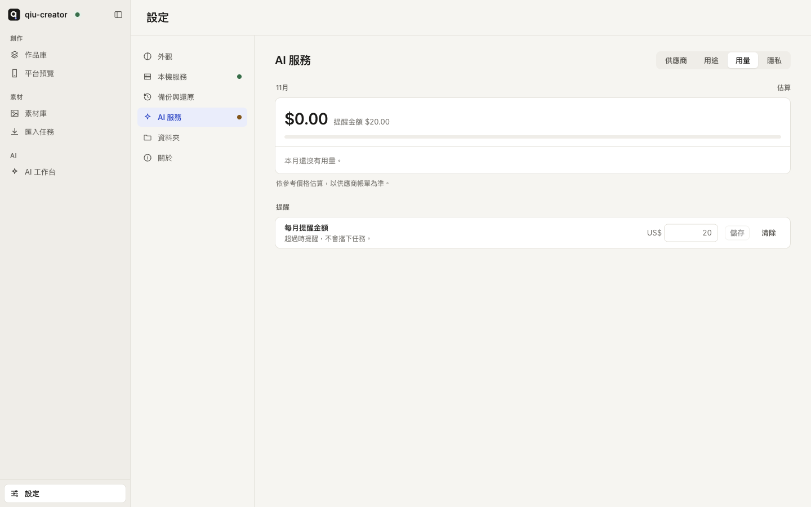 |
| 隱私 | 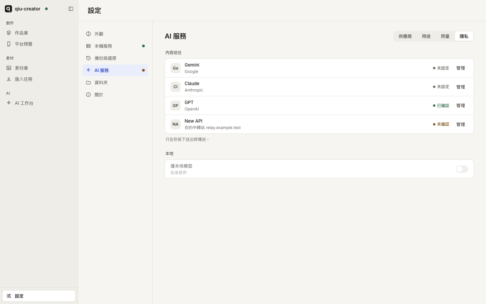 |
| 简体中文 | 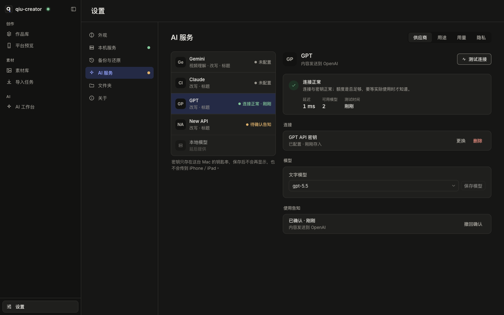 |
| English | 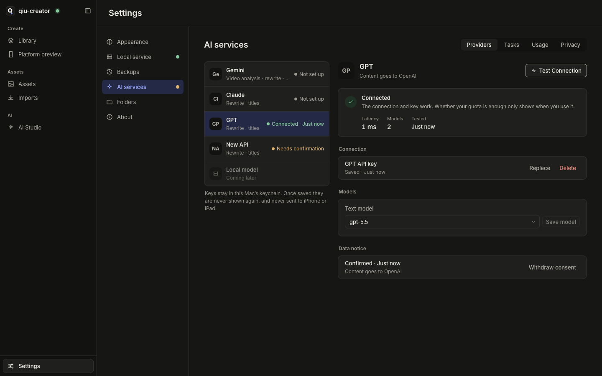 |
| 深色 |  |
| 深色、窄視窗（清單與詳情上下排列） | 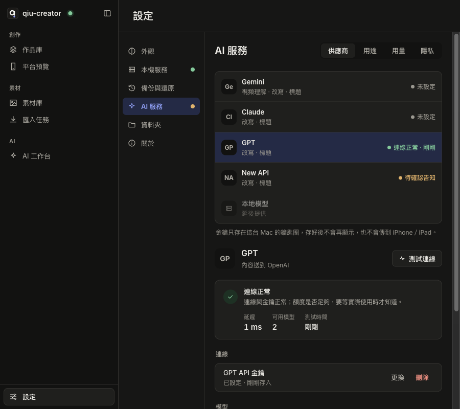 |

## 測試

- **單元測試**：`apps/mac/test/ai-services.test.ts`，共 10 個。
  - 狀態的判斷順序，以及從 `last_test` 讀出狀態。
  - 分類狀態點的顏色。
  - 測試結果卡的每種狀態與技術詳情。
  - 內容送往的地方（`destination`）。
  - 對真實 mac-server 加假 AI 服務：
    - 只在按下時測試，結果保存成 `last_test`，換金鑰後清掉。
    - 取消測試。
    - 沒有金鑰時，是請求錯誤，不算供應商的狀態。
    - 用途的預設存讀。
- **`settings-v2.test.ts`**：原本的「捲動時標示分類」測試已移除，因為不再捲動；改成測試記住上次的分類，包括沒有儲存空間的情況。
- **e2e**：新增 `e2e/specs/settings-v4.spec.ts`，涵蓋：
  - 每個分類一頁，切換後焦點到頁標題，重新開啟時記住分類。
  - ⌘, 打開設定。
  - 四個分頁，以及空狀態。
  - 存金鑰後是未測試；測試成功與額度說明；確認告知。
  - 金鑰無效：技術詳情不含金鑰、分類紅點、按「更換金鑰」後焦點到金鑰欄。
  - 額度不足：分類黃點；取消測試。
  - New API 的 Base URL 改正與顯示。
  - 用途存到服務、用量與提醒、隱私頁的「管理」跳回詳情。
  - 方向鍵切換分頁。
- **依新結構更新的既有 e2e**：`settings-theme`、`new-api`、`model-picker`、`i18n`、`server-text`。斷言沒有放寬，只改成新的頁面路徑與文案；例如 New API 確認告知後，狀態是「未測試」，不再是「鑰匙圈 · 已啟用」。

閘門結果見交付訊息。

## NOT_VERIFIED

- 畫布沒有上傳，無法和渲染畫面逐一比對，只依帳本描述與畫板原始碼實作。
- 真實的四家供應商都沒有連線測試，因為不能打真實網址。
- VoiceOver 沒有實測。分頁用 `tablist`／`tab`／`tabpanel`，測試結果卡是 `role=status`、`aria-live=polite`。
- Gemini 的測試連線只有單元層級的狀態測試；e2e 用 OpenAI 與 New API 的假端點。

## 第二輪（v2，總監退回差異 1）

日期：2026-11-21　分支：`feat/qc057-settings-pages`（從 main `157ca99` 開）

### 五個分類照畫板重做

- **外觀**：「主題」組是三張主題卡（淺色、深色、跟隨系統，點選後立即套用）。「語言」組是一列「介面語言」，用分段控制選擇，四個選項是跟隨系統、简体中文、繁體中文、English。順序沿用產品現有的語言清單，和畫板「繁中在前」不同。
- **本機服務**：
  - 「服務」組有三列：狀態（附「剛剛檢查」）、位址、即時更新，狀態都用圓點加文字。頁尾說明 launchd 常駐。
  - 「系統」組有兩列：開機自動啟動顯示「由 launchd 管理」，防止睡眠顯示「任務進行時自動」。完整說明放在 tooltip。
- **備份與還原**：
  - 頁首是「立即備份」。
  - 「自動備份」組有三列：每日自動備份（狀態點）、保留（每種最新 N 份）、位置（在 Finder 顯示）。
  - 「備份紀錄」組是表格，欄位是時間、種類、大小、還原…，組標題右邊顯示份數。超過 3 份時有「全部 N 份」。
- **資料夾**：
  - 頁首是「新增資料夾」。
  - 「托管目錄」一列，附資料夾圖示與路徑。
  - 「外部資料夾」組的每一列有名稱、路徑、篇數與掃描時間，狀態點（監控中、找不到、已卸載），以及對應的動作。沒有外部資料夾時，有一句完整的說明。
- **關於**：App 圖示、名稱、版本，以及「複製版本資訊」；下方三列是服務版本（含 commit）、建置時間（從原始碼執行時顯示「從原始碼執行」）、資料目錄。

### 文案錯誤

- **沒有備份時的句子**：原本是「上次 尚未執行 · 下次 即將執行」和「第一份每日備份會在 即將執行 之後自動建立」，都是把變數直接填進句子造成的。現在由 `dailyScheduleText`、`firstBackupText` 依情況選完整的句子：
  - 「還沒有自動備份 · 第一份即將建立」
  - 「還沒有自動備份 · 第一份會在 明天 03:00 建立」
  - 「上次 今天 03:00 · 下次即將開始」
  - 「第一份每日備份即將自動建立，也可以按「立即備份」。」

  舊的四個片段鍵（`backupRunningSoon`、`backupDailyTimes`、`backupDailyNever`、`backupEmptyHint`）已從三語目錄刪除。
- **金鑰標籤**：「New API API 金鑰」改成「New API 金鑰」（`keyLabel`），简体是「New API 密钥」，English 是 “New API key”。
- **用途選「自動」時**：不再顯示「–」，改成「自動 · 目前會用 GPT 的 gpt-5.5」。這和 App 實際挑選供應商用的是同一個規則（`pickProvider`）。沒有任何可用的供應商時，顯示「依第一個可用的供應商；目前還沒有可用的」。
- **三語的空值與時間檢查**：English 的時間不再放在句子中間，避免出現 “Checked Just now” 這類大寫錯位。現在寫成 “Last checked: Just now”、“Saved · Just now”。其他帶變數的句子都已確認，值不存在時不會顯示，或改用完整的句子。

### 截圖（v2）

| 畫面 | 檔案 |
| --- | --- |
| 外觀 | 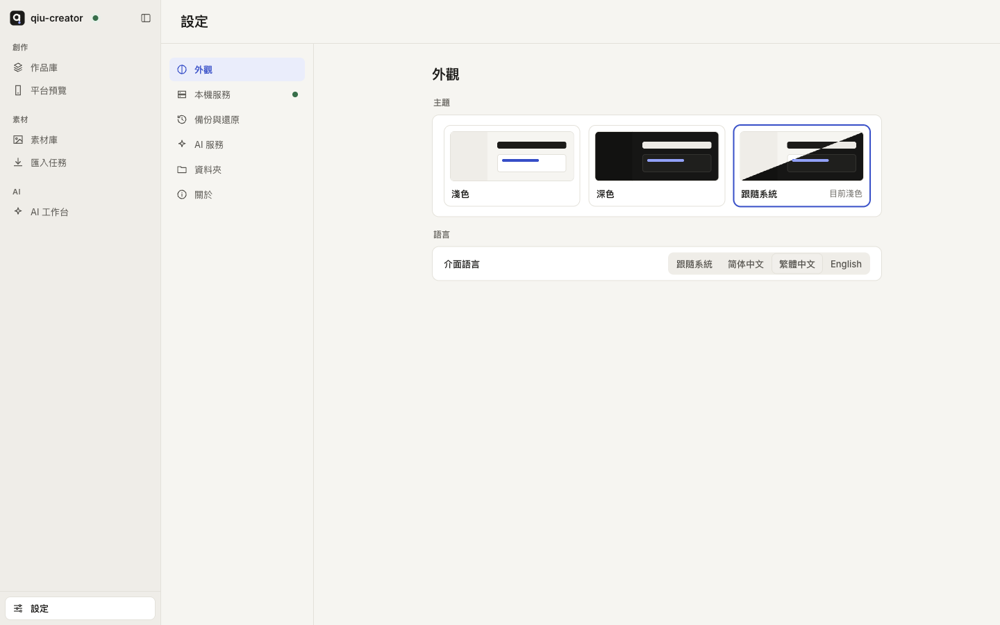 |
| 本機服務 | 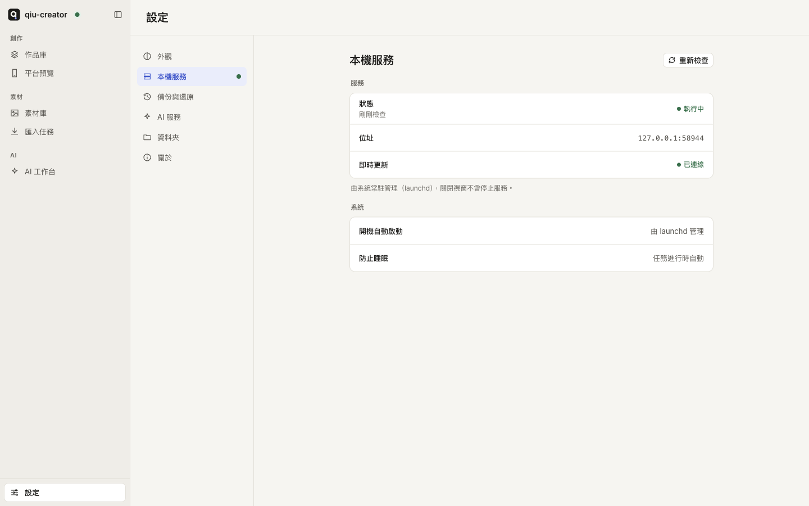 |
| 備份與還原（沒有自動備份，手動備份一份後） | 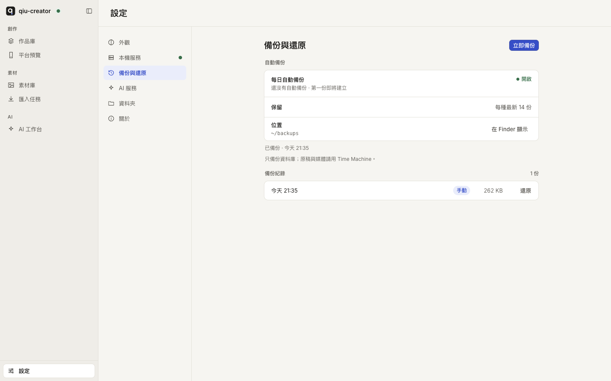 |
| 資料夾（沒有外部資料夾） | 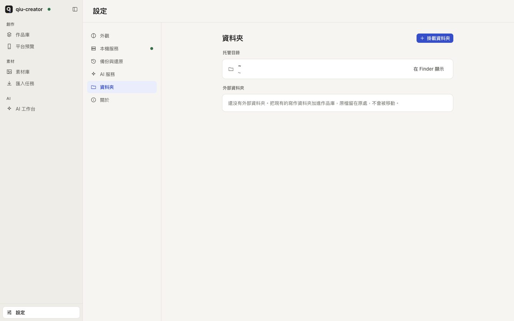 |
| 關於 | 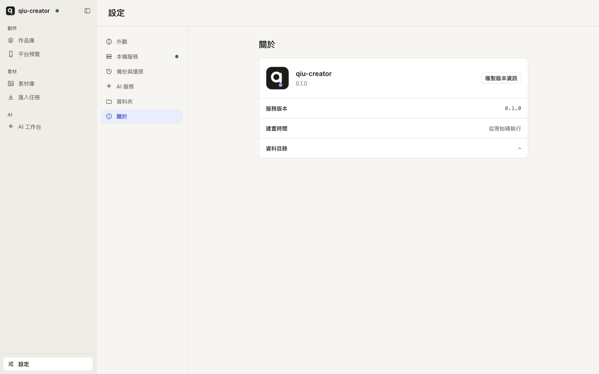 |
| English：Backups | 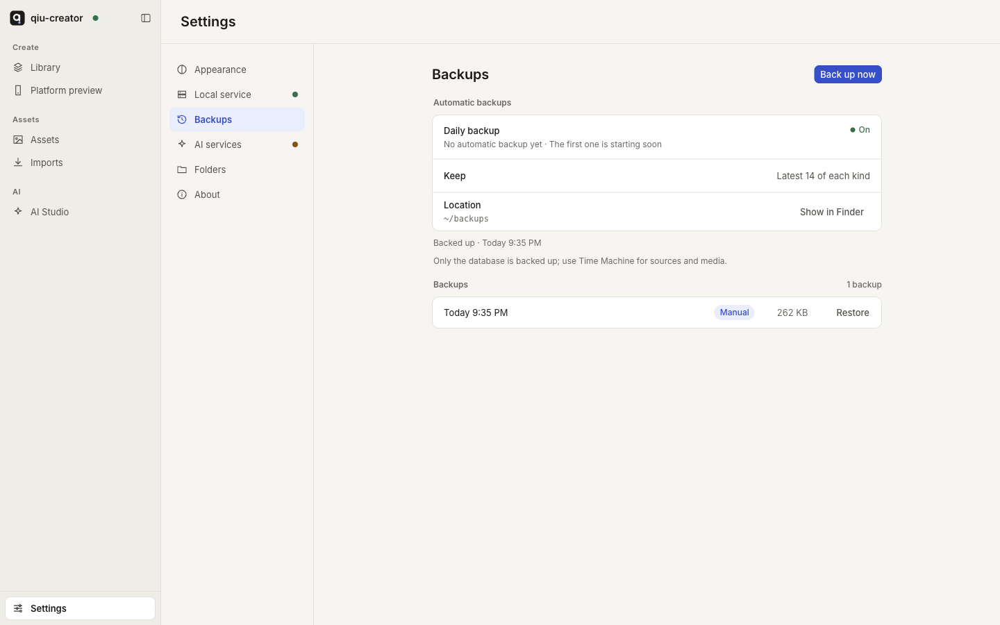 |
| 深色：外觀 | 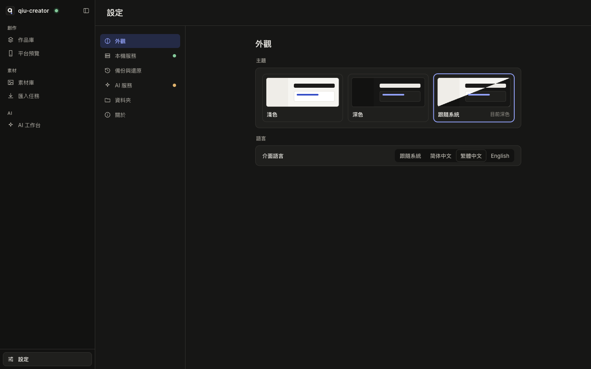 |
| 深色、English：About | 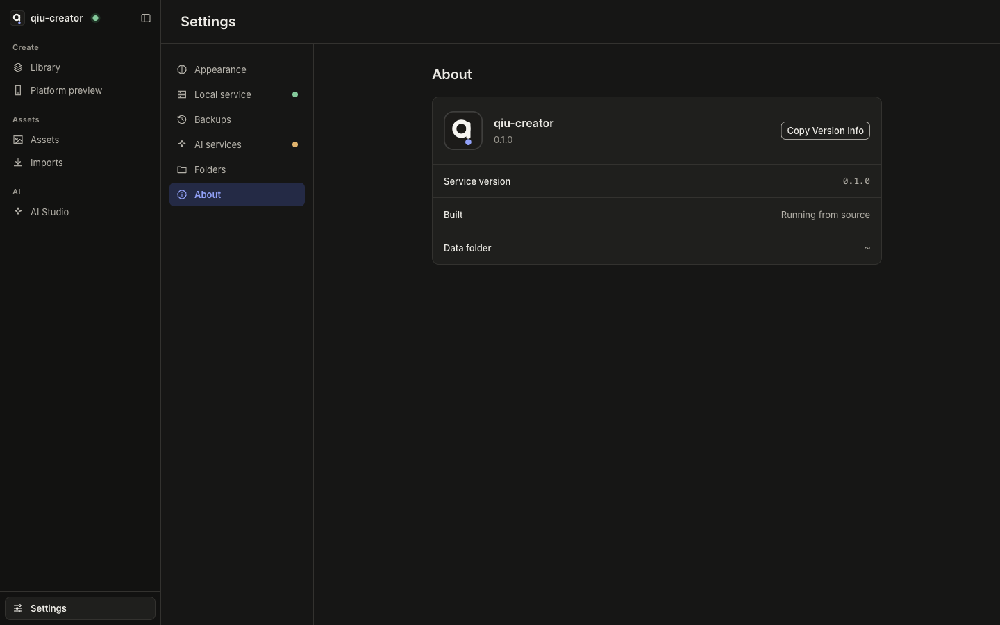 |

### 測試（v2）

- **單元測試**：`backups.test.ts` 改成檢查四種完整句子，並斷言不會再出現舊的片段。
- **e2e**：`settings-v4.spec.ts` 新增一步，涵蓋：
  - 五個分類的版型：主題卡、語言分段控制、服務與系統兩組、備份表格、外部資料夾、關於區塊。
  - 沒有備份時的句子。
  - 立即備份後表格多一列。
  - 用途「自動」的說明。
- **依新版型更新的既有 e2e**：`settings-theme` 的備份清單改成表格列；`new-api`、`model-picker` 的金鑰標籤改成「New API 金鑰」。
