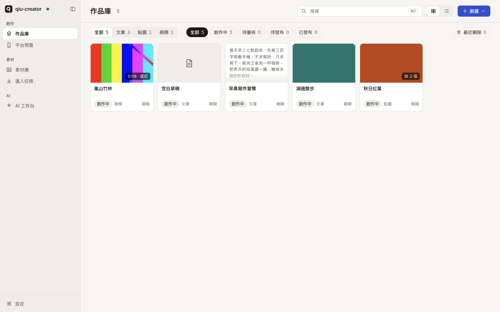
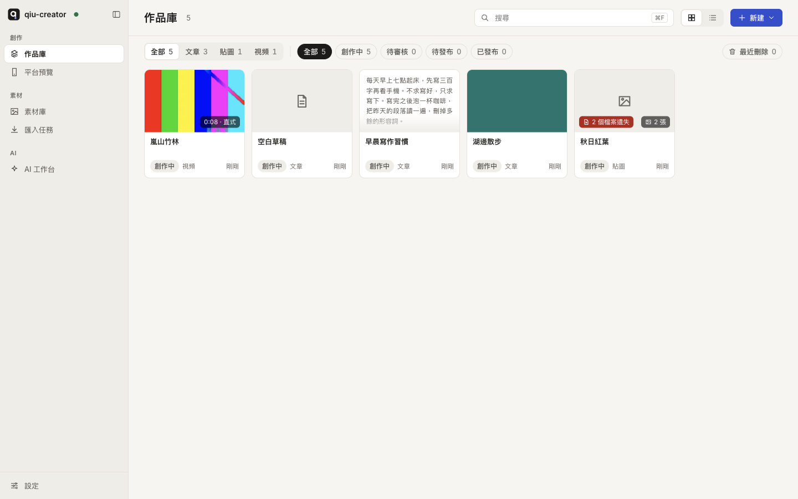
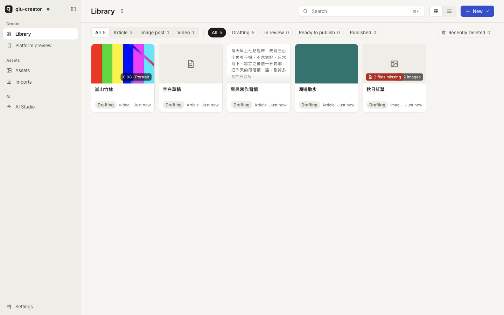
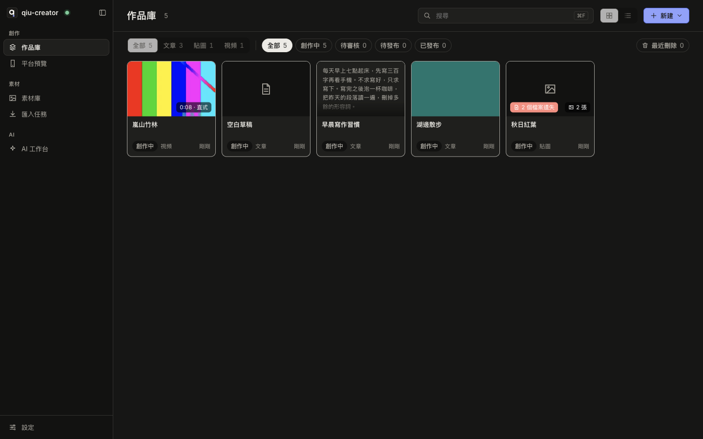
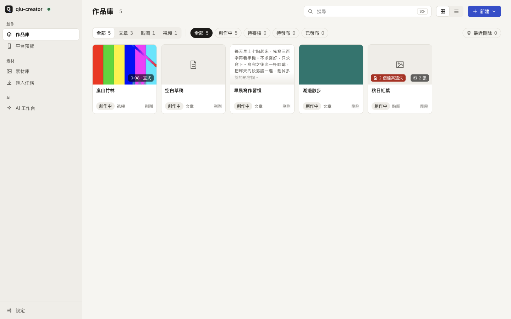

# QC-061 驗收記錄（前端）：作品庫卡片顯示真正的縮圖

日期：2026-11-21　分支：`feat/qc061-library-thumbs`，基底是 main `3880bab`（已包含 qc-backend 的 `6b41b56`、QC-063 和 QC-064）
所有測試都用臨時的 `CREATORHUB_HOME`；e2e 的服務沒有 ffmpeg（`ffmpeg: null`），所以走 App 截幀的流程。

## 診斷（從程式碼與 dev build）

已安裝的 272c754 版有三個問題：

- **視頻卡**：列表裡用 `<video preload="metadata" #t=…>` 取幀，安裝版畫面是空白，只看得到徽章。列表裡放 `<video>` 本來就不可靠，也很耗資源，所以這次改掉這個做法，打包版的根因不再追。
- **貼圖卡**：只有 `thumbnail.asset_id` 有值時才顯示圖。作品自己 `assets/` 裡對不上素材庫的檔案，asset_id 是 null，就只剩圖示。
- **文章卡**：服務端的 thumbnail 一律是 null。

照總監的指示，沒有啟動 /Applications 裡的安裝版，因為它會使用真實的 userData。

## 做法（與 qc-backend 議定的合約，後端在 `6b41b56`）

- **列表欄位**：每個作品新增 `card_image { version, needs_frame, url, frame_source? }` 與 `excerpt`。`url` 是服務簽好的網址，有效期至少 60 分鐘，同一小時內不變，可以快取。
- **卡面**：一律只用 ``，不在列表裡開 `<video>`。卡面依序選：
  1. **圖片**：服務挑出的封面、第一張圖、文章正文第一張 Markdown 圖片，或視頻的一幀。
  2. **文字預覽**：沒有圖片的文章，顯示 `excerpt`（最多 120 字，已去掉第一個 H1 和 Markdown 語法）。排版用字級、間距和淡化收尾，像一頁文件的開頭，參考 `/Users/feature/code/qiuge-design/cases/kami-content-first-document-hierarchy/case.md`（product）。
  3. **類型圖示**：沒有來源、圖片載入失敗（`onerror`）或檔案遺失時顯示，並保留既有的「缺少媒體」徽章。不會出現空白。
- **視頻幀**：
  - 服務有 ffmpeg 時，由服務取封面時間那一幀。
  - 沒有 ffmpeg 時，服務標 `needs_frame`。App 的 `CardFrameQueue` 在畫面外用隱藏的播放器截那一幀（`FrameGrabber.scaledFrame`，最長邊 1024 的 JPEG），一次只處理一支，同一個卡片版本只截一次，失敗也不重試。
  - 截好的幀經主程序的新 IPC `putCardFrame` 上傳，主程序會逐項檢查參數（`card-frame.ts`）。上傳後重新讀取列表，卡片換成那一幀。
  - 視頻沒有對應的素材庫素材時不截，因為會汙染 canvas，那張卡片維持圖示。
- **效能**：圖片延遲載入，網址帶版本，瀏覽器可以快取；截幀一次只跑一支，而且在列表之外進行。
- **打包版驗證的準備**：
  - e2e fixture 支援 `CREATORHUB_E2E_APP=<.app 的執行檔>`，可以用 qc-release 打好的未封裝 .app 跑 spec。
  - 主程序讀取 `CREATORHUB_E2E_PROFILE`，讓打包版也使用臨時的 userData；真實的 App 不會設定這個變數。
  - 這兩處已交給 qc-test 併進 QC-064。

## 截圖（dev build；打包版截圖在下一節）

| 畫面 | 檔案 |
| --- | --- |
| 視頻幀、空白文章（圖示）、文字預覽、文章圖片、貼圖 |  |
| 貼圖的檔案被刪掉：圖示加缺少媒體徽章 |  |
| English |  |
| 深色 |  |

## 打包版驗證

QC-064 已合併。rebase 到 `3880bab` 後，先在 dev build 重跑（2026-11-21 22:58，負載約 3.6）：

- `pnpm typecheck`：通過。
- mac 單元測試：346/346。
- `library-thumbnails.spec.ts`：1/1 passed（QC-064 的背景模式，視窗沒有出現在畫面上）。

打包版（2026-11-21 23:2x）：

- qc-release 用 `30ae100` 打了 `--mac dir` 的未封裝 .app（ad-hoc 簽名，`codesign --verify` 通過，沒有安裝）。
- 以 `CREATORHUB_E2E_APP=…/release/mac-arm64/qiu-creator.app/Contents/MacOS/qiu-creator` 跑 `library-thumbnails.spec.ts`：**1/1 passed**。
- 這次 e2e 用的是臨時的 `CREATORHUB_HOME` 和 `CREATORHUB_E2E_PROFILE`，在背景模式執行，沒有啟動 /Applications 裡的安裝版。
- 安裝版原本的三個問題，在打包版裡都已經解決：視頻卡顯示 App 截的幀；貼圖卡在素材 `asset_id` 是 null 時仍顯示第一張圖；文章卡顯示正文圖片或文字預覽。

| 畫面（打包版） | 檔案 |
| --- | --- |
| 視頻幀、空白文章（圖示）、文字預覽、文章圖片、貼圖 |  |
| 貼圖的檔案被刪掉：圖示加缺少媒體徽章 |  |
| English |  |
| 深色 |  |

## 測試

- **單元測試**：
  - `card-frames.test.ts`：一次一支、依序處理；每個卡片版本只截一次；失敗不重試；沒有素材就不截。
  - `card-frame.test.ts`：主程序只轉送格式正確的上傳，UUID、16 位 hex 的 version、大小上限、時間都有檢查。
- **e2e**：`e2e/specs/library-thumbnails.spec.ts`，單獨在背景模式跑過（跑之前已告知總監）。涵蓋：
  - 貼圖與文章的圖片確實解碼顯示。
  - 列表裡沒有 `<video>`。
  - 文字預覽不重複標題，也沒有 Markdown 符號。
  - 空白文章顯示圖示。
  - 視頻由 App 截幀上傳後換成那一幀，`needs_frame` 變成 false。
  - 刪掉檔案後，顯示圖示與缺少媒體徽章。

## NOT_VERIFIED

- 有 ffmpeg 時由服務取幀，前端只是顯示 `url`；這部分由 qc-backend 的測試涵蓋，前端 e2e 沒有跑。
- 上百張卡片的捲動效能只做了程式碼層面的設計（延遲載入、版本快取、截幀一次一支），沒有量測。
