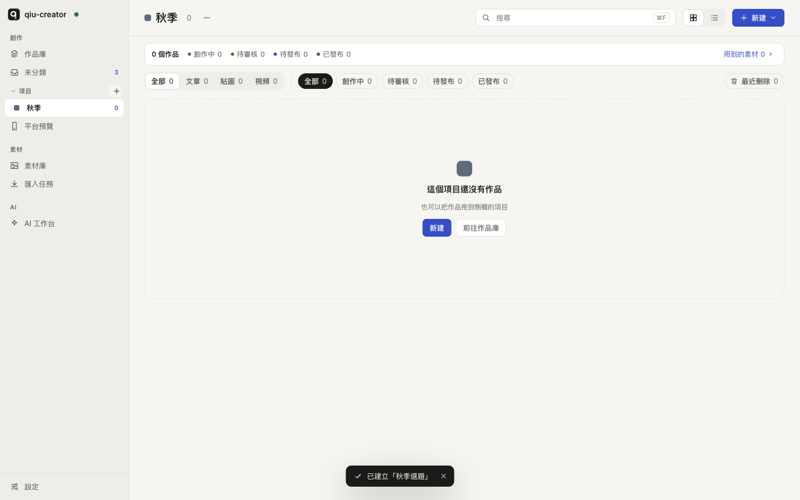
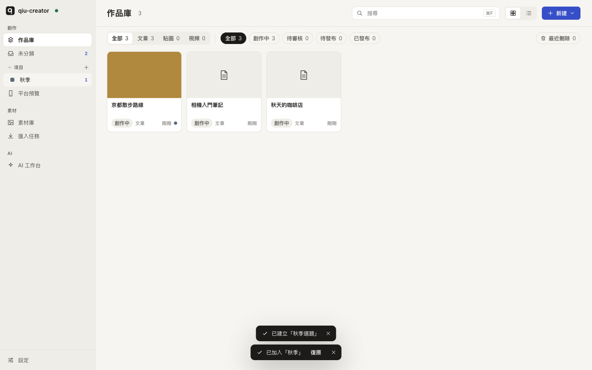
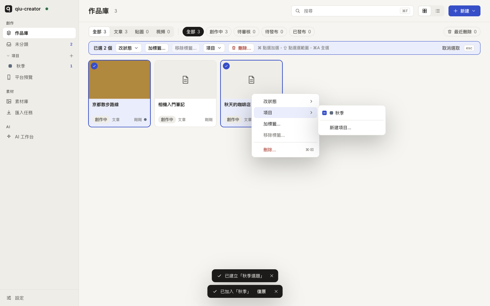
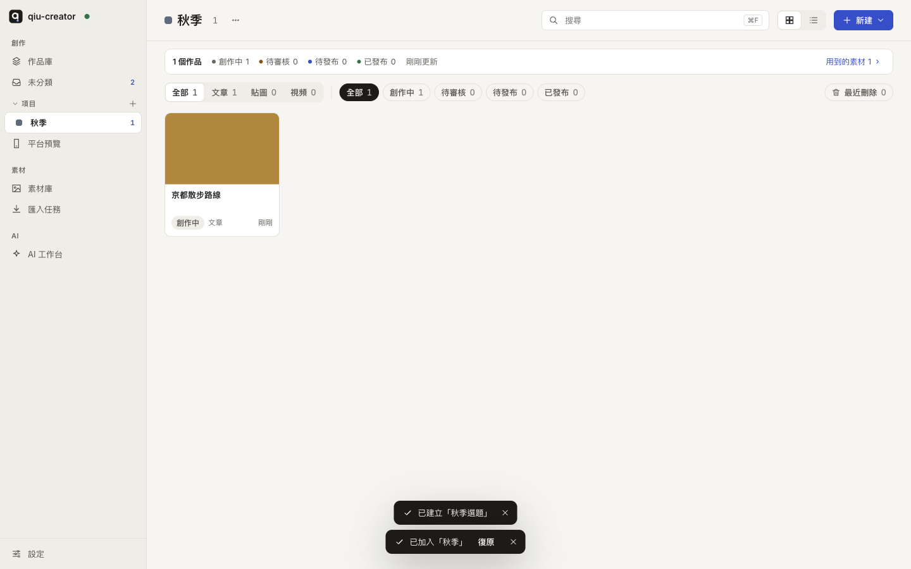
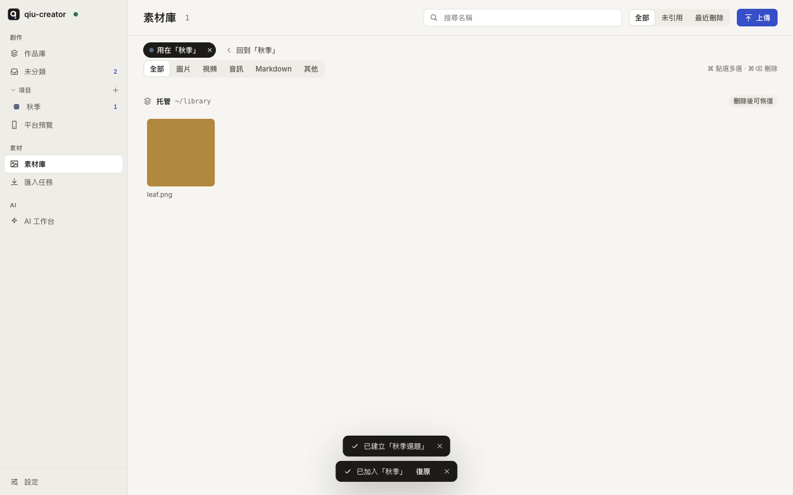
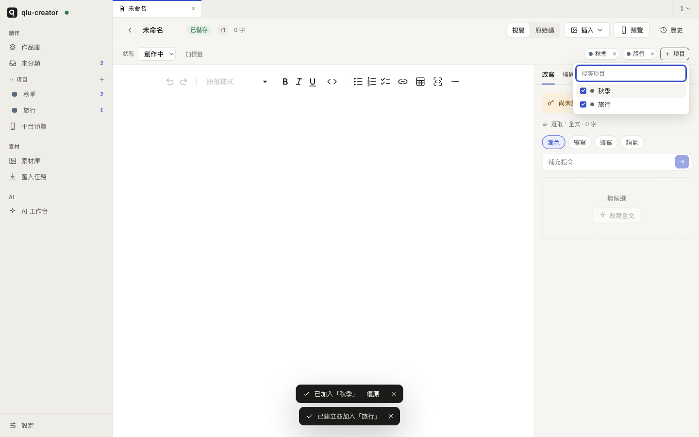
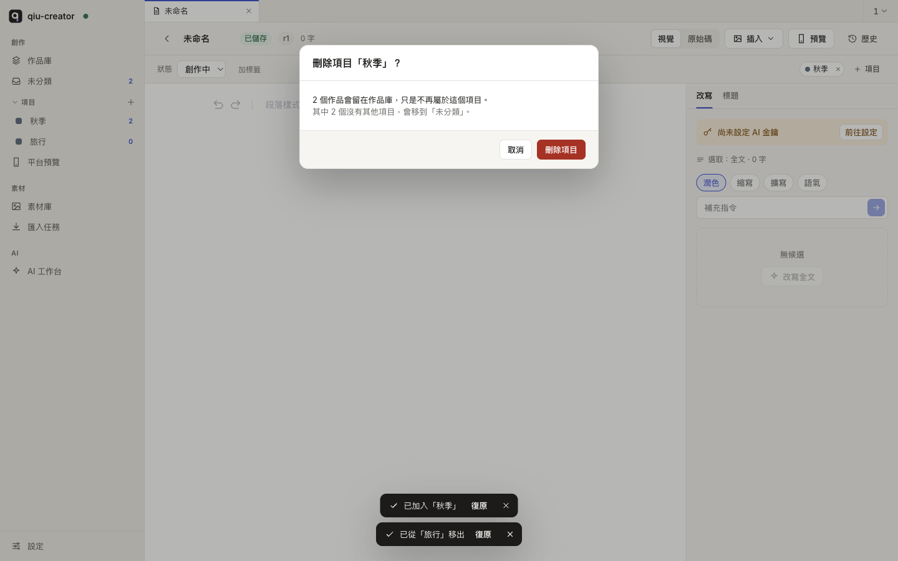
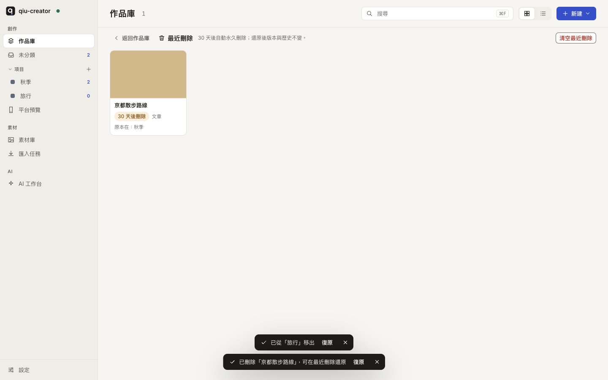

# QC-062 驗收記錄（前端）：作品庫的項目

日期：2026-11-21　分支：`feat/qc062-projects-fe`，基底是 main `3880bab`（已包含 qc-backend 的 QC-062、QC-064 與 QC-065 的動效規格），並疊在 QC-061 的 `8910e24` 上（QC-061 尚未合併）。
原型：PT-20261121-003（看板在 `pt-20261121-003-boards/`）。動效依 DESIGN.md「動效」（QC-065，已核准）。

## 做了什麼

- **側欄**（`SidebarProjects.tsx`）：
  - 「作品庫」下面依序是「未分類」（帶數量），再來是可收合的「項目」標題列（帶 ＋）。
  - 每個項目一列：色塊、名稱、作品數。
  - 單擊開啟，雙擊或 F2 重新命名，右鍵開選單。
  - 排序有三種方式：
    - 滑鼠拖曳（dnd-kit sortable）；
    - 鍵盤：空白鍵拿起、↑↓ 移動、空白鍵放下、Esc 取消；
    - ⌥↑／⌥↓ 直接移動。
  - 作品可以拖到某個項目上加入。
  - 已封存的項目收在「已封存 N」裡。
  - 56 px 圖示列只留色塊，並保留 tooltip。
- **項目選單**（`project-menu.tsx`）：側欄右鍵和項目頁的 ⋯ 是同一份選單：
  - 重新命名、顏色 ▸（8 色色票）、上移／下移、封存／取消封存。
  - 刪除項目…：對話框寫出作品數，以及其中有幾個會回到「未分類」；刪除後可以復原。
- **作品庫**：
  - 範圍有三種：全部、未分類、單一項目。
  - 項目頁的標題帶色塊，可以雙擊改名，旁邊有 ⋯。
  - 標題下方是「項目概覽」：作品數、四種狀態各有幾個、最近更新時間，以及「用到的素材 N ›」。
  - 空狀態：
    - 空項目：顯示提示和「也可以把作品拖到側欄的項目」，附「新建」和「前往作品庫」。
    - 未分類為空：顯示「所有作品都已歸入項目」。
  - 卡片與列表列：
    - 顯示作品其他項目的色點，最多 2 個，其餘以 +N 表示；不含目前的項目和已封存的項目。
    - 可以拖到側欄的項目上。如果拖的卡片在已選範圍裡，就整批拖，拖曳時顯示「N 個作品」。
  - 右鍵與批量工具列：
    - 「項目 ▸」是三態勾選框，按下立即套用，提示附「復原」，最後一項是「新建項目…」（名稱加顏色）。
    - 在項目頁多出「從「X」移出」，以及工具列的「移出此項目」。
    - 用鍵盤時，「項目 ▸」就是拖放之外的另一條路。
  - 在項目內新建的作品會自動加入該項目。
  - 最近刪除的卡片寫出「原本在：…」。
- **素材庫**：從「用到的素材」進來時，頂部顯示「用在「X」」篩選籤（可以清除）和「回到「X」」。
- **編輯器**（文章、貼圖、視頻三種都有）：
  - 標籤列旁顯示所屬項目的色籤，按 × 可以移出。
  - 「項目」彈出框從按鈕右上角長出來，可以搜尋，用勾選框加入或移出，支援 ↑↓↩ 和 esc；輸入新名稱時提供「新建「…」」。
  - 其他地方改了歸屬，SSE 的 `work.projects_changed` 會讓這裡跟著更新。
- **規則**：
  - 拖放、選單和工具列只會加入或移出，不會搬動作品。
  - 加入只送原本不在項目裡的作品，「復原」也只撤回這些。
  - 未分類和已封存的項目不接受放置。
  - 改名遇到 409（別處改過）時，保留新名稱並提示再試一次。

## 動效（DESIGN.md「動效 · 拖放」）

- **依賴**：dnd-kit 6.3.1／10.0.0／3.2.2，記錄在 `docs/dependencies.md`。這次沒有用到 `motion` 套件，等 QC-065 打底時再加。
- **tokens**：規格裡的時長、曲線、彈簧、距離與縮放，放進 `packages/design-tokens`（純資料，並輸出 `--qc-dur-*`、`--qc-ease-*` CSS 變數）。拖放的參數都從這裡取。
- **動效模式**（`motion-mode.ts`）：
  - `full`：全部動效。
  - `reduced`：系統開了「減少動態效果」；不縮放、不位移、不做放下與歸位動畫。
  - `off`：測試模式。e2e 或 `CREATORHUB_MOTION=off` 時，主程序經 `motionMode` IPC 告訴 renderer，`<html data-motion="off">` 讓所有 transition 與 animation 變成 none，dnd-kit 的放下動畫與 sortable 的 transition 也是 null。
- **拖放的各個階段**：

  | 階段 | 做法 |
  | --- | --- |
  | 拿起 | 移動 4 px 才開始。浮層放大到 1.02（`fast` 漸入），帶陰影和抓取游標；原位留 0.4 透明的佔位。 |
  | 經過 | 項目列：其他列讓位（`base`／`out`），並在落點顯示插入線。作品拖到項目列上：該列用 `fast` 顯示強調底色和外框。不是有效目標就沒有任何變化。 |
  | 放下 | 拖進項目：浮層原地縮到 0.6 並淡出（`base`）。排序：浮層落到新位置（`base`／`out`）。 |
  | 取消 | Esc 或放到無效位置：浮層回到原位（`moderate`／`inOut`），資料不變。 |
  | 鍵盤 | 空白鍵、↑↓、空白鍵、Esc。拿起的列有放大、外框和陰影；每一步都用介面語言播報。 |
  | 減少動態效果 | 不縮放，放下與取消直接到位，但保留陰影與佔位。 |

- **彈出層**：編輯器的「項目」彈出框從觸發按鈕那側長出來，以 opacity 加 scale 0.96 加 4 px 位移進場（`base`／`out`）；減少動態效果時只淡入（`fast`）。退場動畫要等 QC-065 的 `<Presence>`，這次是直接卸下。

## 和看板或規格的差異（請總監確認）

1. 側欄第一項仍叫「作品庫」，沒有改成「全部作品」。這樣可以少改大量 e2e 和文案；作品庫在範圍是「全部」時也就等於全部作品。
2. **鍵盤排序沒有用 dnd-kit 的 KeyboardSensor**，原因是在 e2e 裡實測時序不穩：
   - 有時空白鍵拿起後會立刻被結束；
   - 方向鍵也不一定會讓項目移動。
   - 改成自己實作同樣的按鍵和播報：拿起時只在畫面上預覽順序，放下時才送出一次排序，Esc 或焦點離開就還原。實測連跑三次都穩定。
   - 規格裡的「三語播報」用自己的 `aria-live` 區域做到；滑鼠拖曳仍用 dnd-kit 的 `announcements`。
3. 作品卡片只能用滑鼠拖。卡片上的空白鍵和 ↩ 保持「開啟」；鍵盤要加入項目，用右鍵或批量工具列的「項目 ▸」。
4. 項目很多時，56 px 圖示列不會捲動，因為原本的圖示列是 `overflow: visible`，tooltip 才能伸出去。這次沒有處理。
5. 改名在側欄和項目頁的標題上都可以做（雙擊、F2，或選單裡的「重新命名」）。

## e2e 修正過程中發現並修好的問題

- 在編輯器裡新建項目時，SSE 重新讀取和本地加入都會加上同一個 id，色籤因此出現兩次。現在加入前會先去重。
- 項目概覽和素材庫篩選籤原本沒有頁面左右邊距，現在與篩選列對齊（28 px）。
- 項目頁的 ⋯ 原本是文字字元，不符合 DESIGN.md「只用圖示的按鈕要用真正的圖示」，改成新的 `more` 圖示。
- 編輯器「項目」彈出框原本會超出視窗右緣，現在改成靠右對齊觸發按鈕。

## 截圖（dev build，e2e 背景模式，動效關閉）

| 畫面 | 檔案 |
| --- | --- |
| 空項目 |  |
| 拖放加入後的色點與側欄數量 |  |
| 多選右鍵「項目 ▸」半選 |  |
| 項目頁與概覽 |  |
| 素材庫「用在「秋季」」 |  |
| 編輯器的所屬項目與彈出框 |  |
| 刪除項目對話框 |  |
| 最近刪除「原本在」 |  |

## 測試

- **單元測試**：
  - `apps/mac/test/projects.test.ts`，共 12 項：
    - 純函式：三態歸屬、卡片色點、會回到未分類的數量、上移／下移後的順序、放下時的動作（`dropAction`）、各動效模式下的放下動畫與排序 transition、名稱上限、顏色、編輯器搜尋與新建。
    - `ProjectsStore` 對真實服務（臨時 `CREATORHUB_HOME`）。
  - `design-tokens`：新增動效 tokens 的檢查（彈簧回彈不超過 0.15、時長由短到長、CSS 變數）。
- **e2e**：
  - `library-projects.spec.ts` 涵蓋：
    - 側欄新建與 F2 改名；
    - 拖放加入（不搬動）；
    - 多選半選勾選與復原；
    - 項目頁概覽與用到的素材；
    - 在項目內新建；
    - 編輯器色籤與新建；
    - 滑鼠拖曳排序；
    - 鍵盤排序，包括 Esc 取消後資料不變、空白鍵不會開啟項目；
    - 刪除項目與復原；
    - 最近刪除的「原本在」。
  - 跟著介面調整了兩支既有 spec：
    - `sidebar.spec.ts`：「創作」群組的按鈕多了「未分類」和項目區。
    - `library-actions.spec.ts`：右鍵選單多了「項目」。

## 閘門結果

2026-11-21 23:18–23:20，負載約 3–4.5，持有全套鎖。

- `pnpm typecheck`（含 e2e）：通過。
- lint：**failed**，共 30 個錯誤，全部在 `ai-workbench.spec.ts`、`library-actions.spec.ts`、`settings-v4.spec.ts` 的既有程式行。main 上一樣是 30 個，這次沒有增加。
- `prettier --check .`：通過。
- 單元測試一次跑一個套件：

  | 套件 | passed／total |
  | --- | --- |
  | design-tokens | 6/6 |
  | i18n | 29/29 |
  | contracts | 23/23 |
  | api-client | 20/20 |
  | mac | 358/358 |
  | mac-server | 472/472 |

- 完整 e2e（dev build，背景模式）：28/28 passed，包含新的 `library-projects.spec.ts`。
- `library-projects.spec.ts` 單獨連跑三次都通過。

## NOT_VERIFIED

- 正常速度的動效錄影，以及開啟「減少動態效果」時的實際畫面，都沒有拍。e2e 一律關閉動效，而目前還沒有「e2e 開著動效錄影」的開關。這要在 QC-065 打底時補上，再一起錄。
- Performance 面板的長幀檢查（作品庫 300 張卡片時拖曳）沒有做。
- 深色模式、英文與簡體的版面還沒有截圖。
- 打包版：這張任務沒有打包驗證。
