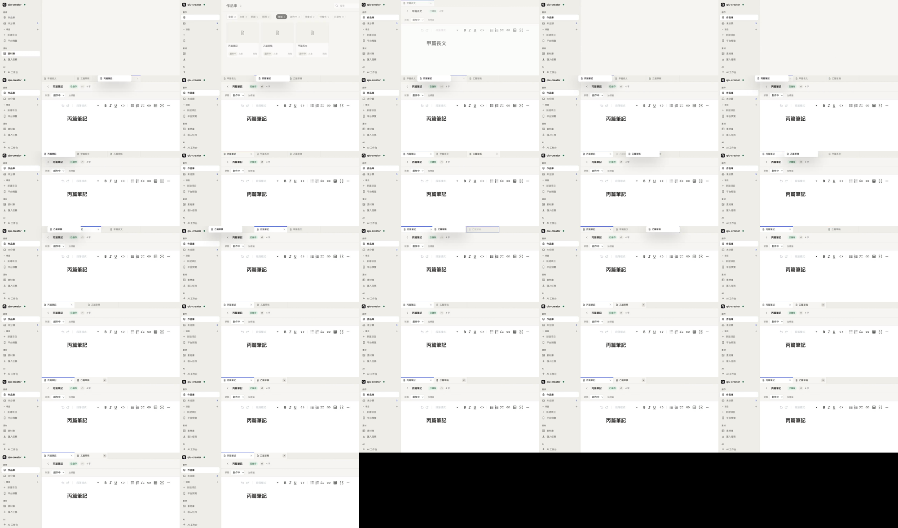
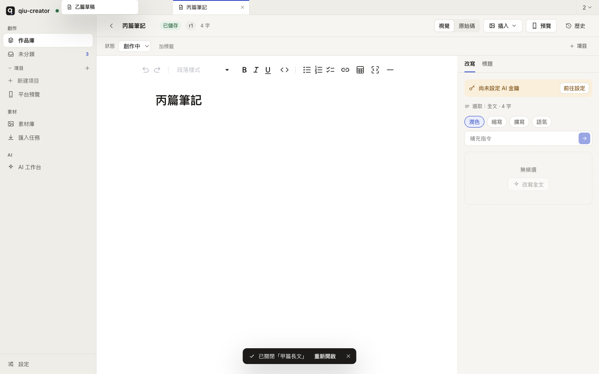

# QC-065 驗收記錄：第 1 區・殼層

日期：2026-11-21　分支：`feat/qc065-area1-shell`，基底是 main `fbe723b`（已包含 QC-065 步驟二）。
規格：DESIGN.md「動效 · 各類互動」裡的頁面切換、側欄收合／展開、編輯分頁切換、編輯分頁開啟／關閉／重排。

## 做了什麼

- **頁面切換**：
  - 從側欄換頁時，舊頁直接卸下，新頁淡入（`fast`），不左右滑。
  - 焦點立即移到新頁的標題。如果這段時間焦點已經被別的元素拿走（例如改名欄、搜尋框），就不搶。
  - 淡入在「減少動態效果」和 lite 模式下保留，因為它只是淡入。
- **側欄收合與展開**：
  - 右側內容包在 `ShellMain`（`motion.div`，`layout="position"`）裡：寬度立即變成最終值，再從舊位置平移到位（`moderate`／`inOut`）。不逐幀改寬度。
  - 只有收合或展開會觸發（`layoutDependency={rail}`）；拖曳側欄邊緣調寬時不動畫。
  - 展開時，標籤用 `fast` 淡入。
- **編輯分頁**：
  - 切換分頁：照規格，內容立即切換，不加動畫。
  - 開啟與關閉：其他分頁滑到新位置（`snappy` 彈簧，`layout="position"`），新分頁淡入（`fast`）。這個 layout 只由分頁數量觸發，所以拖曳排序之後不會再動一次。
  - 拖曳排序：原生 HTML5 拖放換成 dnd-kit sortable，只沿水平方向移動：
    - 其他分頁讓位（`base`／`out`）；
    - 拖曳中的浮層像一個分頁，放大到 1.02，原位留 0.4 透明的佔位；
    - 放下後落到新位置；Esc 取消時飛回原位（`moderate`／`inOut`），順序不變。
  - 原本手畫的插入線，以及沒用到的文案 `tabs.dropHere`，都已移除。
- **共用的拖放設定**（`renderer/dnd-motion.ts`）：
  - 感應器（移動 4 px 才開始拖）、放下動畫和排序 transition，從 `projects-dnd.tsx` 搬到這裡，分頁和項目都用它。
  - 第 4 區的貼圖格之後也會用它。

## 截圖與錄影（dev build，e2e 背景模式）

| 內容 | 檔案 |
| --- | --- |
| 動效錄影（正常速度）：換頁、側欄收合與展開、開三個分頁、拖曳排序、Esc 取消、關閉分頁 | [qc065-area1-shell.mp4](qc065-area1-shell.mp4) |
| 錄影逐格（每秒 8 格） |  |
| 減少動態效果：拖曳中的分頁浮層沒有放大，其他分頁照樣讓位 |  |

## 測試

- **新增 e2e**：`shell-motion.spec.ts`：
  - 一般模式：
    - 從側欄換頁後，焦點在新頁的 h1；
    - 收合與展開側欄後，內容的左緣是 56 和 232；
    - 開三個分頁，拖曳時按 Esc，順序不變；
    - 放下後順序改變；
    - 單擊分頁仍然能切換（4 px 門檻）。
  - 錄影模式（`QC_E2E_MOTION=on`）：同樣的流程以正常速度執行並錄影；減少動態效果時，斷言分頁浮層的 transform 是 `none`。
- **修改的 e2e**：`editor-tabs.spec.ts` 的拖曳排序原本用 `dragTo`，改成逐步移動滑鼠，因為 dnd-kit 要靠指標移動才觸發。
- **一個等待**（請總監知悉）：
  - dnd-kit 的 PointerSensor 在放下後 50 ms 內會吞掉所有 click，用來擋住拖曳本身產生的那次 click（`setTimeout(removeAll, 50)`）。
  - 人沒辦法在 50 ms 內再點一次，但 e2e 可以；實測放下後立刻點「全部分頁」按鈕，那一下會被吞掉。
  - 第一版在放下後固定等 60 ms。總監審查後要求改成等條件，已在第 2 區的 commit 改成 `e2e/fixtures/dnd.ts` 的 `settleAfterDrop`：
    - 先等拖曳浮層消失；
    - 再對一個臨時元素送出探測用的 click，直到它真的收得到為止。
  - 這個探測直接觀察 dnd-kit 的擋 click 狀態。實測放下後立刻探測是 `false`，`settleAfterDrop` 之後是 `true`。

## 閘門結果

2026-11-21 23:50–23:52，負載約 2.3–4，持有全套鎖。

- `pnpm typecheck`（含 e2e）：通過。
- 根目錄 `pnpm lint`（`eslint .`，含 e2e）：**0 個錯誤**。
- `prettier --check .`：通過。
- 單元測試一次跑一個套件：

  | 套件 | passed／total |
  | --- | --- |
  | design-tokens | 6/6 |
  | i18n | 29/29 |
  | contracts | 23/23 |
  | api-client | 20/20 |
  | mac | 365/365 |
  | mac-server | 472/472 |

- 完整 e2e（dev build，背景模式，動效關閉）：31 passed，2 skipped。跳過的兩個是錄影測試，只在動效開啟時執行。
- 錄影跑法（`QC_E2E_MOTION=on QC_E2E_VIDEO=…`）：`shell-motion.spec.ts` 的錄影測試 1 passed。

## NOT_VERIFIED

- 規格寫的是「側欄面板用 transform 移動」，目前側欄本身的寬度是直接切換的，動畫的是內容區的平移和標籤淡入。實際觀感請看錄影；如果總監要側欄面板也滑動，我再補。
- 新分頁沒有做「寬度從 0 展開」，改成淡入，並由其他分頁用 layout 讓位。這樣只動 transform 和 opacity。
- 分頁沒有鍵盤拖曳。鍵盤已經有 ←→ 切換、⌘1–9、⌘⇧[ ]，規格裡的空白鍵拿起，在分頁上會和啟用分頁衝突。
