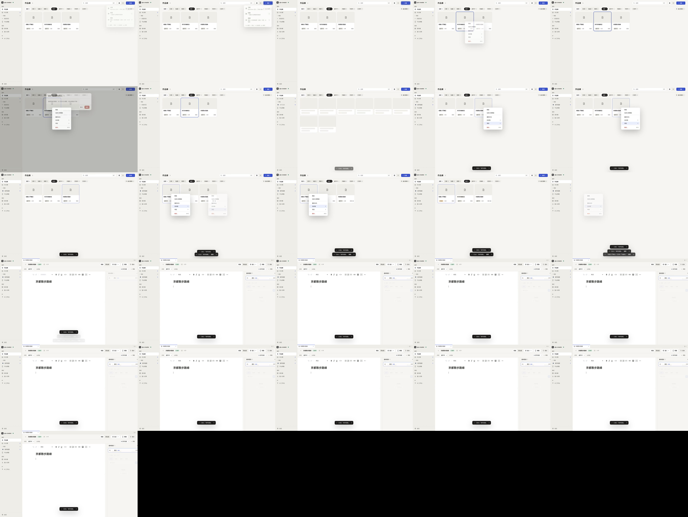
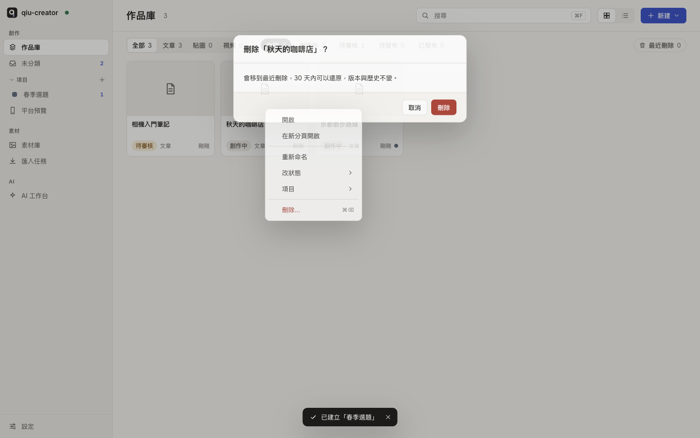

# QC-065 驗收記錄：第 2 區・浮層

日期：2026-11-22　分支：`feat/qc065-area2-overlays`，基底是 main `528753e`（已包含第 1 區）。
規格：DESIGN.md「動效 · 各類互動」裡的選單、下拉、彈出層；右鍵選單、子選單；對話框；側面板、抽屜；Toast。

## 做了什麼

- **進場**：浮層掛上時就播 CSS keyframes，數值都取自 token：

  | 浮層 | 進場 |
  | --- | --- |
  | 右鍵選單、子選單 | 只淡入（`instant` 80ms），子選單不另加延遲 |
  | 下拉與彈出層（新建、全部分頁、插入、模型選單、`/` 指令、項目） | opacity 加 scale 0.96 → 1 加 4 px 位移，`base`／`out`；從觸發按鈕那一側長出來。靠右的選單從右上角，`/` 指令往上開，所以從左下角 |
  | 對話框 | 遮罩淡入（`base`），面板 scale 0.97 → 1（`moderate`／`out`） |
  | 側面板與抽屜（AI 面板、歷史、素材抽屜） | 從右側 24 px 滑入並淡入（`moderate`／`out`），不從整個面板寬度滑進來 |

- **退場**（`useExitFade` 和 `<ExitFade>`，在 `renderer/motion.tsx`）：
  - 浮層被卸下時，真正的元素立即移除，焦點也已經回到原處。
  - 原位留一個靜止的副本：它設了 `inert` 和 `aria-hidden`，不接受指標，然後淡出（`fast`／`in`）；側面板則淡出並往右退 24 px（`base`／`in`）。播完就刪掉。
  - 好處是呼叫端都不用改：各處仍然用 `{open && …}` 或條件渲染。
  - 測試模式不產生副本；React StrictMode 的預演卸載也不會產生副本。
- **Toast**（`ToastHost`）：
  - 從下方升起 8 px 並淡入（`base`），淡出（`fast`）。
  - 其他 toast 用 layout 滑到新位置（`snappy`）。
  - 同時最多 3 個（原本 2 個，依規格調整）。
  - 滑鼠懸停或鍵盤聚焦在 toast 上時，到時間的移除會等使用者離開再執行。
  - 按 × 或「復原」時立即移除。所有 toast 都消失後，暫停狀態會自動解除，不會卡住。
- **減少動態效果和 lite 模式**：以上全部只保留 `fast` 的淡入。退場副本也只淡出，不位移。

## 截圖與錄影（dev build，e2e 背景模式）

| 內容 | 檔案 |
| --- | --- |
| 動效錄影（正常速度）：新建下拉、右鍵選單、刪除對話框、三個 toast 堆疊、歷史面板、插入選單與素材抽屜 | [qc065-area2-overlays.mp4](qc065-area2-overlays.mp4) |
| 錄影逐格（每秒 10 格） |  |
| 減少動態效果：對話框只淡入（`animation-name` 是 `qc-fade-in`） |  |

## 測試

- **單元測試**：`toasts.test.ts`：
  - 最多 3 個；
  - 懸停或聚焦時暫停到時間的移除，按 × 或「復原」時立即移除；
  - 暫停中又被設回的 toast 會留下。
- **新增 e2e**：`overlays-motion.spec.ts`：
  - 一般模式（動效關閉）：右鍵選單、對話框、新建下拉關閉後立即消失，畫面上沒有任何 `inert` 副本。
  - 錄影模式：以正常速度跑一遍，並斷言真正的元素立即消失、副本播完也消失。減少動態效果時，斷言對話框的 `animation-name` 是 `qc-fade-in`。

## 第 1 區 e2e 等待的修正（總監要求）

- `editor-tabs.spec.ts` 和 `shell-motion.spec.ts` 原本在放下後固定等 60 ms，現在改用 `e2e/fixtures/dnd.ts` 的 `settleAfterDrop`。它不假設時間，而是觀察 dnd-kit 的實際狀態：
  1. 等拖曳浮層（`.drag-ghost`）消失；
  2. 對一個臨時元素送出探測用的 click，直到它收得到為止。dnd-kit 擋 click 時，探測會在 document 的捕獲階段被攔下。
- 驗證：在 `editor-tabs.spec.ts` 裡，放下後立刻探測得到 `false`，`settleAfterDrop` 之後得到 `true`。這表示探測看的就是那道擋 click 的機制。
- dnd-kit 沒有任何 DOM 屬性（例如 `[data-dnd-dragging]`）能表示這道機制已經解除，所以用探測代替。

## 閘門結果

2026-11-22 00:03–00:05，rebase 到 main `528753e` 之後跑，負載約 2.2–3.5，持有全套鎖。

- `pnpm typecheck`（含 e2e）：通過。
- 根目錄 `pnpm lint`（`eslint .`）：**0 個錯誤**。
- `prettier --check .`：通過。
- 單元測試一次跑一個套件：

  | 套件 | passed／total |
  | --- | --- |
  | design-tokens | 6/6 |
  | i18n | 29/29 |
  | contracts | 23/23 |
  | api-client | 20/20 |
  | mac | 366/366 |
  | mac-server | 472/472 |

- 完整 e2e（dev build，背景模式，動效關閉）：32 passed，3 skipped（三個錄影測試）。
- 錄影跑法：第 2 區、第 1 區、項目的錄影測試 3/3 passed。

## NOT_VERIFIED

- 退場副本是靜態的 DOM 副本：輸入框裡的值、捲動位置、canvas 不會複製。它只停留 120–180ms，又在淡出，實際上看不出來；但嚴格來說不是元素本身在動。
- 測試模式下 toast 仍照原本的時間消失。規格要求「測試模式 toast 不自動消失，由測試主動關閉」，這會影響所有既有 spec 的時序，需要另外整理，這次沒有做。
