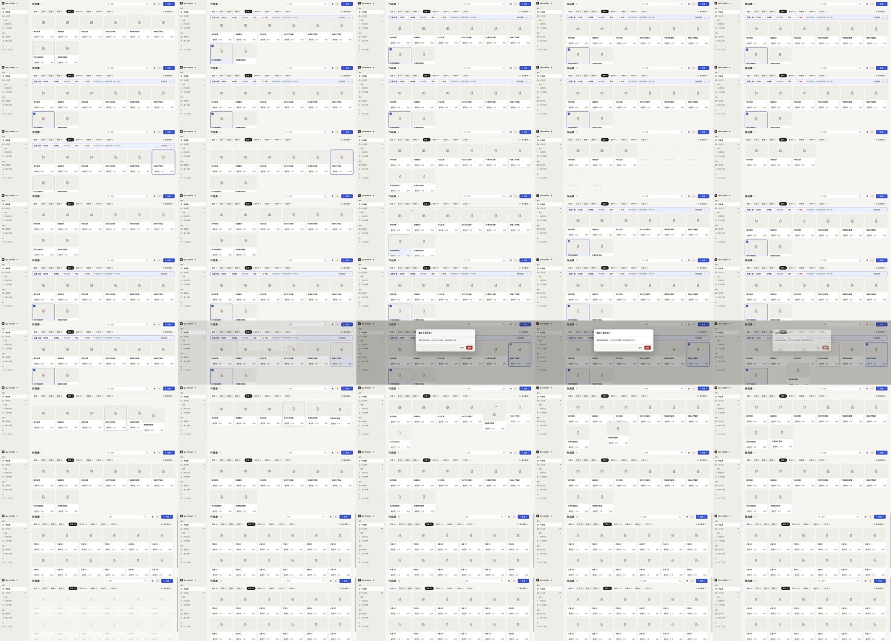
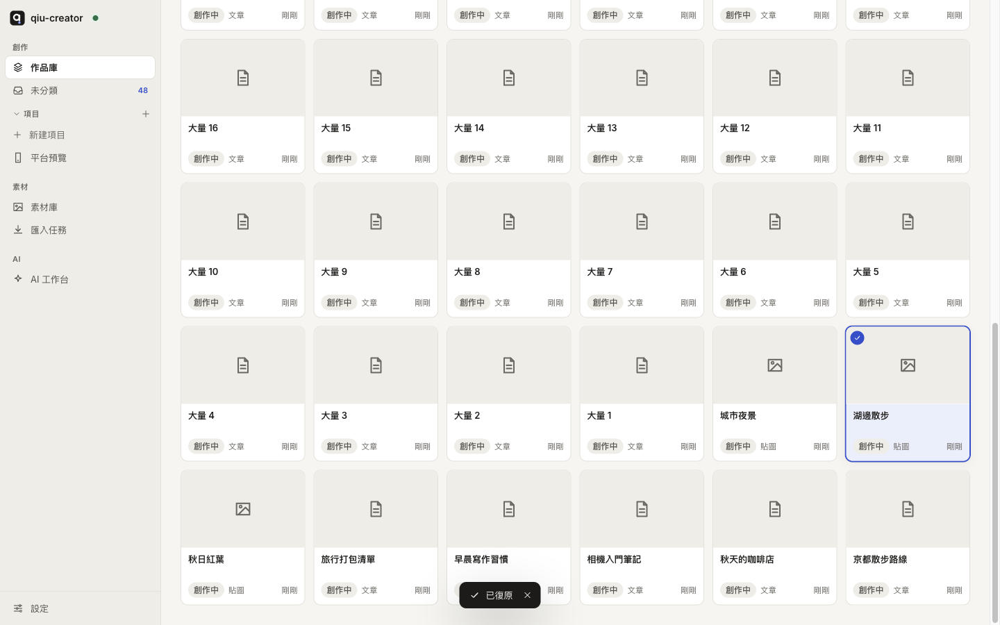

# QC-065 驗收記錄：第 3 區・作品庫

日期：2026-11-22　分支：`feat/qc065-area3-library`，基底是 main `8319149`（已包含第 1、2 區）。
規格：DESIGN.md「動效 · 各類互動」裡的列表與卡片新增、刪除、重排與篩選切換、卡片懸停、卡片選取、載入骨架到內容。

## 做了什麼

- **卡片進出**（`AnimatedItem`，作品庫和最近刪除都用）：
  - 新增：opacity 0 → 1、scale 0.98 → 1（`base`）。
  - 刪除：淡出並縮到 0.98（`fast`）。其他卡片用 `popLayout` 立即補位，用 `snappy` 彈簧滑過去。
  - 復原時，卡片用新增的動效回到原位。
  - 離場中的卡片設了 `inert`，也不接受指標。
- **篩選切換和重排**：
  - 40 張以內：留下的卡片滑到新位置（`snappy`），被篩掉的淡出（`fast`）。
  - 超過 40 張：不逐張移動；整片網格重新換上並淡入（`fast`）。
  - 上限是 `LAYOUT_LIMIT = 40`。
- **刪除後的焦點**：移到被刪卡片的下一張；後面沒有了就移到前一張（`focusAfterRemoval`）。
- **卡片懸停**：只改陰影和框線（`fast`），不放大、不上浮。陰影是卡片後面的一層 `li::after`，只改它的透明度，不逐幀重畫 box-shadow。
- **卡片選取**：
  - 選取環 `fast` 出現。
  - 左上角的勾選記號用 `settle` 彈簧從 0.8 放大到 1，帶一點回彈（`SettleIn`）。
  - 批量列從下方升起並淡入（`base`），退場 `fast`。
- **載入骨架**（`useSkeletonGate`）：
  - 載入 300ms 內完成時不顯示骨架；超過 300ms 才出現，而且一旦出現至少停留 300ms。
  - 內容出現時淡入。骨架沿用原本和卡片同尺寸的格子。
- **減少動態效果和 lite 模式**：卡片和勾選記號只淡入淡出，沒有縮放、位移、彈簧。

## 截圖與錄影（dev build，e2e 背景模式）

| 內容 | 檔案 |
| --- | --- |
| 動效錄影（正常速度）：懸停、選兩張、批量列、篩選切換、刪除兩張後補位與復原、48 張時的整片淡入 | [qc065-area3-library.mp4](qc065-area3-library.mp4) |
| 錄影逐格（每秒 10 格） |  |
| 減少動態效果：選取的勾選記號只淡入（`transform` 是 `none`） |  |

## 過程中發現並修好的問題

- 網格的 key 原本隨動效模式改變，所以使用者開關「減少動態效果」時，整個網格會重新掛上並閃一下；e2e 的錄影測試在那一瞬間偶爾找不到卡片（一次「not visible」）。
- 現在 key 只看卡片數量是否超過 40，切換動效模式不再重畫網格。

## 測試

- **單元測試**（`motion.test.ts`）：`focusAfterRemoval`（下一張、前一張、全部刪除、不存在的 id）；`LAYOUT_LIMIT` 是 40。
- **新增 e2e**：`library-motion.spec.ts`：
  - 一般模式：
    - 篩選切換後顯示符合的卡片；
    - 刪除一張後，焦點在下一張；
    - 超過 40 張時篩選照樣正確。
  - 錄影模式：上面的流程以正常速度執行並錄影；減少動態效果時，斷言勾選記號的 `transform` 是 `none`。
- **既有的作品庫 spec**（`library-actions`、`library-projects`、`library-thumbnails`、`image-post`）照樣通過，沒有修改。

## 閘門結果

2026-11-22 00:13–00:15，rebase 到 main `8319149` 之後跑，持有全套鎖。開始時負載約 4，結束時升到 16.6（測試已跑完），各項結果都是在負載上升之前跑完的。

- `pnpm typecheck`（含 e2e）：通過。
- 根目錄 `pnpm lint`（`eslint .`）：**0 個錯誤**。
- `prettier --check .`：通過。
- 單元測試一次跑一個套件：

  | 套件 | passed／total |
  | --- | --- |
  | design-tokens | 6/6 |
  | i18n | 29/29 |
  | contracts | 23/23 |
  | api-client | 20/20 |
  | mac | 368/368 |
  | mac-server | 472/472 |

- 完整 e2e（dev build，背景模式，動效關閉）：33 passed，4 skipped（四個錄影測試）。
- 錄影跑法：第 1、2、3 區和項目的錄影測試 4/4 passed。

## NOT_VERIFIED

- 規格的「列表首次出現時錯開 20ms（最多 6 項）」沒有做：首次載入時是整個網格一起淡入。逐項錯開和 `popLayout` 的進場一起用時，時序比較難控制，所以先不做；需要的話我再補。
- 300 張卡片的 Performance 長幀檢查沒有做：在背景模式的 e2e 視窗裡量 Performance 不準。超過 40 張時改成整片淡入，就是為了避開這個成本。
- 「超過 40 張」是看整份清單，不是只算可視範圍裡的卡片。規格寫的是可視範圍，用整份清單計算比較保守。
