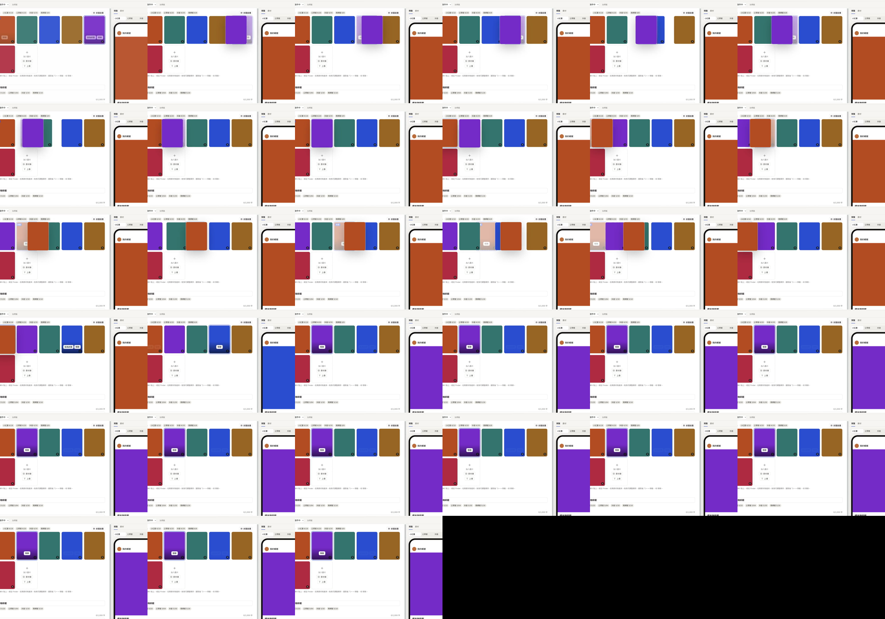
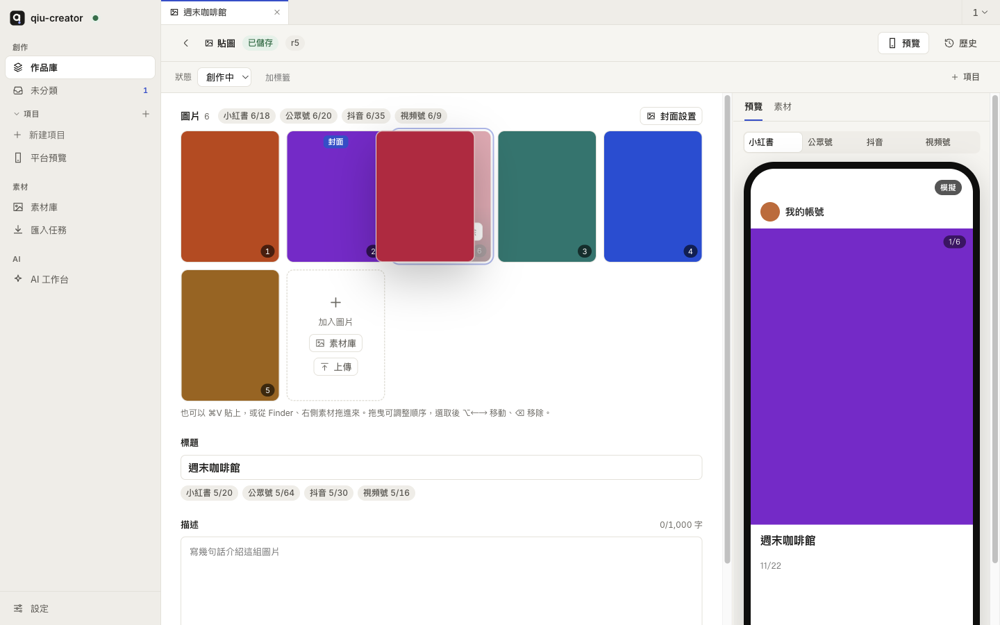

# QC-065 驗收記錄：第 4 區・貼圖編輯

日期：2026-11-22　分支：`feat/qc065-area4-image-post`，基底是 main `129eb6c`（已包含第 1–3 區）。
規格：DESIGN.md「動效 · 拖放」（拿起、經過、放下、取消），以及卡片集合的封面設定。

## 做了什麼

- **圖片格的拖曳排序**：原本的 HTML5 拖放換成 dnd-kit sortable（`rectSortingStrategy`），感應器、放下動畫和讓位 transition 都用 `dnd-motion.ts` 的共用設定：
  - 移動 4 px 才開始拖，所以點選圖片、懸停按鈕都照舊。
  - 拖曳中的浮層是這張圖的縮圖，放大到 1.02 並帶陰影；原位留 0.4 透明的佔位。
  - 其他圖片讓位（`base`／`out`）。
  - 放下後落到新位置（`base`）；Esc 或放到無效位置時飛回原處（`moderate`／`inOut`），順序不變。
  - 從素材抽屜拖素材、從 Finder 拖檔案進來，照舊用原生拖放和插入線，沒有改。
  - ⌥←／⌥→ 照舊。
- **封面**：「封面」標籤用 motion 的共用元素（`layoutId`）。換封面時，標籤從舊的那張滑到新的那張（`snappy`）；減少動態效果時直接換位置。
- **減少動態效果和 lite**：拖曳浮層不放大，放下與取消直接到位，但陰影和佔位照樣顯示。

## 截圖與錄影（dev build，e2e 背景模式）

| 內容 | 檔案 |
| --- | --- |
| 動效錄影（正常速度）：第 5 張拖到第 2 張前面、拖曳時按 Esc 取消、連換兩次封面 | [qc065-area4-image-post.mp4](qc065-area4-image-post.mp4) |
| 錄影逐格（每秒 12 格） |  |
| 減少動態效果：拖曳中的浮層沒有放大，其他圖片照樣讓位 |  |

## 測試

- **新增 e2e**：`image-post-motion.spec.ts`：
  - 一般模式：拖曳時按 Esc，順序不變（以服務端讀到的順序為準）；放下後順序正確；換封面後只有一個「封面」標籤，而且在對的那張上。
  - 錄影模式：同樣的流程以正常速度執行並錄影；減少動態效果時，斷言浮層的 `transform` 是 `none`。
- **既有的 `image-post.spec.ts`**（鍵盤排序、移除與復原、封面設置對話框等）照樣通過，沒有修改。

## 閘門結果

2026-11-22 00:23–00:26，rebase 到 main `129eb6c` 之後跑，持有全套鎖。

- 第一輪在負載 20–30 時開跑，違反了「負載 15 以下才跑全套」的規則。那一輪雖然全部通過，但不算數。
- 等 1 分鐘負載降到 15 以下後重跑一輪，下面是這一輪的結果。開始時負載 8.0，跑 e2e 時 7.3，結束時 3.4。

- `pnpm typecheck`（含 e2e）：通過。
- 根目錄 `pnpm lint`（`eslint .`）：**0 個錯誤**。
- `prettier --check .`：通過。
- 單元測試一次跑一個套件：

  | 套件 | passed／total |
  | --- | --- |
  | design-tokens | 6/6 |
  | i18n | 29/29 |
  | contracts | 23/23 |
  | api-client | 20/20 |
  | mac | 368/368 |
  | mac-server | 472/472 |

- 完整 e2e（dev build，背景模式，動效關閉）：34 passed，5 skipped（五個錄影測試）。
- 錄影跑法：第 1–4 區和項目的錄影測試 5/5 passed。

## NOT_VERIFIED

- 圖片格沒有做鍵盤拖曳（空白鍵拿起）：鍵盤已經有 ⌥←／⌥→ 排序，空白鍵也已經用來選取圖片。
- 新增或移除圖片時，其他圖片沒有 layout 補位動畫：dnd-kit sortable 的 transform 和 motion 的 layout 都會改同一個 `transform`，一起用時會打架。所以只做了拖曳讓位，新增和移除是直接到位的。
