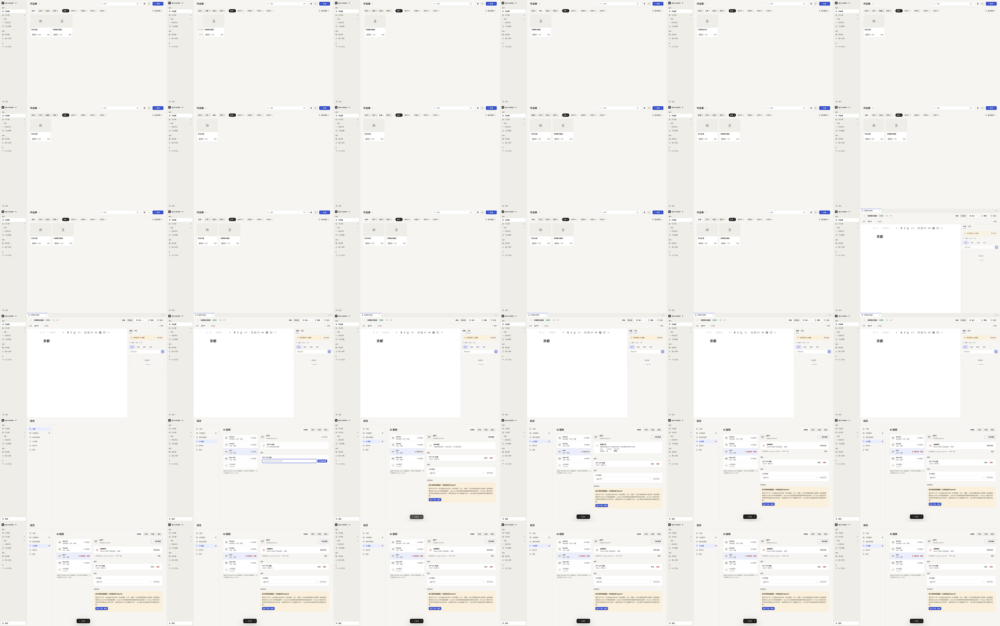
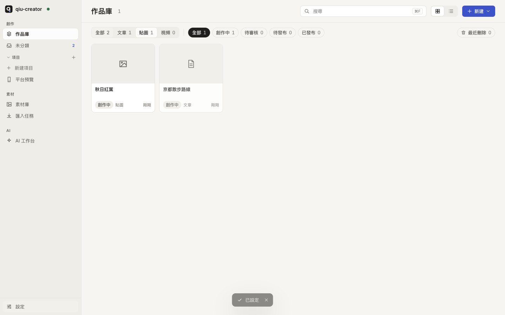

# QC-065 驗收記錄：第 5 區・設定與 AI

日期：2026-11-22　分支：`feat/qc065-area5-settings-ai`，基底是 main `f2498a4`（已包含第 1–4 區）。
規格：DESIGN.md「動效 · 各類互動」裡的分段控制、AI 分頁指示器、頁面切換（設定分類）、測試連線與按鈕的等待、AI 任務進度。

## 做了什麼

- **分段控制和 AI 分頁指示器**（`renderer/segment-glide.ts`）：
  - 選取改變時，底色（分段）或底線（AI 面板的「改寫／標題」）從舊位置滑到新位置（`base`／`out`，只動 transform），播完交回元件本身的樣式。
  - 整個 App 只有一個監看器：MutationObserver 監看 `.seg` 的 `aria-pressed` 和 `.ai__tab-list` 的 `aria-selected`。12 處分段控制都不用改，以後新加的也會自動套用。
  - 滑動中的底色放在控制項裡、按鈕底下，文字永遠在上面。
  - 只有 `full` 模式才滑動；減少動態效果、lite 和測試模式直接換。
- **設定分類切換**：右側內容直接換上並淡入（`fast`），不左右滑；在減少動態效果和 lite 下也保留這個淡入。
- **測試連線**：
  - 結果卡的高度變化用 motion 的 layout（`moderate`），裡面的列用 `layout="position"`，文字不會被拉伸。
  - 結果圖示（成功、失敗）從 0.9 放大到 1（`base`），不回彈；測試中的轉圈是 `fast` 淡入。
  - 按鈕本身不縮放，寬度不變。
- **確定進度條**：AI 工作台、匯入任務、插入上傳、視頻上傳的進度條，從改 `width` 換成 `transform: scaleX`（`progress` 400ms），每一幀都不重新排版（`progressStyle()`）。不確定進度照舊循環。

## 截圖與錄影（dev build，e2e 背景模式）

| 內容 | 檔案 |
| --- | --- |
| 動效錄影（正常速度）：類型與檢視分段切換、AI 面板「改寫／標題」、設定分類切換、存入金鑰後測試連線（成功，再換成金鑰錯誤） | [qc065-area5-settings-ai.mp4](qc065-area5-settings-ai.mp4) |
| 錄影逐格（每秒 12 格） |  |
| 減少動態效果：分段直接切換，沒有滑動的底色 |  |

## 測試

- **單元測試**（`motion.test.ts`）：`glideKeyframes` 從舊位置精確起步，結束在新位置。
- **新增 e2e**：`settings-ai-motion.spec.ts`：
  - 一般模式：分段切換後沒有殘留的滑動元素或 `data-gliding`；設定分類切換；存入金鑰後測試連線成功。
  - 錄影模式：以正常速度跑一遍並錄影；減少動態效果時，斷言切換分段後沒有產生滑動元素。
- **既有 spec**：`settings-v4`、`ai-workbench`、`video-work` 照樣通過，沒有修改。
- **錄影工具**：有一次 ffmpeg 沒產生 mp4（只留下畫格），之後連跑四次都正常，沒能重現。`screencast.ts` 現在會印出 ffmpeg 失敗的原因，不再靜默。

## 閘門結果

2026-11-22 00:33–00:36，持有全套鎖。開始時 1 分鐘負載 2.9，跑 e2e 時 6.4，結束時 3.7。跑的時候分支疊在第 4 區的 `17b00f8` 上；之後 main 只多了合併這筆的 merge commit，程式內容相同。

- `pnpm typecheck`（含 e2e）：通過。
- 根目錄 `pnpm lint`（`eslint .`）：**0 個錯誤**。
- `prettier --check .`：通過。
- 單元測試一次跑一個套件：

  | 套件 | passed／total |
  | --- | --- |
  | design-tokens | 6/6 |
  | i18n | 29/29 |
  | contracts | 23/23 |
  | api-client | 20/20 |
  | mac | 369/369 |
  | mac-server | 472/472 |

- 完整 e2e（dev build，背景模式，動效關閉）：35 passed，6 skipped（六個錄影測試）。
- 錄影跑法（全部 `*-motion.spec.ts`）：6/6 passed，六支 mp4 都產生了。

## NOT_VERIFIED

- 規格寫的是分段指示器「用共享元素（`layoutId`）」，我用 MutationObserver 加 WAAPI 做出一樣的效果，好處是不用改 12 處元件；曲線是 `base`／`out` 的 tween，不是 `snappy` 彈簧，觀感接近。
- AI 任務「完成後進度條淡出，結果用新增動效進場」這次沒有做：AI 工作台的結果區目前是直接換上。可以在之後的收尾補。
- 儲存狀態標籤（未儲存、儲存中、已儲存）的交叉淡化，不在第 5 區的範圍，沒有做。
