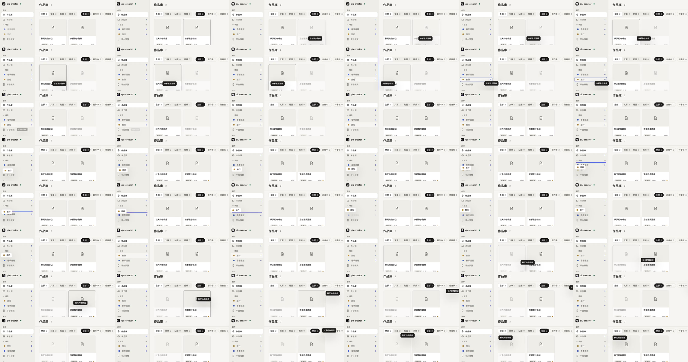
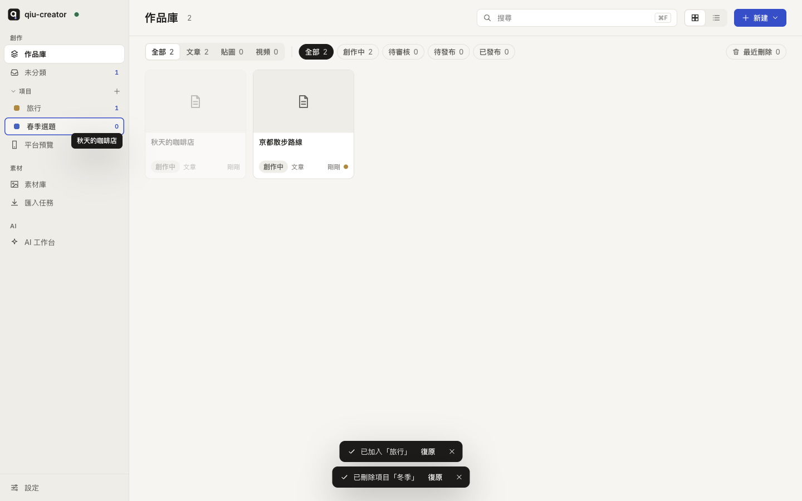
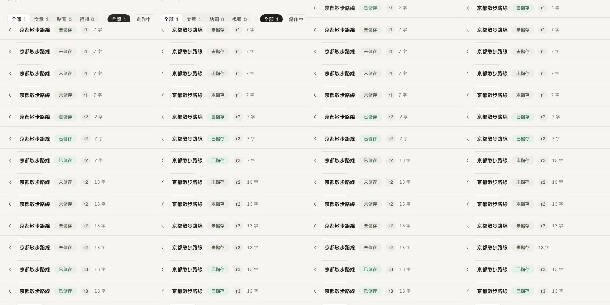
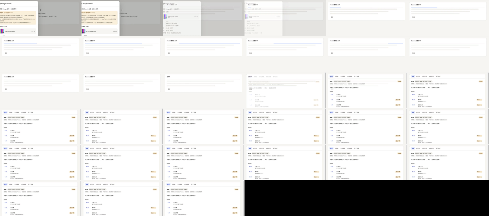
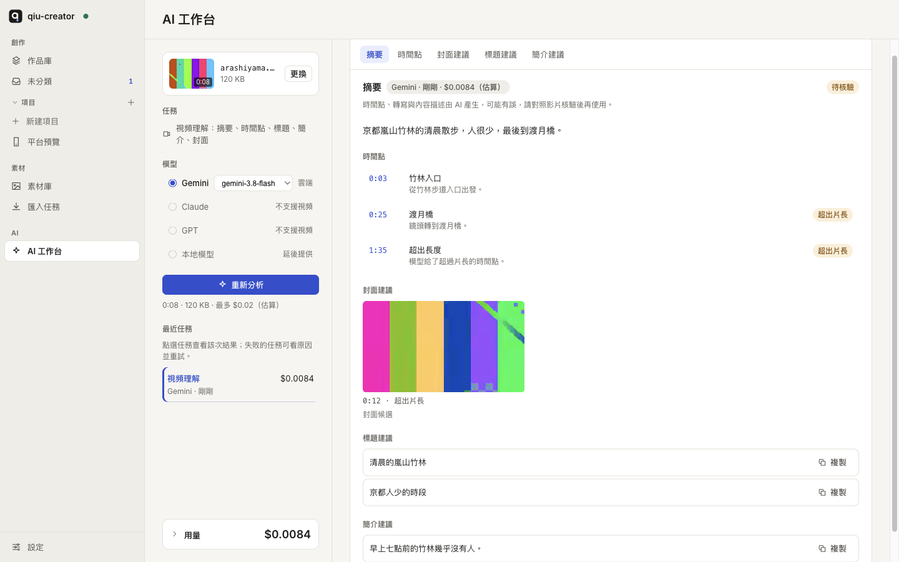

# QC-065 驗收記錄：第 6 區・項目，以及儲存狀態與 AI 任務完成

日期：2026-11-22　分支：`feat/qc065-area6-projects`，基底是 main `ea50dc3`（已包含第 1–5 區）。
規格：DESIGN.md「動效 · 拖放：放下」（放入容器），以及列表新增和刪除。項目的拖曳排序和拖進項目，在 QC-062 和 QC-065 打底時已經照規格做好，這一區補上剩下的部分。

## 做了什麼

- **拖進項目時飛向目標列**：
  - 原本浮層是在放開的位置縮小淡出。
  - 現在一邊縮到 0.6、一邊淡出，同時飛向目標項目列的中心（`base`／`out`），讓人看得出作品去了哪裡。
  - 目標位置在拖曳經過時記下（`towardCentre`）。
  - 減少動態效果、lite 和測試模式直接到位。
- **數量交叉淡化**：項目列和「未分類」的數量改變時，新數字淡入（`fast`），不閃爍。
- **項目列進出**：
  - 新項目的那一列像列表項目一樣進場（opacity 加 scale 0.98，`base`）。
  - 刪除、封存或收合時，那一列用 `ExitFade` 留下一個 inert 的副本淡出，其他列往上補。
- 拖曳排序、插入線、鍵盤排序（空白鍵、↑↓、空白鍵、Esc）都沿用既有做法，這次沒有改。

### 總監追加：儲存狀態與 AI 任務完成

- **儲存狀態**（`SaveChip`，文章、貼圖、視頻三種編輯器共用）：
  - 未儲存 → 儲存中 → 已儲存：舊的文字和圖示淡出，新的淡入（`fast`）；標籤寬度變化用 layout（`snappy`）；底色在 `fast` 內換色。已儲存不閃、不彈。
  - 錄影時發現兩個「閃」：
    - 存檔太快時，儲存中只出現一瞬間，兩次淡化疊在一起，標籤幾乎變空。
    - 標籤寬度一變，旁邊的「r2」和字數馬上跳位，被還在變形的標籤蓋住一格。
  - 修正：
    - 存檔超過 150ms 才顯示「儲存中」，存得快就直接從未儲存淡到已儲存。
    - 標籤給一個最小寬度，常見的幾種狀態之間寬度不變，旁邊的字不會移動。
  - 測試模式下，標籤立即換字，不會同時出現兩個。
- **AI 任務完成**：
  - AI 工作台的進度卡（`RunningCard`）和編輯器 AI 面板的生成中區塊（`Generating`），完成時淡出（`fast`，用 `useExitFade`），蓋在結果進場的位置上。
  - 結果（工作台的 `.aiw__done`、改寫候選、標題候選、失敗卡）用新增的動效進場（opacity 加 scale 0.98，`base`）。
  - 減少動態效果時只淡入；測試模式直接換上。

## 截圖與錄影（dev build，e2e 背景模式）

| 內容 | 檔案 |
| --- | --- |
| 動效錄影（正常速度）：作品拖進「旅行」（飛向該列、數量淡入）、拖曳排序、拖到無效位置後取消、新建一個項目再刪除 | [qc065-area6-projects.mp4](qc065-area6-projects.mp4) |
| 錄影逐格（每秒 20 格，只截取側欄與上方的作品） |  |
| 減少動態效果：拖曳中的浮層沒有放大，只有陰影（沿用步驟二的截圖測試） |  |
| 動效錄影（正常速度）：輸入兩段後「未儲存→已儲存」，再到 AI 工作台分析一支視頻（進度卡淡出、結果進場） | [qc065-area6-ai-save.mp4](qc065-area6-ai-save.mp4) |
| 儲存狀態逐格（每秒 20 格，只截取標題列） |  |
| AI 完成逐格（每秒 15 格） |  |
| 減少動態效果：AI 結果沒有縮放動畫 |  |

## 測試

- **單元測試**（`motion.test.ts`）：`towardCentre` 算出兩個中心的距離；`dropIntoKeyframes` 結束在目標中心，縮到 0.6 並淡出。
- **e2e**：`projects-motion.spec.ts`：
  - 一般模式：在收起的側欄上刪除一個項目後，那一列立即消失，畫面上沒有任何 inert 副本。
  - 錄影模式：加上了新建和刪除項目，並改名為 `qc065-area6-projects`。
- **新增 e2e**：`ai-save-motion.spec.ts`：
  - 一般模式：存檔後標籤是「已儲存」，而且只有一個。
  - 錄影模式：儲存兩次，再跑一次 AI 分析（fake Gemini 的 `processingPolls = 40`，讓進度卡停留一下），並斷言進度卡消失、結果出現；減少動態效果時，斷言結果的 `animation-name` 是 `none`。
- **既有 spec**：`library-projects`、`sidebar`、`editor-tabs`、`ai-workbench` 照樣通過，沒有修改。

## 閘門結果

2026-11-22 00:45–00:48，持有全套鎖。開始時 1 分鐘負載 2.6，跑 e2e 時 4.3，結束時 3.2。跑的時候分支疊在第 5 區的 `81f4705` 上；之後 main 只多了合併這筆的 merge commit，程式內容相同。

- `pnpm typecheck`（含 e2e）：通過。
- 根目錄 `pnpm lint`（`eslint .`）：**0 個錯誤**。
- `prettier --check .`：通過。
- 單元測試一次跑一個套件：

  | 套件 | passed／total |
  | --- | --- |
  | design-tokens | 6/6 |
  | i18n | 29/29 |
  | contracts | 23/23 |
  | api-client | 20/20 |
  | mac | 370/370 |
  | mac-server | 472/472 |

- 完整 e2e（dev build，背景模式，動效關閉）：36 passed，7 skipped（七個錄影測試）。
- 完整錄影（全部 `*-motion.spec.ts`，`QC_E2E_MOTION=on QC_E2E_VIDEO=…`）：**7/7 passed，七支 mp4 全部產生**：`qc065-area1-shell`、`area2-overlays`、`area3-library`、`area4-image-post`、`area5-settings-ai`、`area6-projects`、`area6-ai-save`。

## NOT_VERIFIED

- 用鍵盤（空白鍵加 ↑↓）排序時，其他列是直接換位置，沒有滑動。項目列已經有 dnd-kit 的 transform，再加 motion 的 layout 會互相干擾。滑鼠拖曳時的讓位不受影響。
