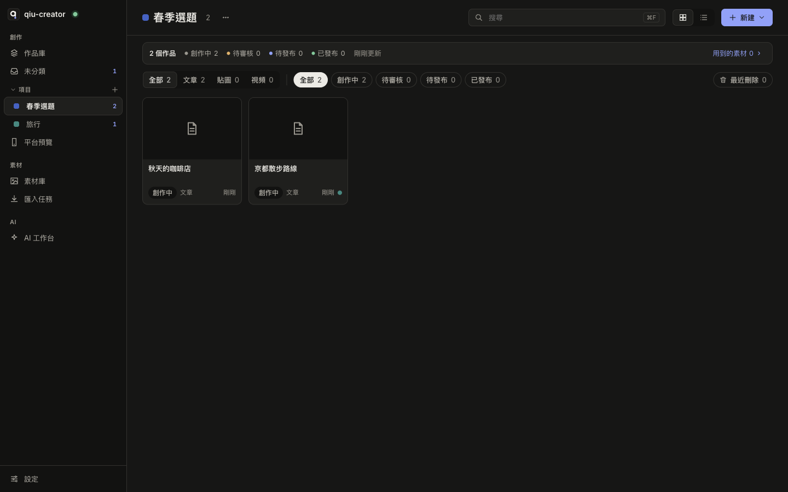
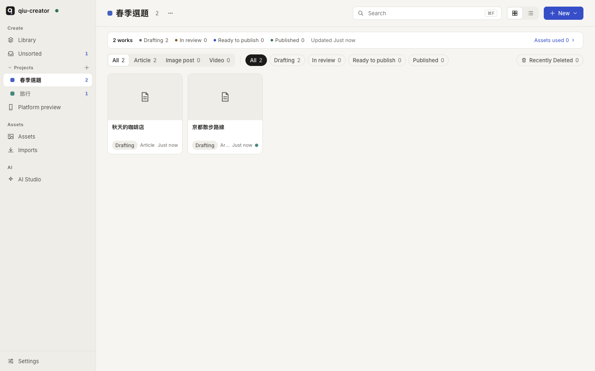
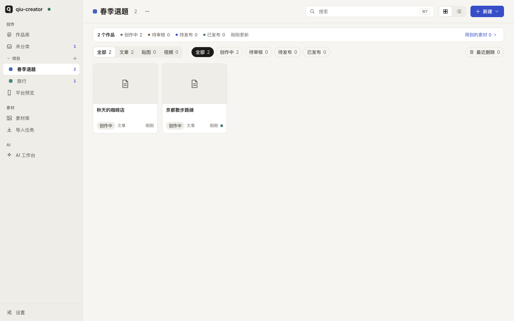
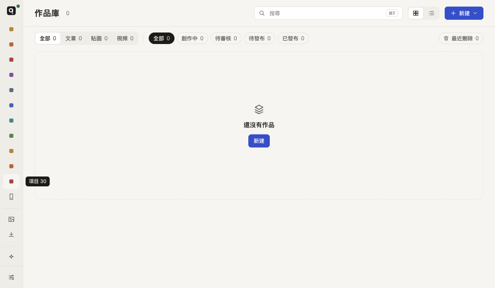
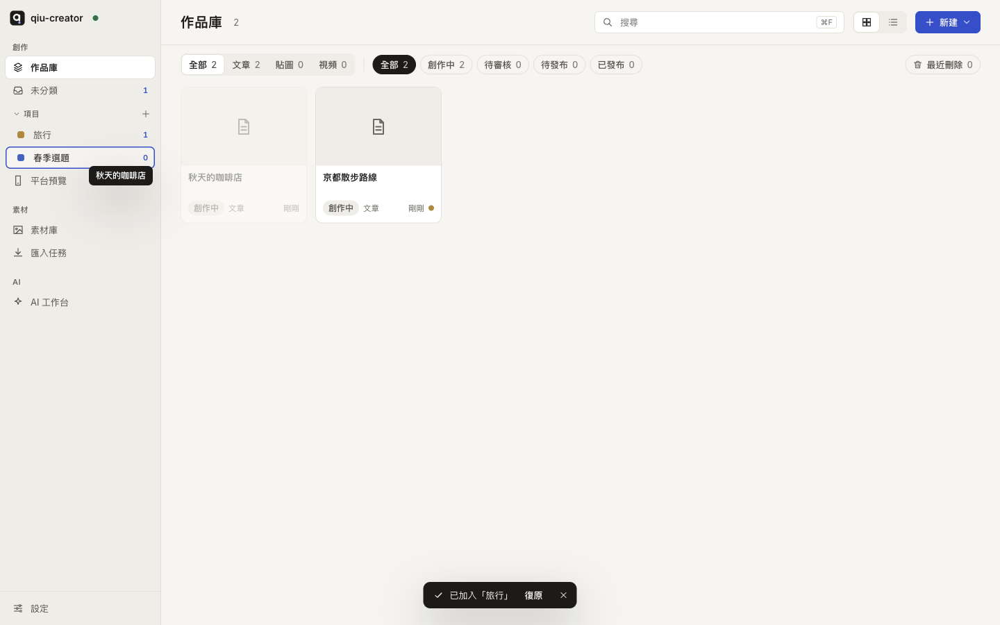
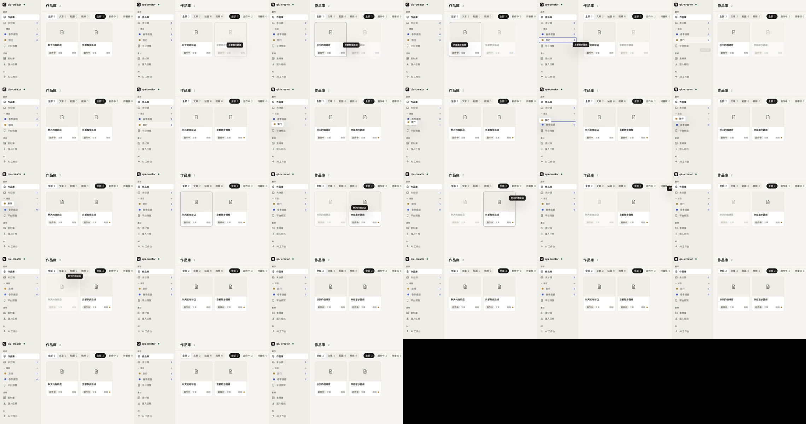

# QC-065 驗收記錄（步驟二：基礎建設）

日期：2026-11-21　分支：`feat/qc065-motion-foundation`，基底是 main `ce1a210`（已包含 QC-061、QC-062）。
規格：DESIGN.md「動效」（總監代使用者核准）。這份記錄也包含總監要求、隨 QC-065 一起交付的 QC-062 補件。

## 做了什麼

- **依賴**：加入 `motion` ^14.14.0（MIT），只放在 `apps/mac` 的 renderer；記錄在 `docs/dependencies.md`。
- **tokens**（`packages/design-tokens`）：
  - 規格裡的時長、曲線、彈簧、距離與縮放，在 QC-062 已經加入。
  - 這次再加上 `easingCurve`（數字形式，給 motion 用），以及 CSS 變數 `--qc-dur-skeleton`、`--qc-dur-spinner`。
  - 舊的懸停 token `--qc-motion-hover` 依規格從 150ms ease 改成 `fast`（120ms ease-out）。
- **動效模式**：`full`、`reduced`、`lite`、`off`。
  - 主程序決定 `off` 與 `lite`（`main/motion.ts`）：
    - e2e 或 `CREATORHUB_MOTION=off` → `off`。
    - e2e 加上 `CREATORHUB_MOTION=on` → 保留動效（錄影用）。
    - 熱狀態 `serious` 或 `critical` → `lite`，變涼後切回。
  - renderer 經 `motionMode()` 和 `onMotionMode()` 套用到 `<html data-motion>`。
- **motion 封裝**（`renderer/motion.tsx`）：
  - `AppMotion`（`MotionConfig`）、`Presence`（`off` 時退場元素同步移除）、`Animated`（各預設，退場時設 `inert` 並關掉指標事件）、`tween()`、`springOf()`。
  - 預設依規格表分成 popover（從觸發處長出）、contextMenu、dialog、scrim、panel、toast、listItem、fade。
  - 頁面還沒有改用它們，這是步驟三各區的工作。
- **CSS**：
  - 「減少動態效果」原本把所有 transition 和 animation 都關掉（連轉圈也停）。改成照規格：不位移、不縮放；淡入淡出與顏色變化保留，縮短為 `fast`；骨架改成靜態；**轉圈保留**。
  - `lite` 模式套用同一組規則。
  - 寫死的 `0.12s`、`0.15s`、`0.4s`、`0.8s`、`1.2s` 都改用 token 變數。只剩分頁閃爍的 `0.9s`，留給步驟三的分頁區。
- **錄影工具**（`e2e/fixtures/screencast.ts`）：
  - Playwright 的 `recordVideo` 會讓隱藏的 e2e 視窗卡住，實測 `page.reload` 和 `evaluate` 都逾時。
  - 改用 CDP 的 screencast 收集帶時間戳記的畫格，再用 ffmpeg 依真實時間組成 mp4。
  - 用法：`QC_E2E_MOTION=on QC_E2E_VIDEO=<dir>`。

## QC-062 補件（總監 2026-11-21 要求）

- **偏差 4：收起的側欄可以捲動。**
  - 項目很多時，56 px 圖示列可以捲動（不顯示捲軸），「設定」仍固定在底部。
  - 名稱提示改成一個浮在側欄右側的元素（`.sb__railtip`），捲動區裁不到它。原本的 `::after` 不再使用。
  - `sidebar.spec.ts` 相應改成檢查浮動提示。
- **拖曳作品時跟著游標的「N 個作品」浮層。** 錄影時發現，它原本停在被拖卡片的左上角加上拖曳位移，結果在游標的左上方。現在改成跟在游標右下方 12 px，和 Finder 一樣（`besidePointer` modifier）。
- **截圖**：項目頁的深色、English、简体（見下表）。
- **錄影**：正常速度，以及開啟「減少動態效果」時拖曳中的截圖（見下表）。

## 截圖與錄影（dev build，e2e 背景模式）

| 內容 | 檔案 |
| --- | --- |
| 項目頁・深色 |  |
| 項目頁・English |  |
| 項目頁・简体 |  |
| 收起的側欄：30 個項目捲到底，名稱浮在旁邊 |  |
| 減少動態效果：拖曳中的浮層沒有放大，只有陰影 |  |
| 動效錄影（正常速度）：拖進項目、拖曳排序、拖到無效位置後取消 | [qc065-projects-motion.mp4](qc065-projects-motion.mp4) |
| 錄影逐格（每秒 8 格） |  |

## 測試

- **單元測試**：
  - `apps/mac/test/motion.test.ts`，共 7 項：
    - 主程序的動效偏好（e2e、錄影、`off`、熱狀態）；
    - token 轉成 tween 與彈簧；
    - 各預設的數值與規格表一致；
    - `reduced`、`lite` 只剩淡入淡出，`off` 完全不動；
    - 浮層跟在游標旁。
  - `design-tokens` 的 CSS 變數檢查改成新的懸停值。
- **e2e**：`projects-motion.spec.ts`：
  - 收起的側欄有 30 個項目時可以捲動、浮動提示位置正確、e2e 的 `data-motion` 是 `off`；
  - 項目頁三語與深色（斷言文字，並截圖）；
  - 錄影測試：只在 `QC_E2E_MOTION=on` 時執行。拖進項目、排序、取消都斷言資料結果；減少動態效果時，斷言浮層的 transform 是 `none`。

## 閘門結果

2026-11-21 23:37–23:39，負載約 3–4.5，持有全套鎖。

- `pnpm typecheck`（含 e2e）：通過。
- `prettier --check .`：通過。
- lint：**failed**，共 30 個錯誤，全部在 `ai-workbench.spec.ts`、`library-actions.spec.ts`、`settings-v4.spec.ts` 的既有程式行，main 上一樣。由 qc-test 在 QC-066 修正；這次新增或修改的檔案沒有 lint 錯誤。
- 單元測試一次跑一個套件：

  | 套件 | passed／total |
  | --- | --- |
  | design-tokens | 6/6 |
  | i18n | 29/29 |
  | contracts | 23/23 |
  | api-client | 20/20 |
  | mac | 365/365 |
  | mac-server | 472/472 |

- 完整 e2e（dev build，背景模式，動效關閉）：30 passed，1 skipped。跳過的是錄影測試，它只在動效開啟時執行。
- 錄影跑法（`QC_E2E_MOTION=on QC_E2E_VIDEO=…`）：1 passed。之後只在錄影結尾加了一個懸停，讓最後一格畫面是收好的狀態（只改測試），錄影重跑 1 passed。

## NOT_VERIFIED

- 低電量模式：Electron 在 macOS 上讀不到，所以只用熱狀態切換。`lite` 只用單元測試驗過切換邏輯，沒有在真的高溫下觀察。
- Performance 面板的長幀檢查（300 張卡片切換篩選、多選刪除、拖曳排序），等作品庫區落地後再做。
- 步驟三的各區（殼層、浮層、作品庫、貼圖、設定與 AI、項目）還沒有改用 motion 封裝。項目區的拖放已經符合規格，所以第 6 區只剩用封裝整理。
