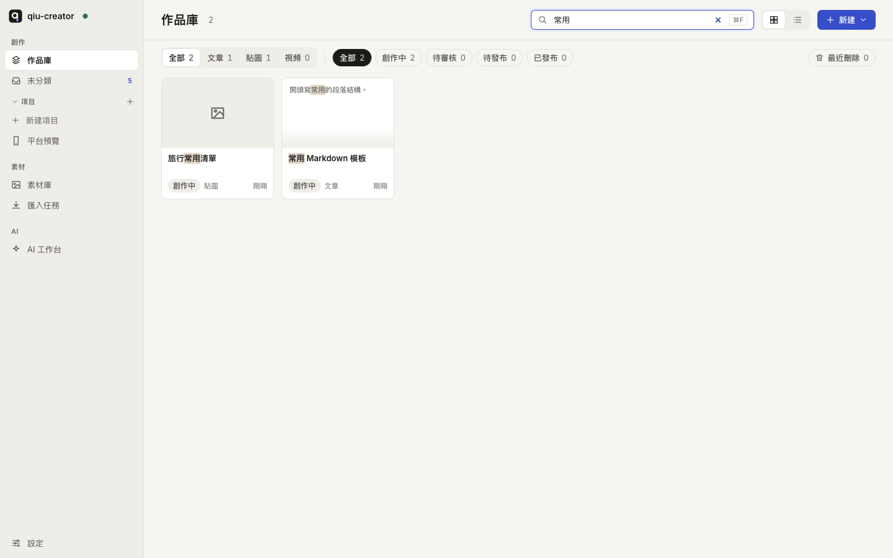
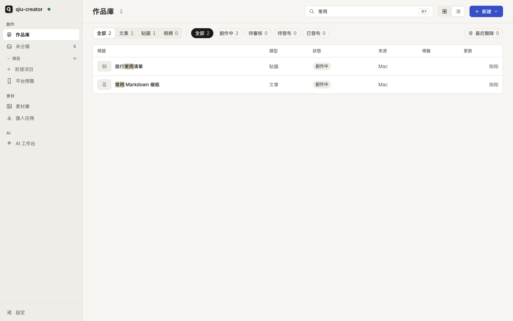
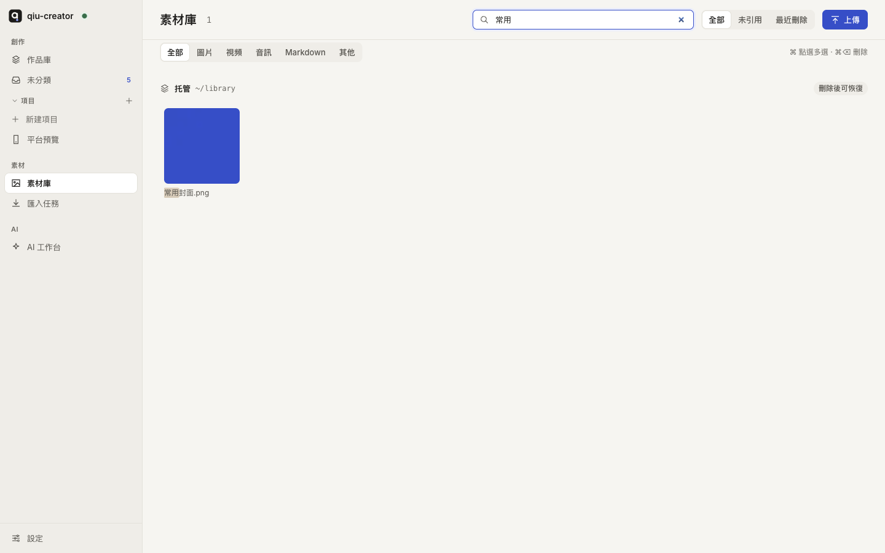
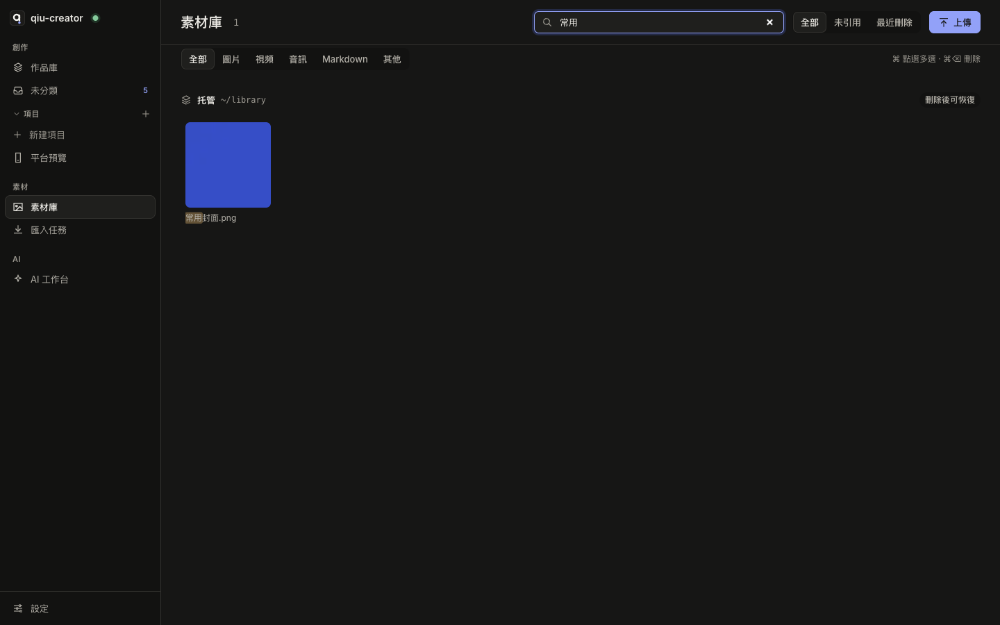
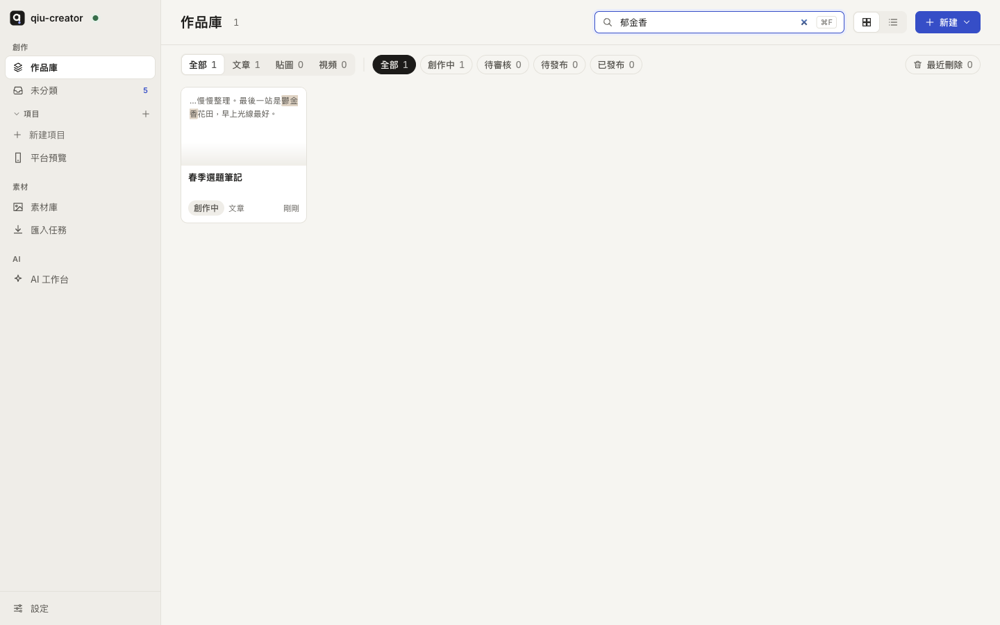
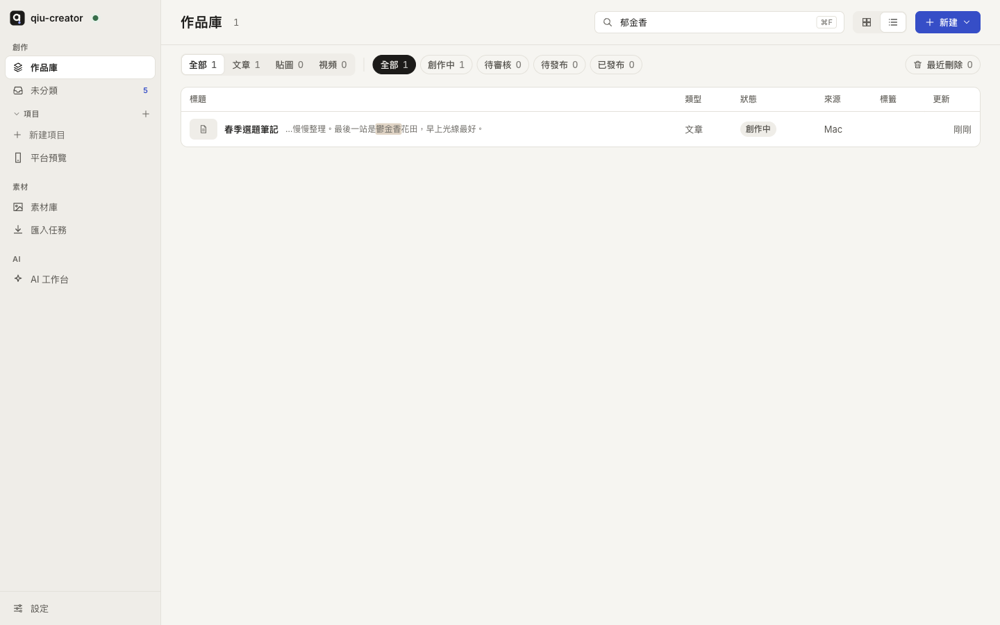
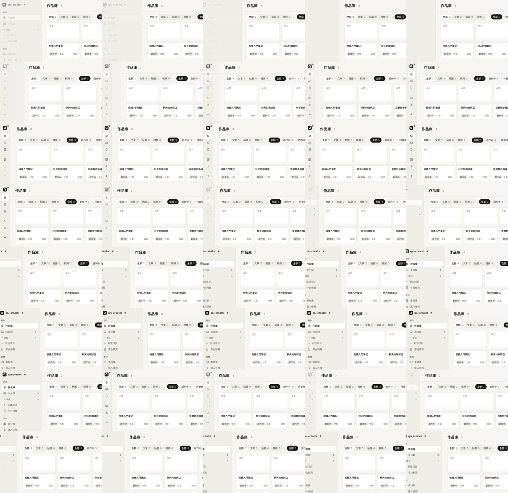

# QC-068 驗收記錄（前端）：搜尋即時高亮、側欄收合過渡

日期：2026-11-22　分支：`feat/qc068-search-highlight`，基於 main `3cf9f38`。

前端建立在以下後端提交之上：

- qc-backend 的 `c04d9e4`（已在 main）：共用比對規則 `@qiu-creator/domain/search`；
- qc-backend 的 `c37d024`（已在 main）：服務端用同一套規則、2 個字也比對內文、`match_excerpt`。服務端的部分見 [qc068-search-fold-backend.md](qc068-search-fold-backend.md)；
本分支只有前端的 3 個提交。

## 1. 搜尋即時高亮

### 比對規則（簡繁的做法，總監 2026-11-22 核准）

搜尋和高亮用同一套規則，放在 `@qiu-creator/domain/search`。domain 不依賴 Electron 或瀏覽器，服務端與 App 共用。比對前，文字與查詢都逐字經過三步轉換：

1. **NFKC**：全形與半形相同（`ＡＩ１` = `AI1`）。
2. **轉小寫**：`Markdown` = `markdown`。
3. **繁轉簡，逐字轉換**：用 OpenCC 的 `TSCharacters` 字表（opencc-js，約 29 KB，見 [dependencies.md](../dependencies.md)），所以 `設計` = `设计`，簡體搜得到繁體，繁體也搜得到簡體。
   - 只逐字轉換，不做詞組轉換。所以少數繁體字共用同一個簡體字時會互相命中，例如「發」「髮」都對到「发」。對搜尋來說，寧可多找到。

### 畫面

- **哪裡會標出命中的字**（`<mark class="hit">`）：
  - 作品庫的卡片標題、列表列、文章封面的摘要，包含項目頁與最近刪除；
  - 素材庫的名稱。
- **更新時機**：
  - 作品庫每打一個字就在已載入的卡片上更新，服務端篩選照舊延後 250ms；
  - 素材庫的查詢本來就逐字送出；
  - 輸入法組字中都不更新。
- **標記樣式**：
  - 底色是 `warn` 的 26%，深色模式 38%；文字保持原色，圓角 2px。
  - 樣式不含文字，三語一樣。
  - 規則記在 DESIGN.md 的「互動合約 · 搜尋」。
- **只有內文命中時**：服務端回傳 `match_excerpt`。
  - 文字封面：用命中段取代開頭摘要；
  - 圖片和視頻封面：在封面底部顯示一條；
  - 列表：接在標題後面，一行，超出時以省略號截斷。
  - 顯示的段落從第一個命中前約 10 個字開始（`leadToHit`），所以即使命中在長內文的尾端，截斷後也看得到。
  - 卡片內另外放一份給讀屏軟體讀的命中段（visually-hidden），因為封面是 aria-hidden。

### 截圖

| 畫面 | 檔案 |
| --- | --- |
| 網格：標題與摘要的高亮 |  |
| 列表檢視 |  |
| 素材庫（淺色） |  |
| 素材庫（深色） |  |
| 簡體搜「郁金香」，命中繁體內文，卡片顯示命中段 |  |
| 列表：只有內文命中時接在標題後的命中段 |  |

## 2. 側欄收合／展開過渡

### 原因

QC-065 第 1 區的 `ShellMain` 用了 motion 的 `layout="position"`，但它其實從來沒有動起來。

- 收合狀態要經過 Sidebar 的 `useEffect`，才傳到 App，晚了一次渲染；
- motion 量位置的時候，DOM 已經是新的寬度，量不出差距，所以不做動畫。
- 使用者因此看到的是瞬間切換。

### 做法（`renderer/sidebar-morph.ts`）

照 DESIGN.md 規格，側欄和主內容區立即取得最終寬度，變化只用 transform 與透明度畫出，時長 `moderate`、曲線 `inOut`：

- **收合**：
  - 舊側欄的靜態副本向左滑走，標籤 `fast` 淡出；後半段副本淡出，露出圖示列。
  - 主內容區從舊位置平移到位，左緣和副本的右緣同步。
- **展開**：
  - 側欄從左滑入，內容同時淡入；圖示列的副本 `fast` 淡出。
  - 主內容區同步平移。
- **減少動態效果、高溫精簡模式**：只有副本淡出，沒有位移。
- **測試模式**：不建立副本，直接到位。
- **副本的限制**：
  - 副本設了 `inert` 和 `aria-hidden`，id 都移除；
  - 讀屏和焦點只看得到真的側欄；
  - 動畫途中再按一次，會停掉前一段，從新狀態開始。

`ShellMain` 改成普通容器，App 不再需要 `rail` 狀態。這次沒有改側欄本身的版面，那是 QC-069 的範圍。

### 錄影與逐幀檢查

- 錄影：[qc068-sidebar.mp4](qc068-sidebar.mp4)，正常速度，依序是收合、展開、收合、展開。
- 逐幀拼圖：

`sidebar-motion.spec.ts` 在動效開啟時（`QC_E2E_MOTION=on`）逐幀取樣，檢查：

- 每一幀的側欄寬度都是最終值（56 或 232），寬度從未逐幀改變；
- 收合時副本有位移；展開時側欄有位移；兩者主內容區都有位移；
- 副本自始至終都是 `aria-hidden` 和 `inert`，結束後移除，沒有東西停在位移狀態；
- 動畫途中再按一次，結束後不留副本；
- 減少動態效果時：副本只有淡出，側欄與主內容區都沒有位移。

## 測試

- **單元測試**：domain `search.test.ts`（5 項）涵蓋全形、大小寫、簡繁、emoji 不被切開、空查詢、命中段截取。
- **e2e `search-highlight.spec.ts`**：
  - 「常用」在標題與摘要上標出；
  - `markdown` 標出 `Markdown`；
  - 簡體「郁金香」找到繁體內文，命中段實際在封面可見範圍內；
  - 2 個字「花田」也比對內文；
  - `ai` 標出全形的 `ＡＩ`；
  - 列表的命中段；
  - 輸入法組字中（`chang`）不標，選字後才標；
  - 素材庫名稱的高亮，以及深色模式。
- **e2e `sidebar-motion.spec.ts`**：
  - 測試模式下直接到位、不留副本（一般 e2e 會跑）；
  - 動效開啟時的逐幀檢查（`QC_E2E_MOTION=on` 才跑，本次已跑過並通過）。

## 閘門結果

在 `ba12cc7`（基於 main `3cf9f38`）上跑完整閘門。期間 load 5–9，並持有 full-suite 鎖：

| 閘門 | 結果 |
| --- | --- |
| `pnpm typecheck`（含 e2e） | passed |
| `pnpm lint`（根目錄 `eslint .`） | passed，0 errors |
| `pnpm format:check` | passed（第一次失敗在 `test-results/.last-run.json`：這是 QC-067 的提交 `bedb0e4` 誤把 Playwright 產物提交進倉庫，main 上的 format:check 也因此失敗。本分支的 `3e3325d` 取消追蹤這個檔案，並在 `.gitignore` 加入 `test-results/`，之後重跑通過） |
| 單元：mac | 376／376 passed |
| 單元：mac-server | 484／484 passed |
| 單元：domain | 39／39 passed |
| 單元：其他 8 個套件 | 172／172 passed（agent-sdk 12、api-client 22、contracts 23、design-tokens 6、i18n 29、installer 39、markdown-editor-web 29、platform-preview 12） |
| e2e 全套 | 39 passed，8 skipped（只在 `QC_E2E_MOTION=on` 時跑的動效與錄影用例），0 failed，1.6 分鐘 |
| `sidebar-motion` 動效開啟（`QC_E2E_MOTION=on`） | 1 passed（本頁的錄影就是這一輪錄的） |

## 範圍外與 NOT_VERIFIED

- 素材搜尋也比對原始檔名；如果命中只在原始檔名，而卡片顯示的是改過的名稱，卡片上不會有標記。
- 圖片和視頻封面（以及有封面圖的文章）底部的命中條：沒有 e2e，也沒有截圖確認。NOT_VERIFIED
- QC-069 原型的 backendNeeds 另提到 facets 的 `scope_total`（不帶 q 時的總數）。這屬於 QC-069 的畫面，到時再和 qc-backend 確認。
