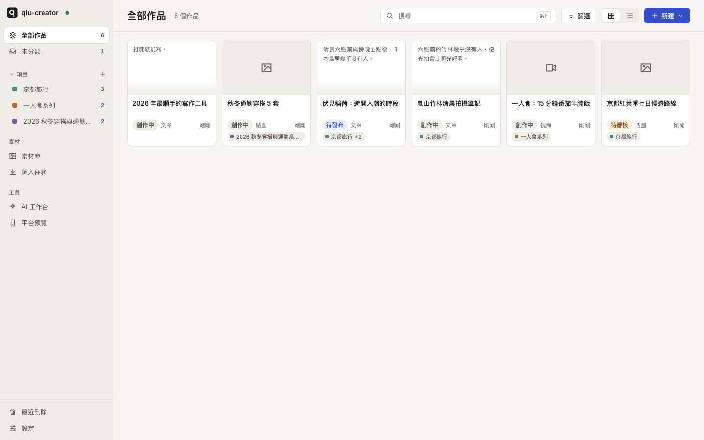
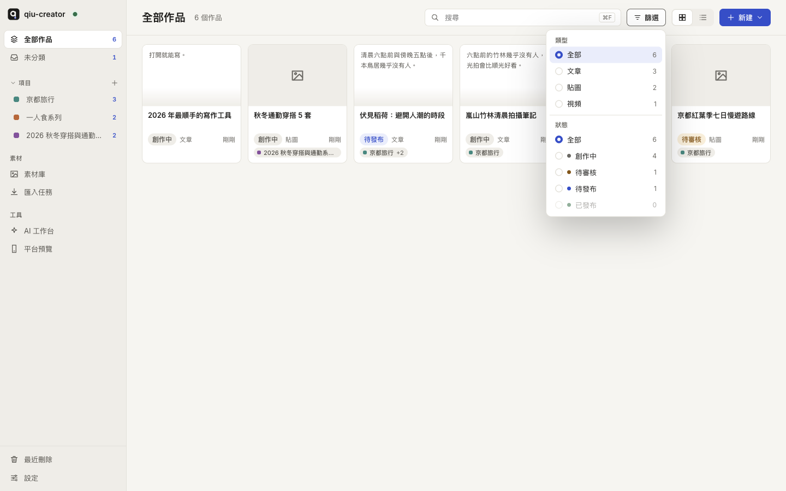
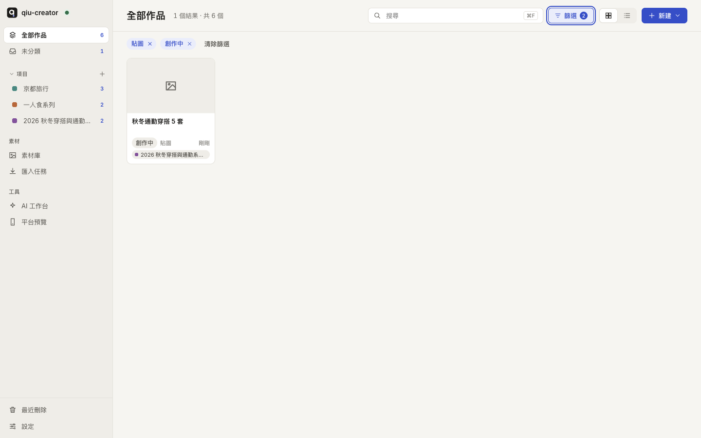
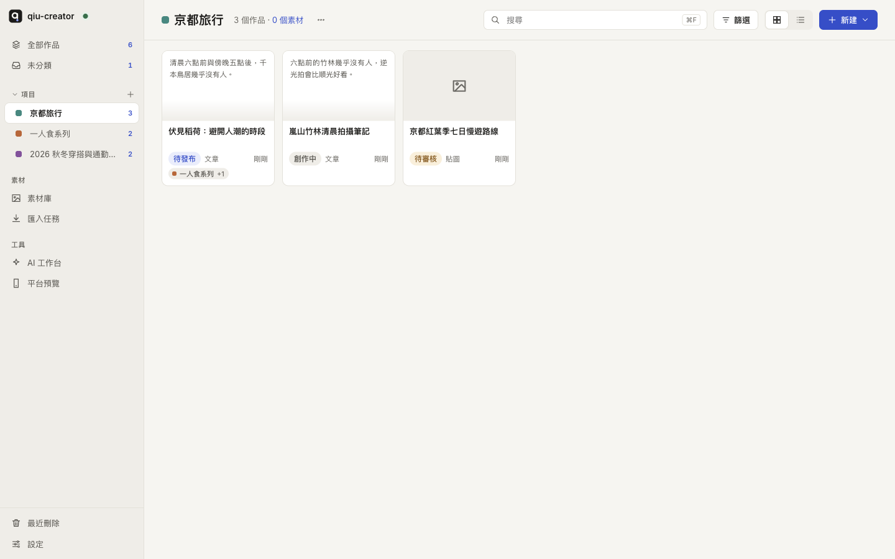
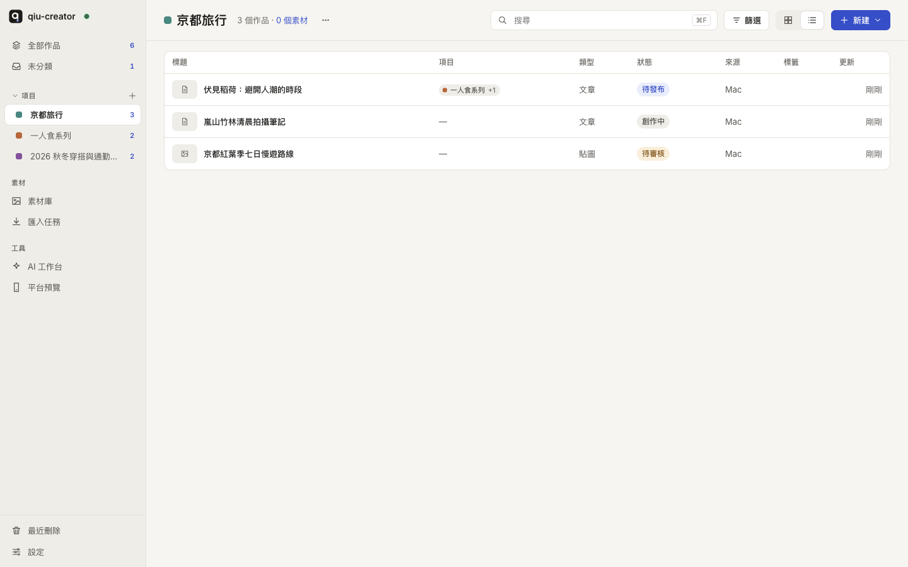
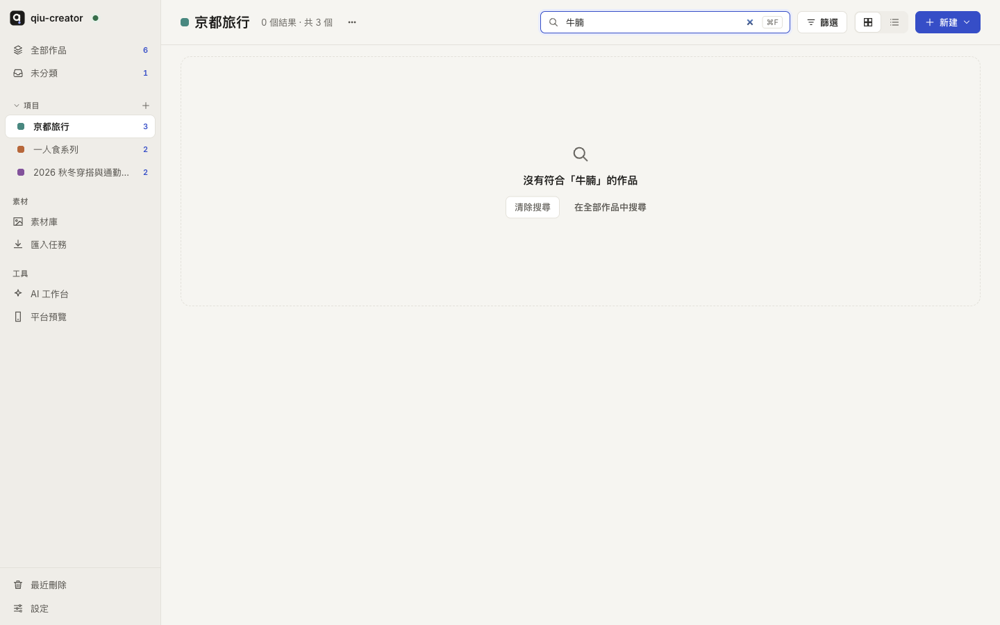
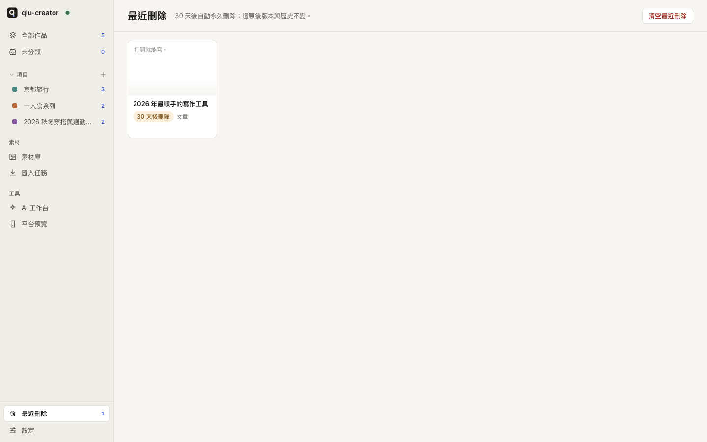
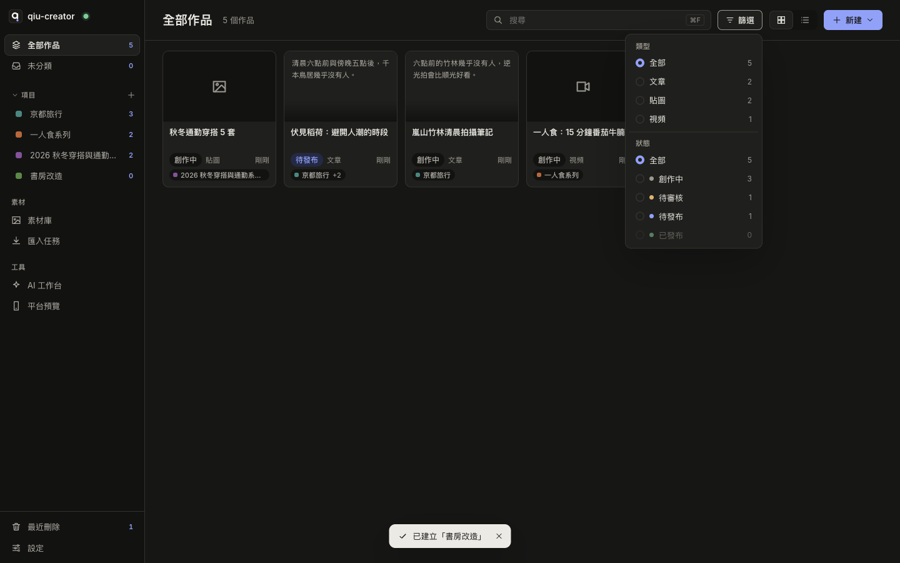

# QC-069 驗收記錄（前端）：作品庫與項目頁精簡、側欄重新分組、項目標籤

日期：2026-11-22　分支：`feat/qc069-library-ia`，基於 main `cc30df5`。依據已核准的原型 PT-20261122-001（`docs/design/prototype/changes.json`），以及 approvalDecisions 追加的兩項：卡片顯示所屬項目名稱、新項目顏色輪替。

## 使用者回報的問題

- 「項目界面是不是有冗餘設計了，這麼多文字和選項，看的人眼花繚亂。」
- 「側邊欄的分類組合和順序也不是很合理，看起來讓人無從下手。」
- 「作品庫中的作品卡片上應該能看到隸屬於哪個項目。」

## 做了什麼

### 側欄（`Sidebar.tsx`、`SidebarProjects.tsx`）

由上而下：

1. 「全部作品」「未分類」：不加標題，各顯示總數。
2. 「項目」：標題加 ＋，下面是項目清單。
3. 「素材」：素材庫、匯入任務。
4. 「工具」：AI 工作台、平台預覽。

底部固定放「最近刪除」（有作品時顯示數量）和「設定」，上下排列。

- 只裝一兩項的「創作」「AI」標題拿掉了。
- 平台預覽移到「工具」。
- 「作品庫」這個導覽項目改名為「全部作品」。
- 側欄的數字一律是總數。最近刪除的數量也由 `ProjectsStore` 讀取，跟著 SSE 更新。

### 頁首與篩選（`LibraryPage.tsx`、`LibraryFilter.tsx`）

- 作品庫、未分類、項目頁共用一行頁首：
  - 左邊是標題（項目頁帶色塊和「⋯」）和一行淡字；
  - 右邊依序是搜尋、「篩選」、網格／列表、新建。
- 淡字：
  - 平常寫「N 個作品」；項目頁再加「M 個素材」連結（取代原本的「用到的素材」），點了打開素材庫的「用在這個項目」。
  - 搜尋或篩選時寫「N 個結果 · 共 M 個」，素材連結隱藏。
  - 「共 M 個」來自第二次不帶 q 的 `GET /works/facets`，不需要新增後端欄位，所以沒有向 qc-backend 要 `scope_total`。
- 「篩選」彈出層：類型與狀態各一組單選（radiogroup，↑↓ 切換），每項都有數量：
  - 分面計數：類型的數字套用目前的狀態，狀態的數字套用目前的類型，都只算搜尋結果。
  - 數量 0 的選項停用變淡，不隱藏。
  - 篩選生效時，按鈕改用強調色並顯示個數，可及名稱是「篩選，已套用 N 項」；頁首下方出現可移除的標籤和「清除篩選」。
- 移除的東西：概覽列（各狀態數、最近更新、用到的素材）、類型分段、狀態膠囊、「最近刪除」膠囊。
- 搜尋沒有結果時，寫「沒有符合「…」的作品」，提供「清除搜尋」；不在全部作品時，另外提供「在全部作品中搜尋」。只有篩選沒有結果時，寫「沒有符合篩選的作品」，並提供「清除篩選」。
- 最近刪除從側欄打開：
  - 頁首是「最近刪除」加「30 天後自動永久刪除…」，「清空最近刪除」按鈕放在頁首右側；
  - 原本的「返回作品庫」按鈕拿掉了，因為側欄就是返回的路。

### 卡片與列表（`LibraryProjects.tsx`、`projects-store.ts`）

- 所屬項目標籤取代 QC-062 的色點：
  - 標籤是色點加第一個項目的名稱，其餘寫成「+N」；
  - 名稱過長時截斷，全名放在 `title` 和無障礙名稱（「所屬項目：…」）；
  - 項目頁不重複顯示目前這個項目。
- 卡片窄時（≤ 220px，用 container query 判斷），標籤換到第二行，每張卡片都預留這一行，讓網格對齊；卡片寬時，標籤排在時間前面。
- 列表檢視加「項目」欄，沒有項目時顯示「—」。
- 搜尋只命中內文，而且卡片有封面圖時，標題下方多一行「內文 …片段…」，取代 QC-068 放在封面底部的那條。文字卡照舊把片段放在封面上。只命中標籤時，這一行寫「標籤 #…」。
- 新項目的預設顏色：`nextProjectColor` 依序輪替，第 n 個項目用第 n mod 8 色。側欄的 ＋ 和「新建項目…」對話框的預設色都用它；既有項目不改色。

### 文件

- DESIGN.md：
  - 左側導航：新的分組。
  - 作品庫與項目頁：頁首、篩選、項目標籤、顏色輪替。
  - 搜尋：只命中內文時片段的位置。

## 截圖

| 畫面 | 檔案 |
| --- | --- |
| 全部作品：側欄新分組、一行頁首、卡片的項目標籤 |  |
| 篩選彈出層：分面計數，數量 0 停用 |  |
| 篩選生效：按鈕強調色、可移除的標籤、「1 個結果 · 共 6 個」 |  |
| 項目頁：淡字的素材連結，不重複目前項目 |  |
| 列表檢視：「項目」欄 |  |
| 項目頁搜尋無結果：「清除搜尋」與「在全部作品中搜尋」 |  |
| 最近刪除：側欄底部打開，清空按鈕在頁首 |  |
| 深色：篩選彈出層，新項目輪到第 4 色 |  |

## 測試

- 單元測試，`projects.test.ts`：
  - 項目標籤略過目前的項目和封存的項目，第一個名稱之外寫成 +N；
  - 新項目顏色依序輪替。
- 單元測試，`library-feed.test.ts`：選了狀態時，類型的數量只算那個狀態。
- 新的 e2e：`library-ia.spec.ts`，涵蓋：
  - 側欄的分組和底部；
  - 一行頁首與淡字；
  - 篩選彈出層：分面計數、0 停用、Esc 關閉、按鈕可及名稱、移除標籤、清除；
  - 「N 個結果 · 共 M 個」；
  - 項目頁不重複目前項目；
  - 列表的「項目」欄；
  - 搜尋無結果與「在全部作品中搜尋」；
  - 最近刪除在側欄底部；
  - 新項目顏色輪替；
  - 深色模式。
- 既有 e2e 跟著新版面更新：
  - 側欄的「作品庫」改為「全部作品」，英文是「All posts」；
  - 類型和狀態改用 `e2e/fixtures/library.ts` 的 `chooseFilter`、`filterCount`；
  - 最近刪除改用側欄底部的 `trashRow`；
  - 概覽列改為頁首淡字；
  - 色點改為 `.plabel`；
  - 動效錄影的分段滑動改用網格／列表切換；
  - 數量 0 的類型改為檢查「停用」。這是行為改變：原本可以選到沒有作品的類型，看到「還沒有視頻」。

## 閘門結果

完整閘門在本分支上跑（load 5–8，期間持有 full-suite 鎖）：

| 閘門 | 結果 |
| --- | --- |
| `pnpm typecheck`（含 e2e） | passed |
| `pnpm lint`（根目錄 `eslint .`） | passed，0 errors |
| `pnpm format:check` | passed |
| 單元：mac | 377／377 passed |
| 單元：mac-server | 484／484 passed |
| 單元：其他 9 個套件 | 211／211 passed（agent-sdk 12、api-client 22、contracts 23、design-tokens 6、domain 39、i18n 29、installer 39、markdown-editor-web 29、platform-preview 12） |
| e2e 全套 | 40 passed，8 skipped（只在 `QC_E2E_MOTION=on` 時跑），0 failed，1.7 分鐘 |

第一輪全套 e2e 有 1 個失敗：`library-paging` 偶發，單獨跑三次失敗一次。原因是 `篩選` 剛打開、焦點還沒移進彈出層時按 Esc，彈出層不會關。這是真的缺陷，不是測試不穩：改成彈出層開著時在 document 上攔截 Esc。`library-ia` 加了「打開後立刻按 Esc」的檢查。修正後 `library-paging` 和 `library-ia` 各重複 4 次，8／8 通過，再重跑全套 e2e 也都通過（見上表）。

## 範圍外與 NOT_VERIFIED

- 三語：e2e 只在英文和簡中下檢查了項目頁的淡字（`projects-motion.spec`）。篩選彈出層和側欄的英文、簡中版面沒有截圖確認。NOT_VERIFIED
- 有封面圖的卡片在只命中內文時的「內文 …」那一行，以及只命中標籤時的「標籤 #…」：都沒有寫 e2e，也沒有截圖確認。NOT_VERIFIED
- `TypeEmpty`（「還沒有視頻」加上新建按鈕）：現在數量 0 的類型不能選，所以這個空狀態實際上已經到不了。程式碼保留，沒有刪。
- 透過 Agent API 建立、而且沒有指定顏色的項目，仍然使用服務端的預設色（0）；顏色輪替只發生在 App 裡建立項目的時候。
