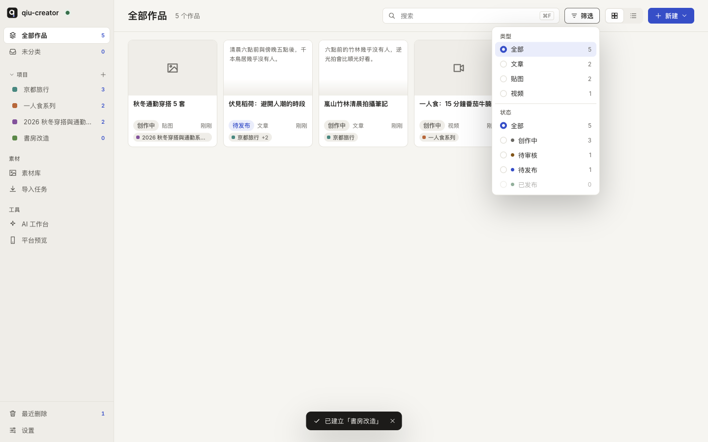

# QC-070 驗收記錄（前端，進行中）：AI 圖片與封面生成

日期：2026-11-22　分支：`feat/qc070-image-ui`，基於 main `69547a6`，並 cherry-pick 了 qc-backend 的 `3ea3f53`（`feat/qc070-image-generation`）。後端的部分見 [qc070-image-generation-backend.md](qc070-image-generation-backend.md)。

原型還沒核准，所以這一輪照總監指示，只接資料層，不做介面。

## 資料層（`renderer/ai-images.ts`、`work-session.ts`）

`ImageGenSession` 是編輯器圖片面板的資料層，介面只負責畫出它的狀態。

- **`load()`**：
  - New API 還不能用時，說明缺的是什麼：沒有金鑰是 `key`，還沒確認告知是 `consent`。
  - 列出中轉站的圖片模型，只留 `kind: image` 的。
- **`estimate(request)`**：送出前的費用預估。`max_cost_usd` 是 null 時，介面顯示「無法預估」。比較晚回來的舊估價會被丟掉。
- **`generate(request)`**：
  - 先存檔，讓提示詞和封面用到的內文是最新的；
  - 送出一個作業，用 `JobWatch` 追蹤（SSE 事件為主，慢速輪詢為輔）。
  - 圖片作業不回報 progress，所以 `queued` 和 `running` 都算「生成中」，介面依請求的張數與比例畫佔位。
  - 失敗時保留錯誤碼。`停止` 會中止呼叫中轉站；`重試` 會重跑失敗的作業。服務端不會自動重試，避免重複收費。
- **候選圖**：url 用 `media.absoluteUrl` 轉成可以直接放進 `` 的網址。每張候選有一個 `fate`：`new`、`kept`、`discarded` 或 `expired`。
- **`keep(index, placement)`**：交給 `WorkSession.keepAiImage`。
  - 先存檔，以目前的版本當 base 保留：
    - `insert`：offset 是存檔後 Markdown 裡的位置；
    - `cover`：寫成封面；
    - `library`：只放進素材庫，原稿不動。
  - base 過期（409 `revision_conflict`）時不覆蓋：沒有本機修改就直接換成較新的版本，有本機修改就走既有的衝突流程。候選圖保持 `new`，可以再保留一次。
  - 候選圖已經被清掉（`ai_job_not_acceptable`）時，標成 `expired`。
- **`undo()`**：還原最後一次改了原稿的保留（插入或封面），恢復到之前的版本，存成一個新版本。只放進素材庫的保留沒有東西要還原。
- **`discard(index)`**：捨棄一張候選，刪掉它的暫存檔。
- **`clear()`**：關閉結果時，捨棄還沒處理的候選。
- 共用 `ai-session.ts` 的 `blockOf`、`messageOf`；這兩個函式原本只在模組內使用，現在改為匯出。

## 測試

`apps/mac/test/ai-images.test.ts` 有 7 項，用真實的 mac-server 和本機的假 New API 中轉站。金鑰存在測試伺服器的記憶體裡，`CREATORHUB_HOME` 是臨時目錄，沒有任何對外請求。涵蓋：

- 請求組裝：圖片一定要有提示詞、封面不用，空白的文字欄位不送出；
- 沒有金鑰時是 `key`、沒有確認告知時是 `consent`；確認後只列出圖片模型；
- 估價：沒有單價時是 null，有單價時是張數 × 單價；
- 生成兩張：
  - 保留之前原稿完全不變；
  - 插入到第一段後面，並能復原；
  - 只放進素材庫時原稿不變，也不會取代插入的那筆復原；
- 封面：提示詞含標題，保留後寫進 front matter；捨棄之後，服務端回報 `expired: true`；
- 另一台裝置先改了原稿：回報 `conflict`，不覆蓋；換成新版本後可以再保留；
- 中轉站回 500：顯示失敗；重試成功；`clear()` 會捨棄剩下的候選。

## QC-069 補拍（NOT_VERIFIED 補上）

`library-ia.spec.ts` 加了一步：切換到 English 和简体，檢查篩選彈出層的標題、兩組單選的名稱和頁首標題都換了語言，並截圖。

| 語言 | 截圖 |
| --- | --- |
| English |  |
| 简体中文 |  |

觀察：英文側欄寫「All posts」，頁首淡字卻是沿用 `projects.worksCount` 的「5 works」，兩者用詞不一致。這不在這一輪的範圍內，交給總監決定要不要統一。

## 閘門結果

GATES_PLACEHOLDER

## 還沒做

- 介面：生成面板、候選卡片、選取浮動工具列，等原型核准。
- e2e：等介面做好再寫。
