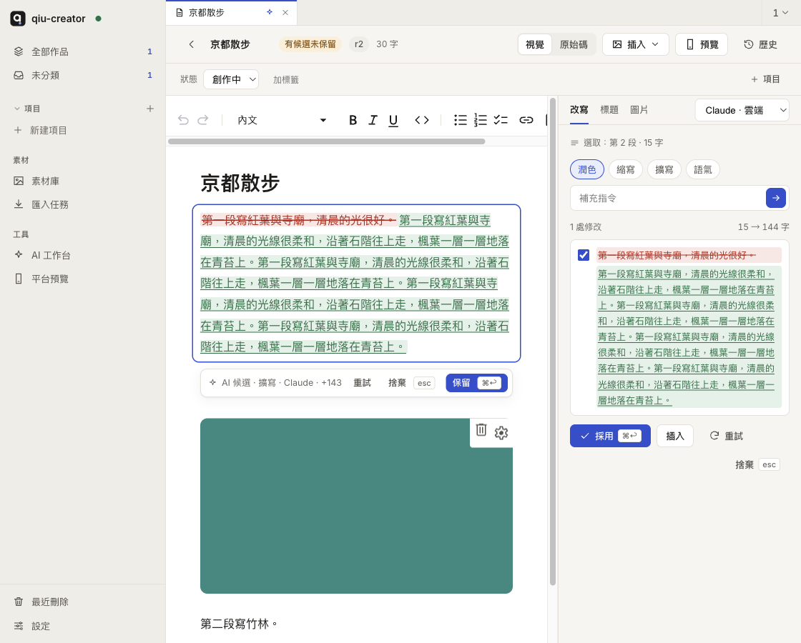
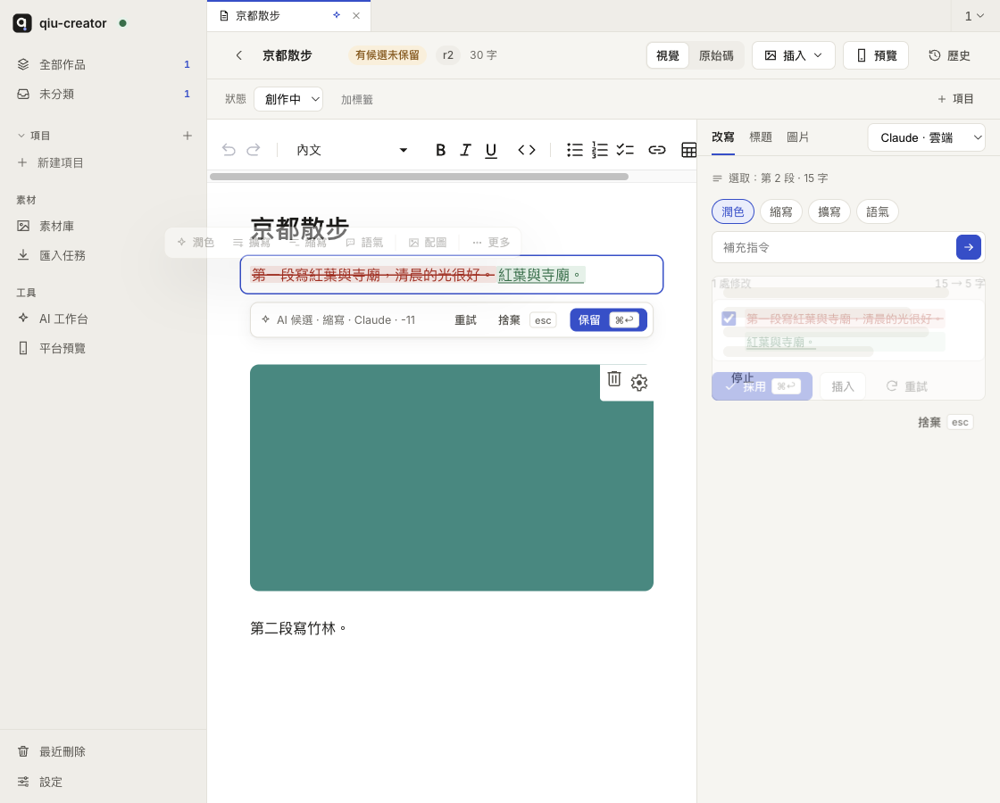
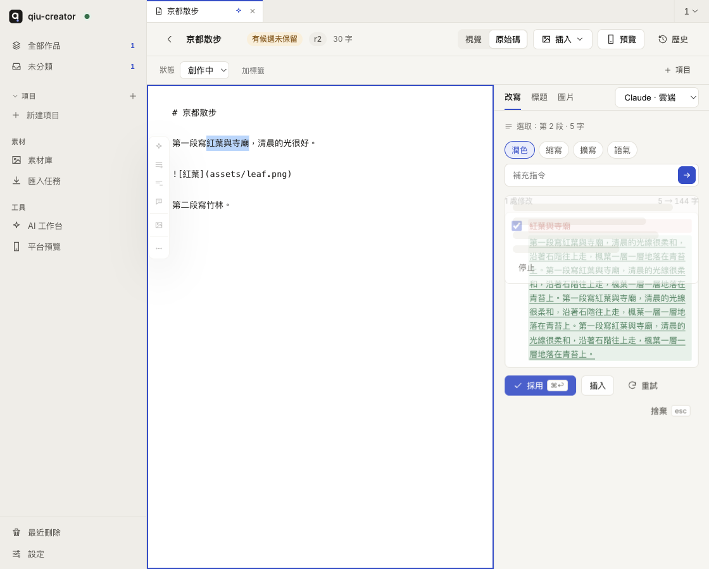

# QC-074 驗收記錄：配圖動效簡化、候選佔真實版面

日期：2026-11-22　分支：`fix/qc074-ai-motion-layout`。

## 1. 配圖動效：一次只有一個等待訊號

**之前**：

- 佔位框同時有骨架閃光、虛線框和不確定進度條。
- 圖片到了以後用 `settle` 彈簧縮放落位。
- 文字改寫中的段落有虛線框加閃光。

這幾種訊號同時出現，又快又多，違反 DESIGN.md「一次只有一個主角」。

**之後**：

- **等待**：靜止的淡色底（`sunken`）和 1px 細框，中間只有一個轉圈、「生成圖片中 · 約 20 秒」和取消。
  - 拿掉閃光、虛線框和進度條。
  - `qc-shimmer`、`qc-indeterminate`、`qc-settle` 三組 keyframes 和 `.shim`、`.imgslot__bar` 一起刪除。
- **圖片到了**：新增 `reveal` 預設，只淡入，`moderate`／`out`，不縮放、不位移。
  - 用在：佔位框裡的圖、「圖片」分頁的縮圖、封面條。
- **退場**（保留、捨棄、取消）：只淡出。
- **文字改寫中**：段落外是一圈淡色實線框，等待訊號只有膠囊裡的轉圈。
- **「圖片」分頁的生成記錄**：生成中是靜止的格子加一個轉圈。

DESIGN.md 跟著更新了三處：

- 「選取浮動工具列與原位候選」一節；
- 原則 4「一次只有一個主角」補上「等待只用一個訊號」；
- 動效表新增「AI 原位候選與配圖」一列。

## 2. 擴寫、縮寫的候選疊在下方圖片上

**根因**：

- 候選是蓋在文件上的浮層。下方內容讓出的空間，是用固定常數估出來的：`BAR_SPACE`，也就是按鈕列假設只有一行。
- 視窗較窄（1120px）時，候選下方的按鈕列會換成兩行，實際高度比估計值多。
- 縮寫的候選因此蓋住下方圖片約 38px。

**修正**：

- 讓出的空間改成量候選實際畫出的高度：diff 加按鈕列，換行也算進去。
  - 浮層向 `InlineAi` 回報自己的根節點（`useLiveLayer`）。
  - 每次 commit 後，在繪製前（layout effect）量一次。
  - ResizeObserver 也監看浮層本身，按鈕列換行或圖說列變高時，在繪製前重量。
- **讓位與收回的方向**：
  - 候選變長時，下方內容立即讓位。如果用滑動讓位，滑動途中候選會疊在圖片上。
  - 候選變短或消失時，下方內容從舊位置滑回（`moderate`／`inOut`，只動 transform，數量在 `LAYOUT_LIMIT` 以內）。
  - 減少動態效果時直接到位。

**另一個根因：候選第一次出現時，會疊一幀**

- 逐幀取樣抓到一幀疊了 156px。
- 原因：`InlineAi` 在樹裡排在 `MarkdownEditor` 前面。
  - 候選出現的同一個 commit，編輯器也會重建它的 imperative handle。
  - React 在 layout 階段才把 ref 接回去，而 `InlineAi` 的 layout effect 先跑。
  - 這時 `editor.current` 還是 `null`，量測直接返回。
  - 要等 ResizeObserver 才補上空間。
- 修正：handle 還沒接上時，用 `queueMicrotask` 在這次 commit 結束後量一次。
  - 這仍然在下一幀繪製之前，所以不會有任何一幀疊在下方內容上。
  - 是用 log 確認過的：mutation 之後、layout effect 量測之前，沒有 handle。

**原始碼模式**：候選在右側面板（`.ai__hunk`），文字上沒有浮層。e2e 有驗證。

## 3. 回歸測試

新增 `e2e/specs/ai-candidate-layout.spec.ts`。文章是：段落、圖片、第二段。

1. **擴寫、縮寫、原始碼模式**（兩種模式都跑；視窗寬 1120，讓按鈕列換行）：
   - 擴寫：量 bounding box，圖片頂端要在候選所有元素的底部之下，而且圖片至少往下移了 40px。按 esc 後回到原位。
   - 縮寫：候選底部和圖片之間不重疊。
   - 原始碼模式：候選在面板裡，文字上沒有浮層。
2. **動效錄影**（只在 `QC_E2E_MOTION=on` 時跑）：
   - 配圖：等待，圖片淡入，然後捨棄。
   - 擴寫、縮寫的候選進場期間，每個 rAF 都取樣「圖片頂端減候選底部」，最小值要 ≥ 0。

## 錄影與截圖

- 之前（舊程式，同一支錄影測試）：[qc074-before.mp4](qc074-before.mp4)
- 之後：[qc074-after.mp4](qc074-after.mp4)
- 擴寫讓位（1120px，按鈕列換行）：
- 縮寫：
- 原始碼模式：

## 閘門

基於 main `4a23681`（已 rebase），載入低於 15、持有全套鎖。臨時 `CREATORHUB_HOME`。

- `pnpm typecheck`（含 e2e）：passed
- `pnpm lint`（根目錄 `eslint .`）：passed
- `pnpm format:check`：passed
- 單元測試，一次一個套件，共 1130 passed／0 failed：
  - mac 391、agent-sdk 12、api-client 22、contracts 23、design-tokens 6、domain 39、i18n 29、installer 39、markdown-editor-web 62、platform-preview 12、mac-server 495
- e2e 一般模式：47 passed／0 failed／10 skipped
- e2e `QC_E2E_MOTION=on`：48 passed／0 failed／9 skipped
- 新測試 `ai-candidate-layout` 在動效模式連跑 3 次都通過；修正前，逐幀取樣每次都抓到 −156px 那一幀。
