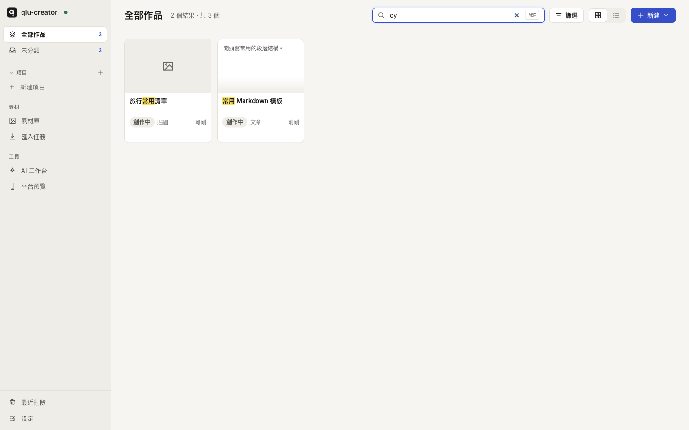
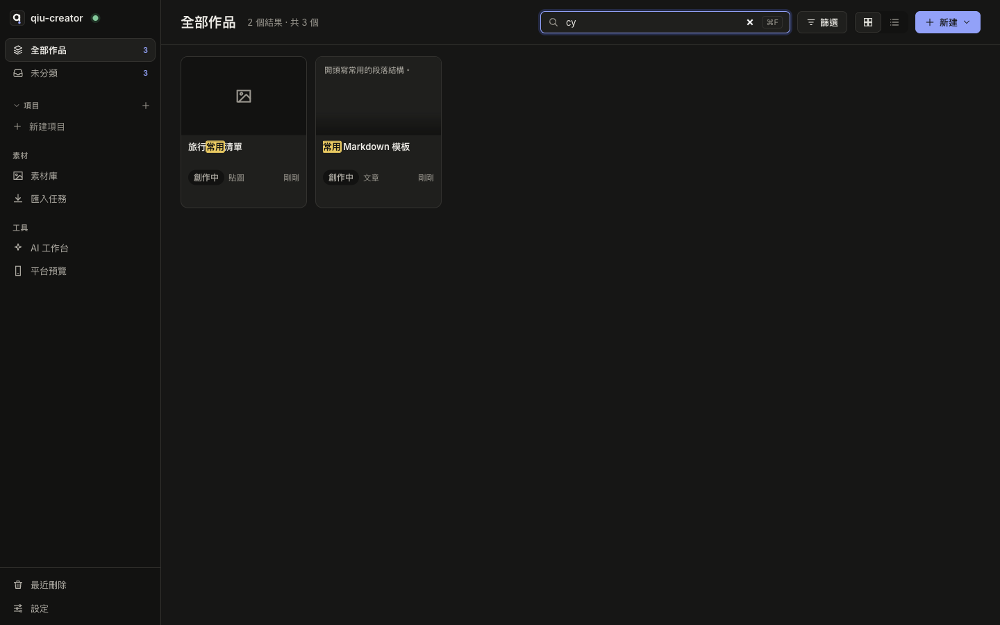
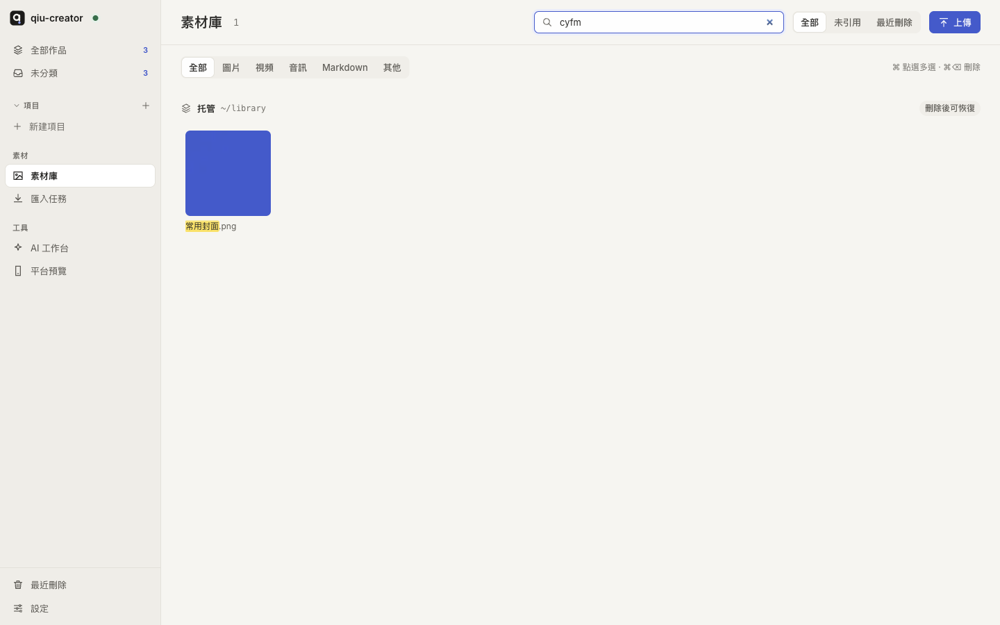

# QC-079 驗收記錄（前端）：拼音命中高亮、醒目的黃色

日期：2026-11-22　分支：`feat/qc079-highlight`，基於 main `e13b227`。後端拼音比對已在 baabced 合併。

## 做了什麼

- **黃色高亮**：新增色彩 token `hit`／`onHit`。
  - 淺色 `#FFE03D`／`#1C1B19`，深色 `#F2C94C`／`#161615`。
  - `mark.hit` 改成亮黃底配深色字，取代原本 `warn` 的 26%／38% 半透明底。
  - token 測試把 `onHit` 對 `hit` 列入 WCAG 對比檢查（≥ 4.74）。
- **拼音命中標在中文字上**：`Highlight.tsx` 沿用 `@qiu-creator/domain/search` 的 `findMatches`，標出的位置與服務端比對一致。
  - 正文與摘要（`HitPassage`、文字卡封面上的摘要）傳 `PINYIN_LONG_TEXT_MIN_LENGTH`（4 個字母），規則與服務端比對正文相同。
  - 標題、標籤、素材名稱沿用預設的 2 個字母。
- **一致性**：作品庫、列表、摘要、素材庫、項目頁、回收站都用同一個 `Highlight` 元件。輸入法組字中不更新的既有行為不變，QC-068 的 e2e 仍然通過。
- **DESIGN.md**：「搜尋」加上拼音規則與新的標記樣式，色彩 token 表加上 `hit`／`onHit`。

## 測試

- 單元測試 `apps/mac/test/highlight.test.ts`：
  - `cy` 標出「常用」；
  - `cy` 不標正文，`changyong` 才標；
  - 字面命中不受長度限制；
  - `leadToHit` 會停在拼音命中處。
- e2e `search-highlight.spec.ts` 新增一個測試：
  - `cy` 標出兩個標題的「常用」，正文摘要不標；
  - `changyong` 也標出摘要；
  - `xtbj`（繁體字經簡體取拼音）標出「選題筆記」；
  - 量 computed style，淺色是 `rgb(255, 224, 61)` 底、`rgb(28, 27, 25)` 字，深色是 `rgb(242, 201, 76)` 底、`rgb(22, 22, 21)` 字；
  - 素材庫 `cyfm` 標出「常用封面」。
  - 這個 spec 在兩種模式各連跑 3 次，都通過。

## 截圖

- 淺色（`cy`）：
- 深色（`cy`）：
- 素材庫（`cyfm`）：

## 閘門

載入低於 15、持有全套鎖，臨時 `CREATORHUB_HOME`。

- `pnpm typecheck`（含 e2e）：passed。第一輪抓到 `highlight.test.ts` 的 children 型別錯誤，修正後重跑，passed。
- `pnpm lint`：passed
- `pnpm format:check`：passed
- 單元測試，一次一個套件，共 1153 passed／0 failed：
  - mac 394、agent-sdk 12、api-client 22、contracts 23、design-tokens 6、domain 45、i18n 29、installer 39、markdown-editor-web 62、platform-preview 12、mac-server 512
- e2e 一般模式：48 passed／0 failed／10 skipped
- e2e `QC_E2E_MOTION=on`：49 passed／0 failed／9 skipped
