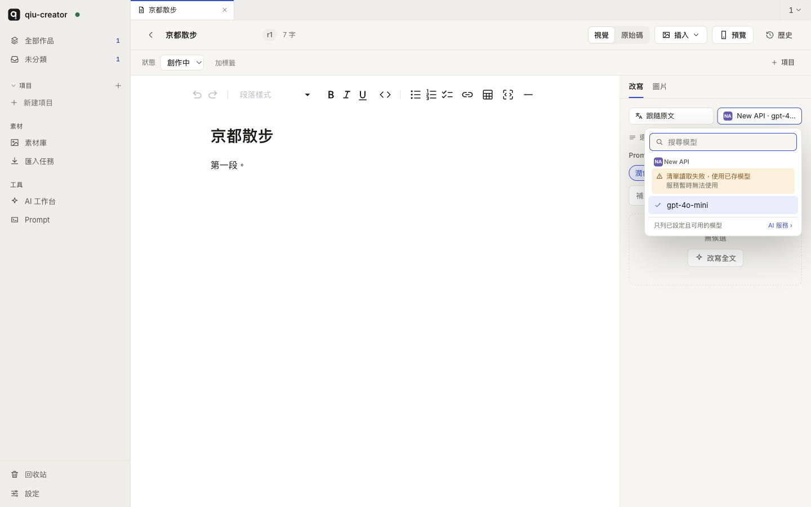
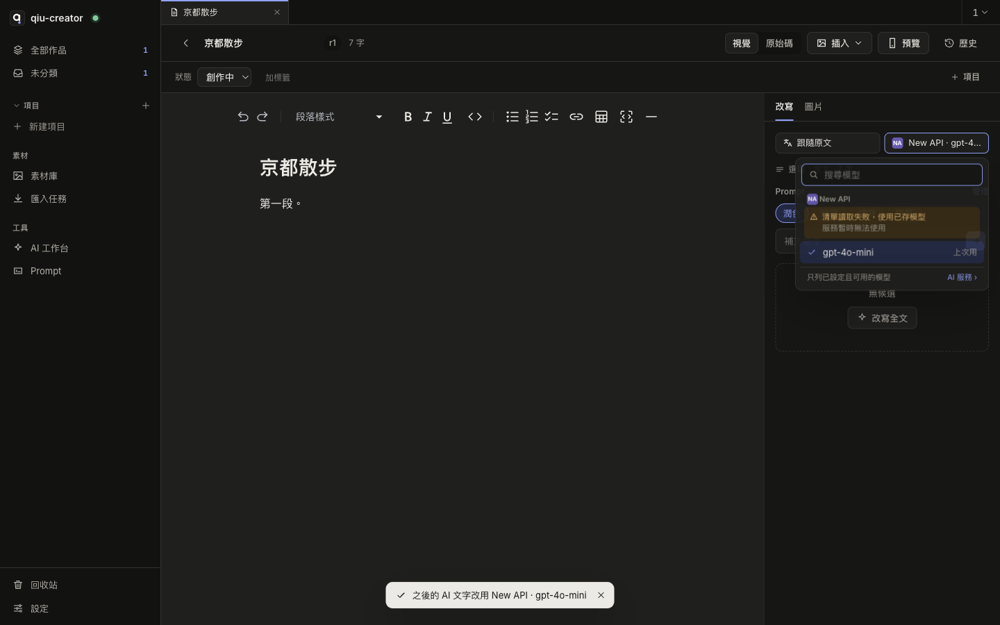

# QC-082 驗收記錄（前端）：模型清單讀取失敗時的提示

日期：2026-11-22　分支：`feat/qc082-fallback-note`，基於 main `1bd4aa3`（含後端 b0eb192）。

## 做了什麼

- 模型選單（工具列與右側面板共用的 `ModelList`）：
  - `errors[]` 裡某個供應商的 `fallback` 不是 `none` 時，這一組的模型照常列出、可以選。組名下方用警示底色寫「清單讀取失敗，使用已存模型」，附上原因：逾時、找不到主機、服務暫時無法使用、額度不足；不認得的原因原樣顯示。改用快取清單時，另附「清單快取於 …」。
  - `fallback` 是 `none` 時，維持原本的停用列「無法讀取模型」。
- 三語字串：`ai.modelFallback`、`ai.modelCachedAt`、`ai.modelReason*`。
- 順手修了 QC-075 的一個版面問題：右側面板的模型選單原本向右展開，會超出面板，讓面板出現橫向捲動。現在向左展開，e2e 檢查選單不超出視窗、面板沒有橫向捲動。
- DESIGN.md 的模型選單規則已補上以上兩點。

## 測試

- 單元測試 `apps/mac/test/ai-choices.test.ts`：已知原因、快取時間、不認得的原因、沒有原因、英文。
- e2e `ai-model-fallback.spec.ts`：假中轉站的模型清單回 503。
  - 面板的模型選單仍列出 New API 的已存模型 `gpt-4o-mini`，提示寫「清單讀取失敗，使用已存模型」與「服務暫時無法使用」。
  - 選單不超出視窗。
  - 選了模型之後，偏好存到服務端。
  - 也截了深色模式。

## 截圖

- 淺色：
- 深色：

## 閘門

載入低於 15、持有全套鎖，臨時 `CREATORHUB_HOME`。

- `pnpm typecheck`（含 e2e）：passed
- `pnpm lint`：passed
- `pnpm format:check`：passed
- 單元測試，一次一個套件，共 1196 passed／0 failed：
  - mac 425、agent-sdk 12、api-client 22、contracts 23、design-tokens 6、domain 45、i18n 30、installer 39、markdown-editor-web 62、platform-preview 12、mac-server 516
- e2e 一般模式：58 passed／0 failed／10 skipped
- e2e `QC_E2E_MOTION=on`：59 passed／0 failed／9 skipped

開發中跑單一 spec 時，`new-api.spec` 在動效模式失敗過一次（進設定頁時 30 秒逾時，QC-081 的同一個症狀）。最後的全套 e2e 兩種模式都通過。
